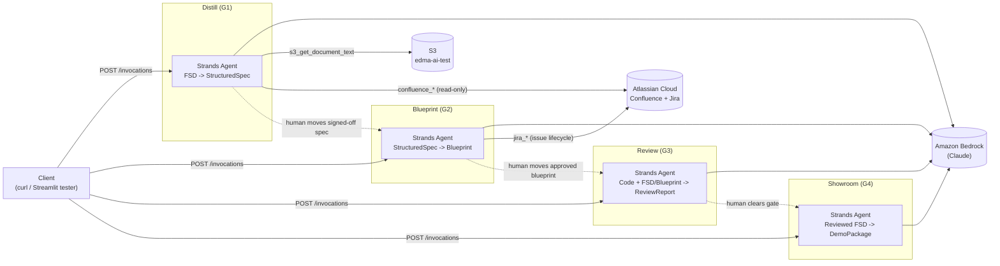
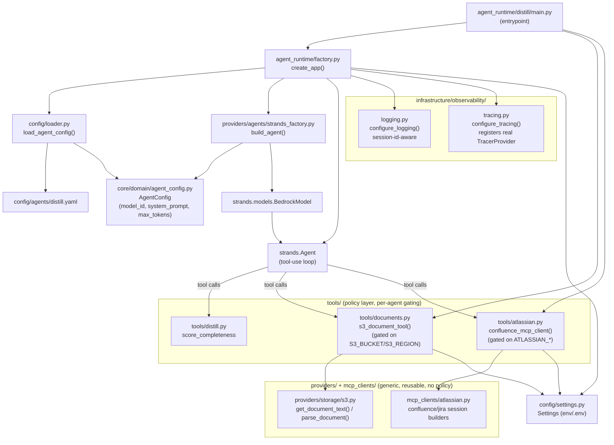

# Hyperdelivery Architecture

## High-level

Four independently-deployed agents, one per delivery gate, each running as its own
AgentCore Runtime container. A client (Streamlit tester locally, or a future
orchestrator/control plane) calls one agent at a time through the AgentCore Runtime HTTP
contract; nothing here calls another agent directly today - handoff between gates is
manual (a human moves the artifact from one gate to the next).

No shared orchestrator, agent registry, or Step Functions control plane exists yet -
Strands owns each agent's own tool-use loop, and gate-to-gate progression is a human
action. See [docs/decisions.md](./decisions.md) for why.

## Low-level (per-agent composition)

Every agent container is built from the same composition root shape. Distill (the most
built-out agent, with two external tools) is shown below; Blueprint/Review/Showroom follow
the identical shape with fewer tools (see the table after the diagram).

| Agent | Deterministic validator tool | External tools | Output model |
|---|---|---|---|
| Distill | `score_completeness` | `s3_get_document_text`, Confluence MCP (read-only) | `StructuredSpec` |
| Blueprint | `validate_units_of_work` | Jira MCP (issue lifecycle) | `Blueprint` |
| Review | `validate_review_report` | none | `ReviewReport` |
| Showroom | `validate_talk_track_coverage` | none | `DemoPackage` |

**Standing convention**: for any new external integration, split it into a generic,
policy-free provider/client (`providers/` or `mcp_clients/`) plus a per-agent `@tool`
wrapper in `tools/` that pulls config from `Settings` and enforces least-privilege
(e.g. the LLM can only ever supply an S3 object *key*, never a bucket). This generalizes
beyond MCP - the S3 tool has no MCP protocol involved at all and still follows the split.
