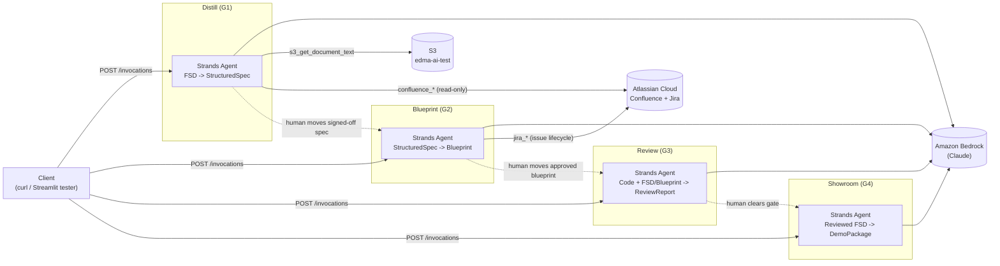
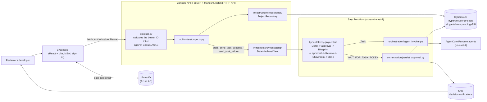
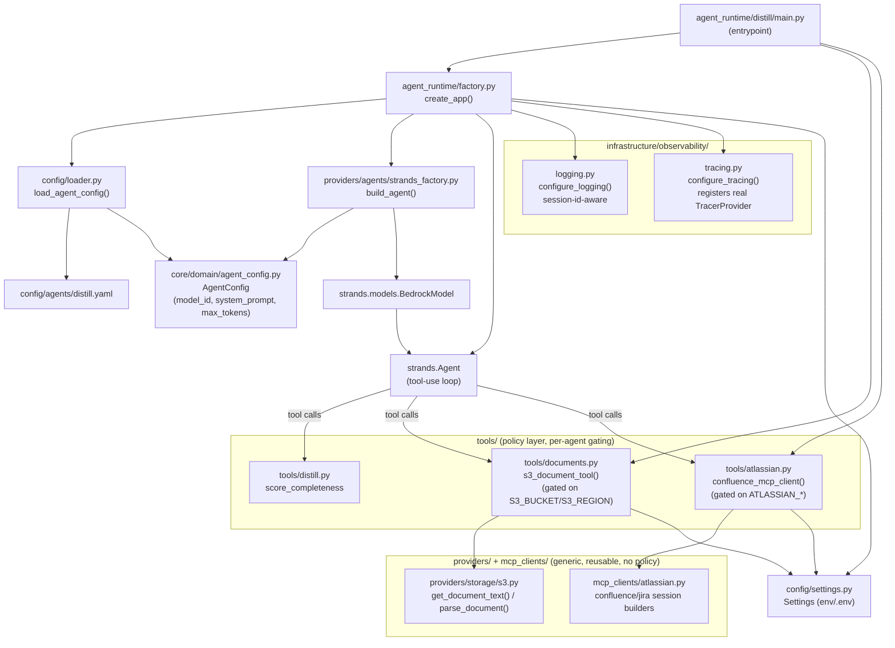

# Hyperdelivery Architecture

## High-level

Four independently-deployed agents, one per delivery gate, each running as its own
AgentCore Runtime container. A client (Streamlit tester locally, or a future
orchestrator/control plane) calls one agent at a time through the AgentCore Runtime HTTP
contract; nothing here calls another agent directly today - handoff between gates is
manual (a human moves the artifact from one gate to the next).

Strands owns each agent's own tool-use loop; there is no shared agent registry.

## The control plane (Phase 2 - scaffolded, not deployed)

Alongside the agents, a control plane sequences the line and holds it at each human
approval. It is written and tested but not yet deployed: that is blocked on IAM, and the
Lambda code assets still have no dependency bundling (TODO ADVA-3015). Until
`STATE_MACHINE_ARN` is set, the console API falls back to DynamoDB-only writes with no
execution to start or resume.

Note the deliberate region split: the state machine and its data live in `ap-southeast-2`,
while Bedrock and AgentCore Runtime are in `us-east-1`. `orchestration/agent_invoker.py`
bridges the two.

Every `/projects/*` route is gated by `Depends(get_current_user)` at the router level
(`APIRouter(..., dependencies=[...])`), so a new route can't ship ungated by accident. The
frontend and backend share one Entra ID app registration (SPA platform type, no client
secret, PKCE) - the frontend sends its ID token, the backend validates its signature,
audience and issuer against Entra's JWKS rather than trusting a client-claimed identity.
`sdk/python/` predates this and does not yet attach a token - it is not a currently-used
path for the console UI, which talks to the API directly over `fetch`.

The approval hold is the important mechanism. A `WAIT_FOR_TASK_TOKEN` state calls
`persist_approval`, which writes the task token and the pending-lookup GSI attributes onto
the project's `STATE` item and publishes a notification, then returns - the execution stays
paused for as long as the decision takes. The console API resumes it by calling
`send_task_success` (approved) or `send_task_failure` (rejected) with that token.

The single-table key layout is owned jointly by
`src/infrastructure/repositories/keys.py` and `infra/stacks/orchestration_stack.py`. They
must change together.

See [docs/decisions.md](./decisions.md) for why each of these shapes was chosen.

## Low-level (per-agent composition)

Every agent container is built from the same composition root shape. Distill (the most
built-out agent, with two external tools) is shown below; Blueprint/Review/Showroom follow
the identical shape with fewer tools (see the table after the diagram).

| Agent | Deterministic validator tool | External tools | Output model |
|---|---|---|---|
| Distill | `score_completeness` | `s3_get_document_text`, Confluence MCP (read-only) | `StructuredSpec` |
| Blueprint | `validate_units_of_work` | Jira MCP (issue lifecycle) | `Blueprint` |
| Review | `validate_review_report` | none | `ReviewReport` |
| Showroom | `validate_talk_track_coverage` | none | `DemoPackage` |

**Standing convention**: for any new external integration, split it into a generic,
policy-free provider/client (`providers/` or `mcp_clients/`) plus a per-agent `@tool`
wrapper in `tools/` that pulls config from `Settings` and enforces least-privilege
(e.g. the LLM can only ever supply an S3 object *key*, never a bucket). This generalizes
beyond MCP - the S3 tool has no MCP protocol involved at all and still follows the split.
