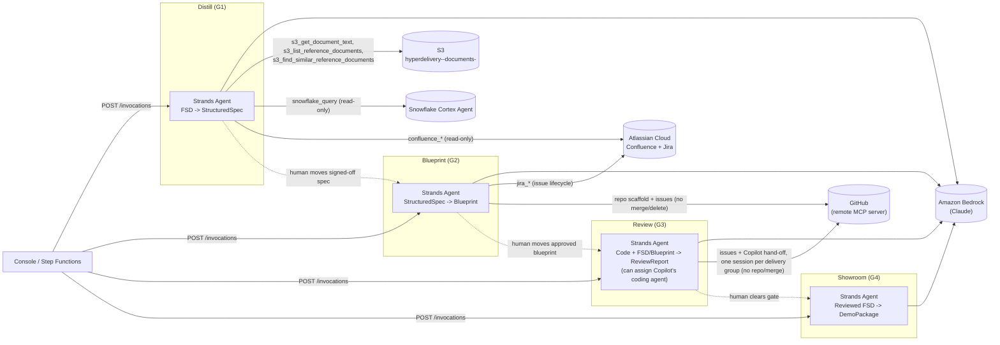
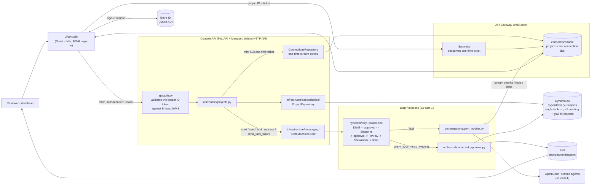
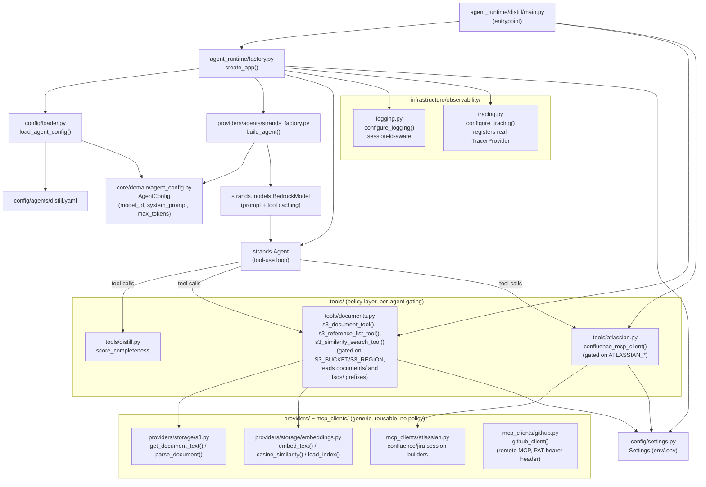

# Hyperdelivery Architecture

## High-level

Four independently-deployed agents, one per delivery gate, each running as its own
AgentCore Runtime container. The Step Functions control plane calls one agent at a time
through the AgentCore Runtime HTTP contract, with the console providing the human surface
for each gated handoff.

Strands owns each agent's own tool-use loop; there is no shared agent registry. Each
AgentCore invocation constructs a request-scoped Strands agent because one `Agent`
instance rejects concurrent calls and carries mutable conversation, metrics, and hook
state. Streaming tools yield native Strands tool events, which the runtime maps onto the
same `tool_call` SSE contract as tool start and completion so local SSE and deployed
WebSocket clients see progressive results without a separate transport. Snowflake uses
`httpx.AsyncClient.stream`, so long Cortex waits do not occupy worker threads.

## The control plane (Phase 2 - deployed in dev)

Alongside the agents, a control plane sequences the line and holds it at each human
approval. The dev environment runs the console API, Step Functions workflow, AgentCore
runtimes, and a WebSocket API for live turn events. Local mode remains available when
`STATE_MACHINE_ARN` is unset and uses the console API's SSE endpoint instead.

Every resource - the state machine, the DynamoDB table, the S3 bucket, Bedrock/AgentCore
Runtime - lives in a single region, `us-east-1` (the prior `ap-southeast-2`/`us-east-1`
split was reversed, see docs/decisions.md). The stateful data plane (DynamoDB table + S3
bucket) is its own CDK stack, `infra/stacks/storage_stack.py`, injected into
`OrchestrationStack`/`ConsoleApiStack` as a real cross-stack reference rather than each
stack re-deriving a name string. Every physical resource name is env-suffixed via
`infra/stacks/naming.py` (e.g. `hyperdelivery-dev-projects`), so a second environment
(e.g. `prod`) never collides with `dev`.

Every `/projects/*` route is gated by `Depends(get_current_user)` at the router level
(`APIRouter(..., dependencies=[...])`), so a new route can't ship ungated by accident. The
frontend and backend share one Entra ID app registration (SPA platform type, no client
secret, PKCE) - the frontend sends its ID token, the backend validates its signature,
audience and issuer against Entra's JWKS rather than trusting a client-claimed identity.
WebSocket handshakes use a separate one-time ticket because browser WebSockets cannot set
that bearer header: an authenticated project route writes a random 60-second ticket, and
the `$connect` Lambda atomically consumes it before registering the connection.
`sdk/python/` predates this and does not yet attach a token - it is not a currently-used
path for the console UI, which talks to the API directly over `fetch`.

The approval hold is the important mechanism. A `WAIT_FOR_TASK_TOKEN` state calls
`persist_approval`, which writes the task token and the pending-lookup GSI attributes onto
the project's `STATE` item and publishes a notification, then returns - the execution stays
paused for as long as the decision takes. The console API resumes it by calling
`send_task_success` (approved) or `send_task_failure` (rejected) with that token.

The single-table key layout is owned jointly by
`src/infrastructure/repositories/keys.py` and `infra/stacks/storage_stack.py`. They must
change together. Each agent's artifact is stored twice: `ARTIFACT#<agent>` (the latest
version, what the console reads by default) and an immutable `ARTIFACT_VERSION#<agent>#v<NNNN>`
history item per rerun - `ProjectRepository.list_artifact_versions` reads the latter.

See [docs/decisions.md](./decisions.md) for why each of these shapes was chosen.

## Low-level (per-agent composition)

Every agent container is built from the same composition root shape. Distill (the most
built-out agent, with two external tools) is shown below; Blueprint/Review/Showroom
follow the identical shape with fewer tools (see the table after the diagram).

| Agent | Deterministic validator tool | External tools | Output model |
|---|---|---|---|
| Distill | `track_plan`, `get_context`, `detect_fsd_template`, `score_template_coverage`, `extract_field_rules`, `submit_structured_spec`, `ask_clarifying_questions` | Local files; S3 document/reference retrieval; Confluence and Jira MCP (read-only); Snowflake (read-only) | `StructuredSpec` |
| Blueprint | `track_plan`, `get_context`, `validate_units_of_work`, `plan_delivery`, `score_blueprint_completeness` | Jira MCP (issue lifecycle), GitHub MCP (repo scaffold/brownfield-read + issues/PRs, no merge/delete/Copilot) | `Blueprint` |
| Review | `track_plan`, `get_context`, `validate_review_report`, `validate_copilot_assignments`, `plan_delivery` | GitHub MCP (issues + `assign_copilot_to_issue`/`create_pull_request_with_copilot`, no repo/merge) | `ReviewReport` |
| Showroom | `track_plan`, `get_context`, `validate_talk_track_coverage` | none | `DemoPackage` |

Agent validator tools are advisory. Both local and deployed entrypoints overwrite reported
completeness with `core.validation.evaluate_artifact` before persistence or gate progression.

`track_plan` is shared by every station: called first with the steps the agent intends to
take and again as each finishes, it keeps a long turn from drifting and shows the human
what is actually happening. It is stateless - the whole plan is passed on every call.

`get_context` is also shared by every station. It reads a single global, system-wide
standing note (repo, database, design system, conventions - see docs/decisions.md),
stored via `ContextRepository` and edited from the console's `/context` page - not
scoped to any one project. `_build_prompt` inlines it directly when short but only
previews it above a length threshold, and this tool fetches the full text on demand -
the same on-demand shape as `s3_get_document_text` for an uploaded document, so a
page-long note isn't resent in full on every turn.

`plan_delivery` is shared by Blueprint and Review. A unit of work is a unit of *review*;
the unit of *shipping* is a delivery group, because a coding-agent session branches from
one ref and two units writing the same file would branch from the same base and overwrite
each other. It merges units that share a file into one group - one branch, one pull
request, several issues closed - and returns the groups in build order, so a group that
depends on another can start from that group's branch via `base_ref` (see
docs/decisions.md). No agent tool can merge a pull request - see below.

Review records each pull request it opens in `ReviewReport.builds`, and the console polls
`GET /projects/{id}/builds` while any of them is still moving. That endpoint reads GitHub's
REST API directly (`providers/github/pull_requests.py`) rather than spending a model turn
on "is it green yet", and reports an unreadable pull request as unknown rather than failed.
When every build settles the console sends one follow-up turn, so the station reports the
outcome in the thread.

Merging is a human decision, not an agent one (`tools/github.py` grants no station
`merge_pull_request`), but it does not require the human to know git. `providers/github/
merge.py` is a write-path client - deliberately outside any agent's toolset - used two
ways: `POST /projects/{id}/builds/{number}/merge` lets a human trigger one build's merge
explicitly from the console, and approving at the G3 gate (`SHOWROOM_APPROVAL`) merges
every recorded build automatically before the approval completes. Both paths call
`resolve_and_merge`, which first takes the build's pull request out of draft (Copilot
opens every PR as a draft and does not reliably flip it to ready itself, so this is done
via GraphQL's `markPullRequestReadyForReview` - REST's "Update a pull request" has no
field for it) and brings its branch up to date with its base (purely mechanical - no
textual judgment) and only then merges: a build that was merely a draft or behind needs
no one's attention, while a build with a real, unresolved conflict fails the merge -
and, at the G3 gate, fails the whole approval rather than recording a decision the state
machine can't actually deliver. Resolving a genuine conflict still needs a human (or a
new Review turn) to look at the code; nothing here guesses at that.

A successful merge can also start a local preview, entirely optionally
(`infrastructure/local_preview.py`). This is a laptop-demo convenience, not the hosted
"preview per pull request" `docs/hyperdelivery-plan.md`'s Phase 3 describes: it assumes
the console API and a single checkout of the target repo share one machine, and shells
out to whatever preview script that repo already has. Setting `PREVIEW_CHECKOUT_PATH`
makes both merge paths above fire it as a background task after the merge succeeds -
`git pull --ff-only` (never force, never touches a dirty tree) then the configured
command, detached - and `POST /projects/{id}/preview` / `.../preview/stop` let a human
trigger or stop it by hand. It is entirely best-effort: a failed pull or a script that
never starts is logged and otherwise silent, never surfacing as an error on the
merge/approval response that already told the human the merge itself succeeded.

**A station asks rather than guesses.** `CompletenessScore.questions` carries up to four
`OpenQuestion`s written for the person who requested the work, with concrete options where
they can be guessed. An intake turn - nothing drafted, questions asked - holds at its
station via the same `_has_open_gaps` path, and the console renders it as question cards
rather than a 0% score. The gate computes `score` and `gaps` but only bounds `questions`,
since what is worth asking a human is not something a validator can derive.

**These tools are advisory, not the gate.** Each one is called by the agent with id
lists the agent itself chose, so it can only check a draft's internal consistency - a
model is free to validate one thing and emit another. The gate is `core/validation`,
which runs against the *persisted* artifact plus its predecessors' artifacts and
overwrites `completeness` before the console API decides whether a station advances
(`api/routers/projects.py`). Coverage is read off stored traceability edges - a
`UnitOfWork`'s `requirement_ids`/`acceptance_criterion_ids`/`contract_ids`, a
`RequirementCoverage`'s `requirement_id`, a `TalkTrackSection`'s `requirement_id` -
never off prose. See docs/decisions.md for what this deliberately does *not* check.

**The G2 artifact is portable by design.** A `UnitOfWork` carries the components it
builds, the files it touches and the API contracts it implements alongside its spec
traceability, so `GET /projects/{id}/artifacts/blueprint` gives any external coding agent
everything it needs per unit without access to the conversation that produced it. That is
why the hand-off is a JSON read rather than an integration with one vendor's agent.

**GitHub access is split by direction, not by agent.** Blueprint reads a repository
proactively on every run (`search_repositories`, `get_repository_tree`, `search_code`,
`get_file_contents`) so a design is grounded in the codebase it will land in. Writing -
creating a repository, pushing files, filing issues - stays gated on an explicit request,
because Blueprint runs *before* the G2 sign-off and an irreversible resource must not
appear ahead of the approval that authorizes it. Review has no repository-write tools at
all, deliberately: an agent that authors cannot independently judge what it authored.

**Standing convention**: for any new external integration, split it into a generic,
policy-free provider/client (`providers/` or `mcp_clients/`) plus a per-agent `@tool`
wrapper in `tools/` that pulls config from `Settings` and enforces least-privilege
(e.g. the LLM can only ever supply an S3 object *key*, never a bucket). This generalizes
beyond MCP - the S3 tool has no MCP protocol involved at all and still follows the split.
