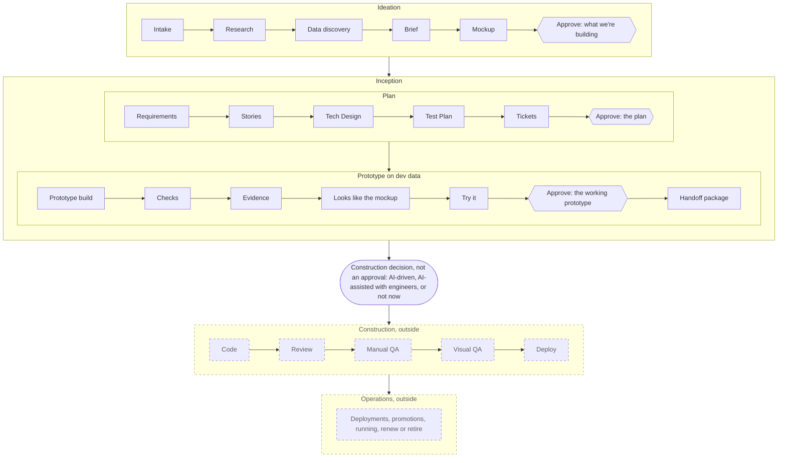
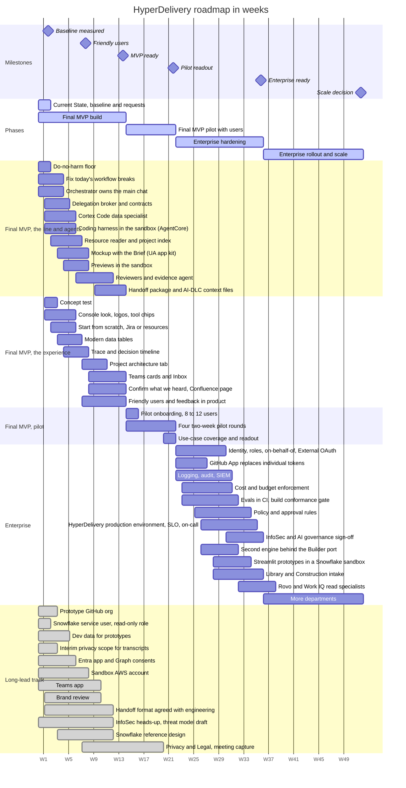
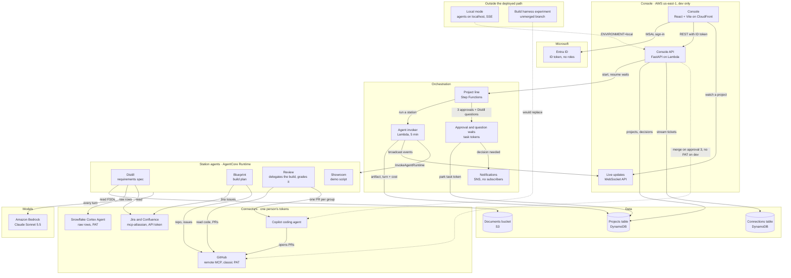
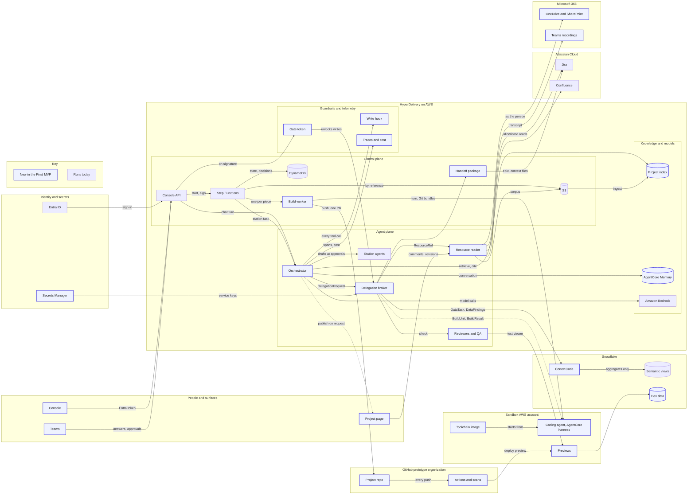
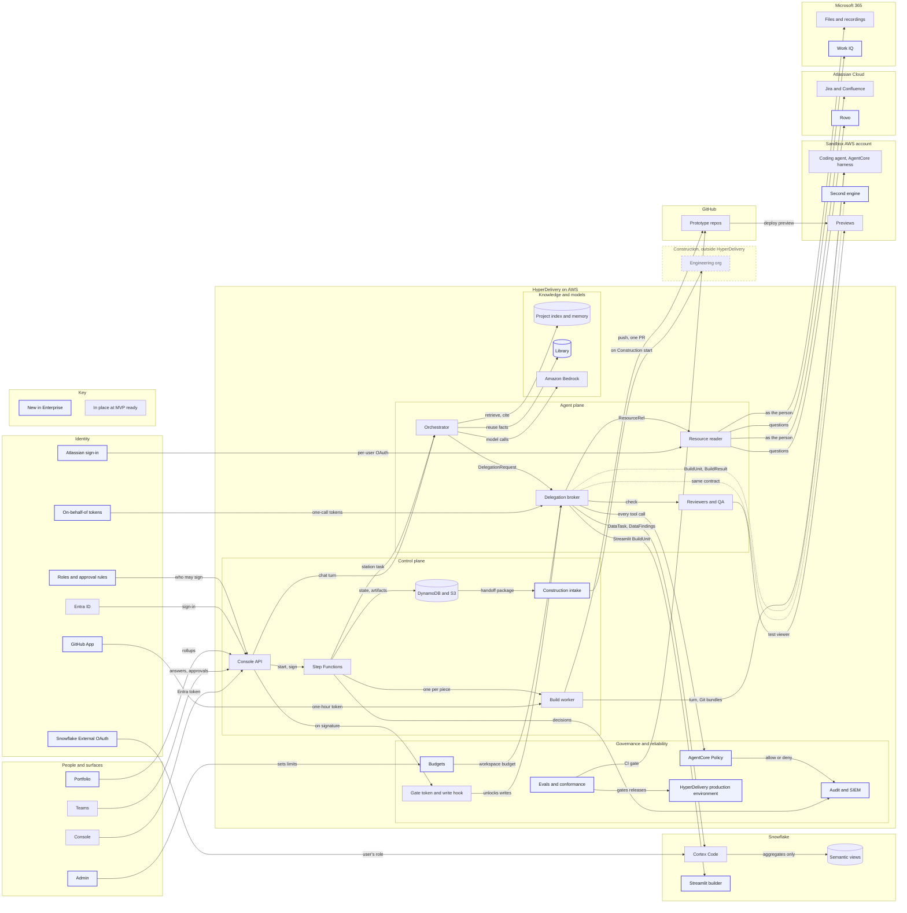

<!-- cspell:words Kiro Snowsight -->

# UA-DLC and HyperDelivery

**A governed way for Under Armour teammates to take cross-functional ideas from a mockup to a
working prototype, grounded in UA's own data and decisions, and hand them to engineering ready to
build**

| | |
|---|---|
| Status | Draft v3 for leadership review. Nothing here is decided until [the decisions](#8-the-ask-in-three-tranches) are made |
| Date | 2026-10-25, revised 2026-10-26 (HyperDelivery stops at Inception; the experience; who else is building toward this) |
| Owner | Eitan Flor, Enterprise Data Management |
| Detail | [operating-model.md](operating-model.md) (how UA-DLC works), [platform-architecture.md](platform-architecture.md) (how HyperDelivery is built), [ux-direction.md](ux-direction.md) (the experience) |
| Concept screens | [HyperDelivery concepts canvas](https://claude.ai/artifact/BUcEKzAz1CXa27EY398sAF) (private until shared), with a standalone copy in this folder under `site/concepts/`. Every name, project and number on it is invented to show the design; none is a measured result. |
| Evidence | [current-state.md](current-state.md) (the repo today), [research/](research/README.md) (sourced research and critique) |

Part 1 is the narrative, about ten minutes. Part 2 is what we will do in three phases (Current
State, Final MVP and Enterprise), what it costs, how we will know it worked, and what we need from
you. Values in [brackets] are filled in before the meeting (see
[Before the meeting](#13-before-the-meeting)).

## The one-page version

1. **The problem.** When a UA business team has an idea for a tool, getting a working version
   means joining an engineering or analytics queue. Today that takes [baseline: median business
   days from request to first working prototype, measured in weeks 1 and 2] and [N] open EDMA requests are
   waiting. The context that would make the tool right is spread across functions and rarely in
   one room.
2. **Where it stands today.** HyperDelivery, built in EDM, takes an idea through four AI agents
   and three human approvals to a working prototype. It works end to end on a laptop and is
   verified on AWS as far as the first approval. [N] projects have started and [N] teammates have
   used it. It has not yet run a measured pilot, and that is the first thing we fix.
3. **How we get there: three phases.** **Current State** keeps today's EDM pilot running for its
   users while we measure a baseline and file every long-lead request in weeks 1 and 2. **Final
   MVP** builds to the new design until it is fully usable end to end (weeks 1 to 14): one
   assistant that hands Snowflake work to Cortex Code and coding to a sandboxed coding agent,
   projects that start from scratch, a Jira ticket or resources people point at, a per-project
   index of everything the project learns, and a new console, with friendly users from week 8.
   Then a real testing pilot (weeks 15 to 22): 8 to 12 users from at least three functions on real,
   low-risk work across a spread of use cases, in four two-week rounds. **Enterprise** (from week
   23) adds governance, identity, logging and audit, cost and budget enforcement, evals, policy and
   HyperDelivery's own production environment, then more departments. A two-week do-no-harm floor
   keeps UA data and systems safe for pilot users; nothing in Enterprise is a precondition for the
   pilot, so the enterprise controls never hold the Final MVP back.
4. **Where HyperDelivery stops: at Inception.** In UA-DLC, Ideation ends in a visual mockup,
   Inception in a working prototype (at most on a hosted sandbox, on dev data), Construction in a
   production-ready version on production data connections, and Operations runs the deployments
   and promotions after that. HyperDelivery's build stops at Inception: every project ends at its
   third approval with a handoff package (a Jira epic and issues, engineering's AI-DLC context
   files, the repository, the decisions and the evidence), built in the Final MVP. After Inception,
   UA decides per project, with a default set by risk, whether Construction is AI-driven or
   AI-assisted with engineers, because that is where work starts touching production systems and
   data.
5. **What we will prove in about 22 weeks.** At least three projects reach an accepted working
   prototype and leave with a handoff package, at least four of five non-technical pilot users
   reach a working preview without help, at least half of pilot users start a second project,
   cycle time is measured against the week-2 baseline, and at least five distinct kinds of use case
   are tried. That is the **pilot readout**, with a stop rule if we miss.
6. **The smallest ask.** Fund the Final MVP: the current owner, two borrowed engineers, part-time
   design and about two days a week from a data platform engineer, for about 22 weeks, about
   [cost]. Sponsor the requests with long lead times on day one (sandbox AWS account, Teams app,
   Microsoft Graph consents, prototype GitHub organization, Snowflake roles, a dev-data source from
   data platform, engineering's agreement on the handoff format, Brand review, an InfoSec
   heads-up) so Enterprise starts with approvals already moving. Enterprise waits for evidence at
   the pilot readout.
7. **What we will not build.** No second data platform, no competitor to Snowflake CoWork
   (formerly Snowflake Intelligence), BI or Microsoft 365 Copilot, and nothing past Inception for
   now: HyperDelivery builds nothing on production data connections and deploys nothing to
   production, and Construction and Operations stay with UA's existing paths, decided after
   Inception. HyperDelivery is the governed path from idea to prototype on top of UA's Snowflake
   golden reports and Microsoft 365; section 5 shows which requests belong in other tools.

---

# Part 1 - The narrative

## 1. Why now

**At UA:**

- UA's data and AI investment now covers **asking questions of data** (Snowflake CoWork, the
  golden-report pattern) and **developers writing code** (Cortex Code, per the
  [Snowflake case study](https://www.snowflake.com/en/customers/all-customers/case-study/under-armour/),
  and GitHub Copilot, which UA job postings name). There is no governed path for a non-technical
  teammate to **build something new** with that data.
- FY27 priorities create exactly these requests: another 25% SKU reduction within 18 months,
  fewer and bigger marketing stories with clear measurement, full-price selling and inventory
  discipline ([Q1 FY27 call](https://www.fool.com/earnings/call-transcripts/2026/08/07/under-armour-uaa-q1-2027-earnings-call-transcript/)).
  Each needs a small analytic tool that several functions agree on.
- The UA ideathon suggested that the best business context appears when technical and
  non-technical teammates from different functions work a problem together; the pilot tests this
  (section 3). Meeting tools such as Teams Facilitator capture notes, but nothing ties what such a
  room says to UA's data, definitions and owners and carries it into a build.

**In the market, over the last eighteen months:**

- **Writing code became cheap.** Every major vendor ships a coding agent. UA job postings already
  name GitHub Copilot, and today's pilot builds with it; the plan moves building into a sandbox
  HyperDelivery controls (section 4). Factory's website lists Under Armour as a
  customer; we will confirm before the meeting what UA licenses and where it fits (section 5).
- **The slow part moved to intent, decisions and review.** Anthropic's
  [AI-native SDLC playbook](https://claude.com/resources/articles/the-ai-native-sdlc-playbook),
  GitHub Next's [Chopin](https://githubnext.com/projects/chopin/) and AWS's
  [AI-DLC](https://aws.amazon.com/blogs/devops/ai-driven-development-life-cycle/) all make that
  case. Those are the steps where UA-specific knowledge lives.
- **Business-user app builders are churning.** Microsoft is retiring its App Builder agent and
  vibe.powerapps.com on November 30, 2026 and moving app creation into Copilot Cowork's App skill
  (Frontier program only) and Apps in Copilot Studio (public preview)
  ([MC1505609](https://mc.merill.net/message/MC1505609),
  [Microsoft Learn](https://learn.microsoft.com/power-apps/vibe/migrate-apps)).
  GitHub announced Spark's deprecation in August 2026. A platform that owns UA's process and stays neutral about where apps
  run is insulated from that churn. We carry our own exposure: several AWS services we plan to use
  became generally available in 2026, so the design keeps them behind replaceable interfaces.

## 2. Where HyperDelivery is today

This is the **Current State** phase, drawn as a diagram in section 9
([Phase 1: Current State](#phase-1-current-state)). It stays as is for its current users while the
Final MVP is built. Full detail with file references: [current-state.md](current-state.md).

**What works:**

- An idea goes through four AI agents (requirements, plan, build and review, demo) with three
  human approvals. The server re-checks every document rather than trusting the agent.
- Approvals are signed by the verified Microsoft identity, can be undone for 12 seconds, and are
  kept as a trail.
- A project can wait days for an approver without losing its place. All four agents are deployed
  on AWS in `dev`.
- In local mode it reads Confluence, Jira, GitHub, Snowflake and S3 (Snowflake and S3 serve only
  the first agent), and builds with the GitHub Copilot coding agent, one change per group of work.
- Every successful agent turn records its tokens and dollar cost.
- The console is carefully built and accessible.

**What is not ready:**

- **Three workflow breaks** on AWS: sending work back at any approval fails the run and strands the
  project, only the first agent can ask questions, and the demo step marks a project done on its
  own. Verified on AWS only as far as the first approval. There are also resilience defects (the
  Lambda that calls each agent times out at five minutes while a turn may run ten, with no retry or
  restart; full documents ride in the workflow's payload; lost updates) and review-scoring defects
  (a report with no requirement met can still pass).
- **The deployed setup is incomplete:** the deploy script passes only the Snowflake settings, and
  only to the first agent, and the console API gets no GitHub token, storage bucket or Bedrock
  access. On AWS, uploads fail, the final approval's merge and build status are skipped without an
  error, and the first agent could not open an upload even with storage configured.
- **Security and operations:** no roles or permissions, so anyone can approve their own request;
  everyone acts through one person's GitHub, Atlassian and Snowflake tokens, and the Snowflake token
  reaches the runtime as a plain environment variable, with no secrets store; some writes to GitHub
  and Jira happen before the approval that reviews them, guarded only by the prompt; the final
  approval squash-merges every build pull request with no check that its tests passed; anyone
  signed in can edit the instructions every agent reads; deletes are hard deletes with no audit, and
  the projects table has no point-in-time recovery; there is no dependency scanning; HyperDelivery
  runs only in `dev`, in one account and one region, with agent images pushed by hand and no release
  pipeline.
- **Data:** the Snowflake integration asks for raw rows under a personal token and stores up to
  1,500 characters of each result in its turn records. That breaks UA's "don't move data" tenet
  and is the first fix, inside the do-no-harm floor in weeks 1 and 2.
- **No hosted preview:** the only preview runs the target repository's script on the same machine
  as the console API, so the working prototype effectively runs on a laptop.
- **Nobody is notified:** the notification topic has no subscribers, so there is no Teams message,
  email or inbox; people find out by opening the console.
- **No memory:** a fresh agent for every request, one shared notes field, and project files written
  to storage but never read; finished projects never feed back.
- **Not measured or tested:** traces are created but never exported (the tracing setup has no
  exporter), logs are plain text keyed only by session, turn records are clipped to 1,500
  characters, and cost is recorded only for successful turns, with no rollups. There are no
  evaluations, nothing has been usability-tested, and the pilot and baseline that the earlier plan
  ([hyperdelivery-plan.md](../hyperdelivery-plan.md)) set for around 18 October did not happen. The code is effectively one engineer's.

**Bottom line.** The core design is right and worth keeping: humans approve what passes between
stations, the server checks the work, and each agent's permissions are separate from the shared integrations.
The gaps are the normal gaps between a pilot and a platform. The Final MVP fixes the workflow
breaks, and its do-no-harm floor closes the gaps that could hurt a pilot user in the first two
weeks. The rest are platform gaps that the Enterprise phase closes once the pilot has shown what
people use, so we harden the product people actually use rather than the one we guessed at.

## 3. What we heard

From [N] early users in EDM ([month]) and the UA ideathon ([date], [N] participants across [N]
functions). These are hypotheses we will test in the pilot, not established findings.

- **"We don't care which agent is doing what."** Users want three things: what is happening with
  my idea, what do you need from me, and can I see it working. Today's console shows a named crew
  of agents on every screen.
- **The best context comes from mixed rooms.** Ideas from the ideathon included [3 to 5 real
  ideas, each with its function].
- **Pain today:** [how long requests wait], [how often numbers are disputed], [the spreadsheet
  workarounds people use].

UA works in Microsoft 365 (Teams, Outlook, SharePoint), engineering works in Jira and Confluence,
data lives in Snowflake, and the cloud is AWS. Asking people to leave those tools to take part
would lose them.

## 4. The proposal: UA-DLC on HyperDelivery

**UA-DLC**, the Under Armour AI Delivery Lifecycle, is a four-phase line with three standing
human approvals, and each phase is judged by what it hands over: **Ideation** a visual mockup that
supplements the research and the brief, **Inception** a working prototype (at most on a hosted
sandbox, on dev data), **Construction** a production-ready version on production data connections,
and **Operations** the deployments, promotions and running that follow. Those outputs are the
definition UA aligned on with [the other team] in October 2026. **HyperDelivery runs the first two
phases and ends every project at the third approval with a handoff package; Construction and
Operations stay outside its build for now.** The line keeps engineering's twelve steps (in AWS
AI-DLC's vocabulary) word for word, in engineering's phases, adds Intake, Data discovery and a
Mockup to Ideation and a sandbox prototype and the handoff to Inception, and names each approval by
the decision it records:

The phase names are process vocabulary for the people who run the line; business teammates see
Discover, Plan, Prototype and Handoff on the line, and approvals named by their decision ("what
we're building", which signs the brief and the mockup together, "the plan" and "the working
prototype"). The prototype stretch has its own step names (Prototype build, Checks, Evidence, Looks
like the mockup, Try it), so Code, Review and QA keep one meaning: engineering's Construction work,
in engineering's order. Construction and Operations are drawn dashed because they are outside
HyperDelivery's build for now. This matches AWS AI-DLC 2.x, whose Ideation already ends in rough mockups
and an approval ([research](research/aws-aidlc.md)). Every step's inputs, outputs, owner and
screen are in [operating-model.md](operating-model.md#1-the-line). The line was checked against AWS
AI-DLC, Anthropic's AI-native SDLC playbook, Microsoft's guidance (GitHub Spec Kit, Foundry and
Copilot Studio) and software factories such as Factory, Runlayer and Chopin; the step-by-step
comparison is in [research/ua-dlc-reconcile.md](research/ua-dlc-reconcile.md).

Engineering has since built its own variant in UA's internal AI marketplace, for engineers in their
coding tools, with gates of its own: a plan approved before any code, an explicit yes before a push
or pull request, and every acceptance criterion checked in the running app. The two lines share a
spine (no writes before approval, gaps recorded rather than guessed, a plan approved before code).
HyperDelivery reuses engineering's contracts where they fit and hands work over in its format: its
handoff lands where engineering's Construction tooling starts, with AI-DLC context files per ticket
feeding engineering's Jira-to-PR pipeline, either with an engineer approving the plan (AI-assisted)
or trusting approval 2 as the approved design (AI-driven), which engineering has to agree. What to
settle with engineering is in
[operating-model.md](operating-model.md#how-this-lines-up-with-engineerings-variant)
([research](research/ua-marketplace-alignment.md)).

**A project can start anywhere people already are:** a sentence typed from scratch, an existing
Jira ticket with its linked pages, or resources people point at, such as a Teams recording, a
OneDrive folder or a Confluence page. Nothing has to be uploaded. HyperDelivery reads what it is
pointed at (Microsoft 365 files as the person who pointed, from the Final MVP; Jira and Confluence
through an allowlisted service token until per-user sign-in arrives in the Enterprise phase) and
indexes it for that project; that growing, cited, project-by-project memory of UA's own decisions
is the moat (section 5).

Four rules make it UA's:

1. **Risk and the target tier decide who signs, never how many approvals there are.** A low-risk
   "Prototype only" project needs only the requester. A T1 Team app target adds a business
   owner, a target that will read confidential data adds a data owner, and a T2 or T3 target, or
   high risk, adds an engineering reviewer from the intended receiving team
   ([who signs](operating-model.md#4-who-signs)).
2. **Every number cites a golden report or is labeled "uncertified".** Snowflake stays the system
   of record for definitions; HyperDelivery creates no second semantic layer. On dev data the
   evidence says the definitions match and the numbers were not checked, rather than claiming the
   numbers match.
3. **Rows stay in Snowflake, and prototypes run on dev data.** Snowflake work is handed to Cortex
   Code, which runs inside Snowflake and returns only schema, counts and aggregates, so data
   discovery can cite certified definitions without reading rows. Prototypes run in the sandbox on
   dev data (synthetic data, a dev Snowflake database, or views data platform designates as dev
   data), query live and keep no copies; the production runtime (Streamlit in Snowflake or
   engineering's platforms) is chosen and built in Construction.
4. **Questions go to the person who can answer them, in Teams,** and the decisions people make are
   recorded with who made them and why.

**HyperDelivery** is the platform that runs UA-DLC: it already exists, and Part 2 says how it
grows. The full process, including the prototype contract and target tiers, roles, time budgets
and support, is in [operating-model.md](operating-model.md). (HyperDelivery's own phases, Current
State, Final MVP and Enterprise, are in section 9; a project's prototype contract and its target
tier, from T1 Team app to T3 Engineering-owned system, are in
[operating-model.md section 3](operating-model.md#3-the-prototype-contract-and-target-tiers). They
are different things: a phase is how mature the platform is; a target tier is where one project's
production version is meant to land, built in Construction.)

**After Inception, UA makes the Construction decision.** Every accepted prototype leaves with a
handoff package, and the Construction owner (the receiving engineering lead, with the business
owner) then chooses **AI-driven** (agents build the production version from the package),
**AI-assisted with engineers** (engineers lead and may rebuild from the plan) or **not now**. It is
a recorded decision, not a fourth approval. Its default comes from risk and the target tier, which
is what the earlier "both, by risk tier" production path becomes: low-risk, read-only work with no
sign-in or personal data defaults to AI-driven; sensitive data, authentication, writes to systems of
record or core systems default to AI-assisted with engineers. Engineering's gates on push, merge and
release apply in both modes, and a pipeline, never a model, deploys. AI-driven maps to engineering's
`jira-to-pr --require-context` [confirm with engineering]. The package and the decision are in
[operating-model.md](operating-model.md#10-handoff-and-the-construction-decision). Whether
HyperDelivery later adds an AI-driven Construction lane of its own is decided at the scale decision,
on handoff evidence; nothing is built for it before then.

### How HyperDelivery does the work

From the Final MVP on, people talk to one assistant. Behind it, an **orchestrator** owns the
conversation and the plan and hands work to **specialists**, each of which crosses one boundary per
call and returns only what the project needs:

- **Snowflake work** (finding the right tables, checking a metric against its certified definition,
  profiling, synthetic samples, drafting queries) goes to **Cortex Code**, which runs inside
  Snowflake under a scoped,
  read-only, per-task identity and returns schema, counts, aggregates and query ids, never rows.
- **Coding** goes to a **coding agent in HyperDelivery's sandbox**, which builds the prototype on
  dev data: one Amazon Bedrock AgentCore harness session per build, in a sandbox AWS account that
  never runs HyperDelivery. It works
  through the signed plan's pieces in order with the whole plan in its workspace, tests after each
  piece, commits each one to a single branch, and asks a person when two readings of the plan would
  build different things. The engine is swappable behind one contract and the model is set per call
  (Claude Sonnet 5.5 through Bedrock). HyperDelivery, not the model, pushes and opens one pull
  request in a dedicated prototype organization, and the agent never holds UA data or credentials.
  GitHub Copilot's cloud agent, which turns each issue into its own pull request on autopilot, is not
  used for business prototypes; it stays acceptable on an engineering team's own repositories in
  Construction ([research](research/agentcore-harness-coding.md)).
- **Resources people point at** (Teams recordings, OneDrive and SharePoint files, Jira tickets,
  Confluence pages and their comments) go to a **resource reader** that reads them (Microsoft 365 as
  the person who pointed; Jira and Confluence through an allowlisted service token until the
  Enterprise phase) and indexes them into that project's knowledge base on AWS.
- **Checking** goes to fresh-context reviewers and an evidence agent that runs every acceptance
  criterion in the sandbox prototype, so the author never grades its own work.
- **The handoff** is assembled after approval 3: the Jira epic (for a T1 to T3 target) with an
  issue per ticket, engineering's AI-DLC context files (checked with engineering's own validator),
  the repository, the decision chain, the evidence, what the prototype skips, a dev-to-production
  data map and the target tier's Construction checklist. HyperDelivery records the Construction
  decision against it, and its work on the project ends there.

A small, trusted **delegation broker** sits between the orchestrator and every specialist: it scopes
the credential for each call (service keys from Secrets Manager in the Final MVP; per-call minting
for every system arrives in the Enterprise phase), caps the call's time and spend, validates what
comes back against a typed contract, and writes the trace. Writes with side effects happen only
after the human approval that authorizes them: the repository and the build after approval 2, the
Jira epic and context files at the handoff, after approval 3.

The orchestrator stays on Strands, which the code already uses and AgentCore runs natively.
LangGraph's main advantage, human-in-the-loop that resumes from saved checkpoints, already lives in
Step Functions and the signed decision record, so we revisit it only on the triggers in
[platform-architecture.md](platform-architecture.md#strands-not-langgraph-for-now). Step Functions
stays as the spine that holds each project across days and parks it at every approval, with no
model in that loop; LangGraph would replace Strands inside a step, not Step Functions
([why](platform-architecture.md#why-step-functions-stays-and-where-langgraph-would-fit)). AWS's Strands
Box sandbox is a v0.1.0 developer preview, so we watch it rather than adopt it, but its security
lessons go into the threat model now: enforce outside the agent's process, never give the agent a
secret, and give each credential domain its own sandbox
([Strands Box and Dogwood](platform-architecture.md#strands-box-and-dogwood)).

The Final MVP's architecture is drawn in section 9 ([Phase 2: Final MVP](#phase-2-final-mvp)),
beside the Current State and Enterprise diagrams. The full design, including identity at each step and
what lands in which phase, is in [platform-architecture.md](platform-architecture.md). A project's
Architecture tab shows that project's own solution architecture, while HyperDelivery's platform
architecture lives in [platform-architecture.md](platform-architecture.md), on the
[plan page](https://claude.ai/artifact/FTURRJS2HcSGEDT7QQYowh) and on the concept canvas's Help page
["How HyperDelivery Is Built"](https://claude.ai/artifact/BUcEKzAz1CXa27EY398sAF).

## 5. Why HyperDelivery, and not a generic tool

Generic tools are good at building, and group work is starting to appear around them: Teams
Facilitator captures meeting notes, and GitHub Next's Chopin (a research prototype) and Claude Tag
(in Slack for Claude Team and Enterprise customers; Teams coming soon) are multiplayer. What none of them does is tie multi-party
input to **UA's data, definitions and owners**, confirm it as reusable context, and carry it through
signed approvals to a working prototype and a package engineering can build from. That makes HyperDelivery the best fit for one kind of
request; for every other common request, another tool UA teammates can use wins or ties. The two
matrices below show where each tool does its best work. The facts and their sources are in
[research/tool-landscape.md](research/tool-landscape.md), checked on 2026-10-26.

Three names changed in 2026: Snowflake Intelligence is now **Snowflake CoWork** (Snowflake's own
name, not a UA label), Cortex Code is now **Snowflake CoCo**, the same product renamed (this plan
keeps the name Cortex Code), and Windsurf is now
**Devin Desktop**. Cursor, part of SpaceX since August 14, 2026, keeps its name. Anything about UA's
own licenses is marked [confirm].

**How far it goes, and who builds.** Across is how far the result goes: an answer (nothing is
built), a personal tool one person runs, a team app hosted inside the tool that built it, or a path
to production (code in UA's repositories with review, release and support, or a governed handoff to
engineering for Construction). Up is who builds.

<!-- plan-visual: tool-matrix -->

| Who builds | An answer | A personal tool | A team app | A path to production |
|---|---|---|---|---|
| **Engineer** |  |  |  | GitHub Copilot; Factory (Droid); Claude Code; Cursor and other agentic IDEs (Devin Desktop, Kiro) |
| **Analyst** |  |  | Cortex Code (Snowflake CoCo); Palantir Foundry and AIP |  |
| **Business teammate** | Snowflake CoWork and Snowsight | Microsoft 365 Copilot, Copilot Cowork and Copilot Studio |  | **HyperDelivery** |

<!-- /plan-visual -->

The bottom-right cell is the gap. Every tool that reaches a path to production expects an engineer
at the keyboard, and every tool a business teammate can use alone stops at an answer, a personal
tool or an app inside its vendor's platform. HyperDelivery is meant for that cell: a business
teammate starts, and analysts, data owners and engineers join at its approvals.

**Which tool for which request.** Best fit is where we would send a typical request; Works means
the tool can do it, with more effort or a caveat; Not for this means another tool should take it.
HyperDelivery's marks describe the Final MVP, whose path to production is the handoff to
Construction at the end of Inception; Construction itself is AI-driven or AI-assisted with
engineers, decided per project.

<!-- plan-visual: use-case-matrix -->

| Use case | Snowflake CoWork | Cortex Code | GitHub Copilot | Palantir | Factory | Claude Code | Cursor and other agentic IDEs (Devin Desktop, Kiro) | Microsoft Copilot | HyperDelivery |
|---|---|---|---|---|---|---|---|---|---|
| Ask a question of certified data | **Best fit** | Works | Not for this | Works | Not for this | Not for this | Not for this | Not for this | Not for this |
| Build a dashboard on governed data | **Best fit** | Works | Not for this | Works | Not for this | Not for this | Not for this | Not for this | Not for this |
| Automate a personal Microsoft 365 task | Not for this | Not for this | Not for this | Not for this | Not for this | Not for this | Not for this | **Best fit** | Not for this |
| A recurring write-up from the same sources | Works | Not for this | Not for this | Not for this | Not for this | Not for this | Not for this | **Best fit** | Not for this |
| A simple team workflow, form or tracker | Not for this | Not for this | Not for this | Works | Not for this | Not for this | Not for this | **Best fit** | Works |
| A Streamlit data app on one Snowflake source | Not for this | **Best fit** | Works | Not for this | Works | Works | Works | Not for this | Works |
| A data pipeline or transform in Snowflake | Not for this | **Best fit** | Works | Not for this | Works | Works | Works | Not for this | Not for this |
| An operational app on governed enterprise data | Not for this | Works | Works | **Best fit** | Works | Works | Works | Not for this | Works |
| Review or fix code | Not for this | Works | **Best fit** | Not for this | **Best fit** | **Best fit** | **Best fit** | Not for this | Not for this |
| Change an existing codebase | Not for this | Works | **Best fit** | Not for this | **Best fit** | **Best fit** | **Best fit** | Not for this | Not for this |
| A large, multi-part engineering project | Not for this | Not for this | Works | Not for this | **Best fit** | **Best fit** | Works | Not for this | Not for this |
| A cross-functional new tool that needs a path to production | Not for this | Not for this | Works | Works | Works | Works | Works | Not for this | **Best fit** |

<!-- /plan-visual -->

**Where each kind of request goes.**

- **Snowflake.** Simple questions about data go to Snowflake CoWork, which gives business
  teammates cited answers over certified semantic views without moving data. Snowflake's June 2026
  announcement names Under Armour as a CoWork customer; who has it today, over which views, is
  [confirm]. An analyst's own dashboard goes to Snowsight, and a recurring dashboard on certified
  data goes to EDMA's BI team (Tableau or Power BI). Single-source Snowflake apps and pipelines,
  built by someone who writes code, go to Cortex Code with Streamlit in Snowflake, under the
  builder's own role [confirm who has it]. Data-quality checks stay with Snowflake Data Metric
  Functions and the existing observability tools.
- **Microsoft 365.** Personal work on Microsoft 365 content goes to Microsoft 365 Copilot and
  Copilot Cowork, and simple team tools on Microsoft 365 data go to Copilot Studio, if UA licenses
  them [confirm]. Forms and simple workflows go to Power Automate, or Amazon Quick if licensed
  [confirm]. A recurring write-up from the same sources in the same format (a weekly report, a deal
  brief, variance commentary) becomes a shared skill and template in an enterprise assistant UA
  licenses; engineering's AI marketplace already runs scheduled briefings
  ([research](research/factory-sources-round4.md)). Microsoft's business-user app building is
  still in Frontier or preview, and its App Builder agent retires on November 30, 2026, so "Best
  fit" for a team tracker is a forward-looking call.
- **Palantir Foundry and AIP.** Operational apps where many people act on a shared object model,
  with write-back, go to Foundry and AIP, but only where the data already lives in Palantir's
  Ontology. For data that lives only in Snowflake, Palantir is not for this, given UA's stated
  "tenet of not moving data" (Chief Data and AI Officer, Snowflake case study). Whether UA licenses Foundry or AIP, and for which data, is
  [confirm]; no public source links UA to Palantir.
- **Engineering's coding agents.** Changes, reviews and fixes in existing codebases go to GitHub
  Copilot, Factory (Droid), Claude Code or an agentic IDE such as Cursor, Devin Desktop or Kiro.
  They are close substitutes, so the choice follows what UA licenses and supports; UA's AI
  marketplace defaults to Factory and GitHub Copilot, and seats and plans for each are [confirm].
  Large, multi-part engineering projects with an approved plan suit Factory or Claude Code.
  HyperDelivery's own coding agent stays behind the `Builder` port so it can follow whatever UA
  standardizes on, and a tool HyperDelivery prototyped is built in Construction with engineering's
  tools, AI-driven or AI-assisted.
- **HyperDelivery.** A cross-functional new tool that a business teammate starts, that needs input
  from more than one function and more than one system, and that needs approvals, a record of
  decisions and a path to production comes here. It is for things people act in, not only look at:
  they enter assumptions, run scenarios, mark decisions, route approvals, or combine data with a
  workflow. It also works for the shapes the pilot will try: a data app, a team workflow tool,
  turning a report into an app, changing a tool its team already owns (as a pull request to that
  team), and a Teams-centered process. Engineering codebases stay with engineering's coding agents,
  and a simple Microsoft 365 tool still goes to Copilot Studio first.
  When a request fits better elsewhere, the person who runs the line says so in conversation; the
  product's screens carry no tool advice.

**What HyperDelivery still has to prove.** No other tool in the matrices combines all five: a
non-technical person can start it; input from several functions is captured and attributed; numbers
tie to UA's certified definitions; approvals scale with risk and record who decided and why; and the
result can be handed to engineering as a complete package. Both halves of that cell, start to
prototype and the handoff package, are now Final MVP work, and Construction itself is outside
HyperDelivery, so the claim to prove at the pilot readout is that receiving engineering leads take
handoffs into Construction without a rewrite. Until then the honest claim is that it is designed
for the gap, not that it already fills it.

| Advantage | True today? | Proven by | Measure |
|---|---|---|---|
| **Cross-functional discovery**: many teammates contribute, every statement attributed and cited | Partly: one requester plus an expert answer page | Scale decision (at least 3 functions contributing) | Functions contributing per project |
| **Pointed, indexed project context**: what people point at (recordings, folders, tickets, pages, their comments and revisions) is read as them, indexed per project on AWS, and cited | No | Pilot readout | Share of plan statements citing a pointed source |
| **Organizational memory**: confirmed context compounds across projects | No | Scale decision | Reuse of confirmed context across projects |
| **UA golden paths**: approved stacks, the UA look, Snowflake and Entra patterns | No: prompt text only; the UA EDMA request template (unmerged) covers intake, not stacks | Scale decision | Share of prototypes built from a golden path |
| **Governed data, enforced at build time**: Cortex Code works inside Snowflake and returns only what the project needs; every app uses the certified definitions | No: the Snowflake tool returns raw rows, read-only by prompt | Do-no-harm floor (containment), then the pilot readout | Share of plan metrics bound to a certified definition |
| **A signed chain from idea to evidence** | Partly: signer recorded; version binding comes first | Pilot readout | Approvals bound to an exact version |
| **Neutral about runtimes and agents**: Streamlit in Snowflake and AWS, coding agents and models behind replaceable contracts | No: local preview only, one coding agent wired directly | Pilot readout (sandbox previews), then Enterprise (a second coding engine behind the same contract, Streamlit prototypes in a Snowflake sandbox) | Prototypes built in more than one sandbox runtime (the sandbox AWS account, a Snowflake sandbox schema) |
| **A handoff Construction can start from**: a Jira epic and issues, engineering's AI-DLC context files, the repository, the decisions and the evidence | No | Pilot readout | Handoffs taken into Construction without a rewrite |

**Honest threats, and what we concede.** Microsoft's Copilot Managed Runtime (in preview) will be
the better home for simple tools on Microsoft 365 data, and Snowflake's Cortex Sense plugins move
Snowflake toward the same gap. An analyst who writes code can build a single-source Snowflake app
with Cortex Code and Streamlit in Snowflake directly. Lovable, Bolt and v0 will always
out-prototype us on looks. We concede all three. The matrices send simple Microsoft 365 tools and
single-source Snowflake apps to their homes; we do not route UA data to unsanctioned builders.

**Exit ramp.** If a sanctioned vendor tool supports multi-party discovery, signed approvals and
grounding in UA's golden reports, we move the process onto it and keep only what is UA's: the
golden paths, the confirmed context and the decision record. We re-check both matrices, and the
comparison below, at the pilot readout.

### Who else is building toward this

Yes: many vendors are building pieces of UA-DLC, and the shape is converging on one chain (intent,
spec, plan, build, review, release) with a person approving between steps. Nobody ships the whole of
UA's Inception for a business teammate, the spec chain *and* a working prototype on certified data
with several functions' input and signed approvals: engineering lifecycles write the paperwork and
go straight to production code, while business-user builders make a prototype for one person
without the paperwork ([research](research/dlc-landscape.md#1-the-short-answer)).

Each phase is judged by its output, as in section 4: **Full** means the product produces that
output and the work behind it, **Partial** that it does some of the work or gives the output without
it, **None** that it does not address the phase; HyperDelivery's Construction cell reads "Handoff,
decided later" and its Operations cell "None for now", because it stops at Inception. Status and
sources for every product were checked on 2026-10-26
([research](research/dlc-landscape.md#2-the-comparison-table)); GitHub Universe on October 28 and
29 may change the GitHub rows.

<!-- plan-visual: dlc-matrix -->

| Product | What it is | Primary user | Ideation | Inception | Construction | Operations |
|---|---|---|---|---|---|---|
| GitHub Next Chopin | Multiplayer planning document with a repository-grounded agent; a research prototype | Engineering teams, with PMs and designers | Partial | Partial | Partial | None |
| Anthropic AI-native SDLC playbook ("Claude's AIDLC") | A method, carried out with Claude Design, Cowork, Claude Code and Claude Tag | Anyone originates; engineers build | Full | Partial | Full | Full (as a method) |
| AWS AI-DLC and Kiro | A method, open-source workflow rules and a spec-driven IDE | Developers in an IDE or CLI | Full | Partial | Full | Full (as rules) |
| GitHub Spec Kit and Copilot | Open-source spec toolkit plus coding agents | Developers | Partial | Partial | Full | Partial |
| Factory (Droid) | Agent-native engineering platform | Engineering teams | Partial | Partial | Full | Full |
| Cognition Devin | Autonomous coding agent and Devin Desktop | Engineers | None | Partial | Full | Partial |
| Microsoft Copilot apps | Business-user app building on a Microsoft-hosted runtime, in preview | Business users and makers | Partial | Partial | Partial | Partial |
| Atlassian Rovo Dev | Coding agent started from a Jira work item | Developers | None | Partial | Partial | None |
| Google Antigravity and AI Studio | Developer agent hub and prompt-to-app studio | Developers; anyone prototyping | Partial | Partial | Partial | Partial |
| Lovable, v0, Bolt, Replit | Prompt-to-app builders with hosting | Business users | Partial | Partial | Partial | Partial |
| Snowflake apps (CoCo, App Runtime, CoWork) | Apps built and run next to Snowflake data | Analysts and engineers build; business users use | Partial | Partial | Partial | Partial |
| 8090 Software Factory | Requirements, engineer-signed blueprints and work orders | Business writes requirements; engineers build | Partial | Partial | Partial | Partial |
| **HyperDelivery** | UA's governed line from idea to prototype | Business teammates, joined by analysts, data owners and engineers | Full, designed | Full, designed | Handoff, decided later | None for now (outside its build) |

<!-- /plan-visual -->

**What makes HyperDelivery different.** Each point is designed, not yet proven; the advantage table
above says which are true today
([research](research/dlc-landscape.md#4-what-makes-hyperdelivery-different)).

- **The whole of Inception for a business teammate.** The spec chain and a working prototype
  together, ending on a hosted sandbox with dev data. Engineering lifecycles give the paperwork
  without a prototype, app builders give a prototype without the paperwork, and AWS's own method
  puts simple systems that non-developers could build outside its scope.
- **Numbers tied to UA's certified definitions, with rows kept in Snowflake.** Every number cites a
  golden report or says "uncertified", and Cortex Code returns only schema, counts and aggregates.
  Engineering agents can query Snowflake through MCP (Devin's data analyst lists it), but none ties
  a number to a certified definition or keeps rows in Snowflake, and Snowflake's own apps inherit
  its policies but write no brief. Today's Snowflake tool still returns raw rows; fixing that is
  do-no-harm work.
- **Several functions' input, attributed, in Teams.** Questions go to the UA person who can answer
  them, and every decision records who made it and why. Chopin is the only other product with real
  multi-party decisions, and it lives on GitHub, for engineers. Today this is one requester plus an
  expert answer page.
- **Three named approvals, where risk decides who signs, each bound to an exact version.** Fewer
  stops than AI-DLC's gate after every stage, and more people than Microsoft's apps, which
  describe no approval involving a second person; among the app builders, Lovable's publish
  approval by an admin or owner is the clearest second-person step.
- **A deliberate stop before production, with a handoff UA engineering can take.** The package
  carries engineering's own AI-DLC context files, so Construction starts in engineering's
  `jira-to-pr` pipeline (Factory, Copilot or Claude Code) under engineering's gates, not inside a
  vendor's runtime.
- **Context that compounds across UA projects.** What people point at is read as them, indexed per
  project, and confirmed decisions become reusable context. Devin's memory is personal; Microsoft's
  and Lovable's are per app. Not built yet; proven only at the scale decision.

**Where others beat us.** Lovable, v0, Bolt and Claude Design make a better-looking first version in
minutes. Factory, Devin, Copilot, Claude Code and Kiro are generally available and cover
Construction and much of Operations, which HyperDelivery does not do at all, by design for now. Snowflake App Runtime and
Copilot Managed Runtime host apps next to governance UA already runs. AWS AI-DLC and Spec Kit are
mature open methods with large communities, Chopin's live co-editing is ahead of anything we have
built, and Cognition and 8090 have scale and funding we do not; ours is one team's design
([research](research/dlc-landscape.md#5-where-others-beat-us)).

**Prepared answers.**

- **"Is anyone already building this?"** Many are building halves. Engineering tools (AWS AI-DLC,
  Anthropic's playbook, Spec Kit, Factory, Devin) run spec to code for engineers; business-user
  builders (Microsoft's Copilot apps, Lovable, v0) make a prototype for one person, and
  Snowflake's apps are built by analysts and engineers for business users to use.
  The two closest in shape are not substitutes: GitHub Next's Chopin is a research prototype for
  engineering teams with no public instance, and 8090 turns requirements into engineer-signed
  blueprints and hands the work to engineers, with no prototype. None takes a UA business
  teammate's idea, with several functions' input and UA's certified data, through signed
  approvals to a prototype ([research](research/dlc-landscape.md#7-prepared-answers-for-leadership)).
- **"Why stop at Inception, and what happens after?"** UA's agreed definition puts production data
  connections and releases in Construction, where engineering's change process and UA's production
  controls already live. Stopping at a sandbox prototype on dev data keeps the pilot inside the
  do-no-harm floor, and it makes HyperDelivery's last output, the handoff package with
  engineering's AI-DLC context files, engineering's first input. After approval 3 the Construction
  owner (the receiving engineering lead, with the business owner) records AI-driven, AI-assisted
  with engineers or not now within 10 business days, with a default set by risk and the target
  tier. Engineering may decline, or rebuild from the plan. Testers keep the prototype until 30 days
  after the decision (proposed). Whether HyperDelivery later adds a Construction lane is decided at
  the scale decision, on handoff evidence
  ([research](research/dlc-landscape.md#7-prepared-answers-for-leadership)).
- **"Engineering already uses AWS AI-DLC. Why a second line?"** It is the same line: the same phase
  names, and HyperDelivery hands over in engineering's AI-DLC context-file format. AI-DLC is built
  for developers in an IDE, and AWS's method paper puts simple systems that non-developers could
  build outside its scope; HyperDelivery is the business-facing front half, and it ends where
  engineering's Construction begins
  ([research](research/dlc-landscape.md#aws-ai-dlc-the-method-aidlc-workflows-and-kiro)).
- **"Isn't this what Claude's AIDLC or GitHub's Chopin does?"** Anthropic's playbook is a method
  that a team assembles from engineer-facing products; its Claude Design mockups match our
  Ideation output and could become our mockup engine if UA licenses Claude [confirm]. Chopin is a
  research prototype for engineering teams around one GitHub repository, with no public instance;
  we borrow its decision patterns
  ([research](research/dlc-landscape.md#anthropics-ai-native-sdlc-playbook-and-the-claude-products-behind-it),
  [Chopin](research/dlc-landscape.md#github-next-chopin)).
- **"Why not Microsoft Copilot? We already run Microsoft 365."** For a simple tool on Microsoft 365
  data we would send people there, if UA licenses it [confirm]. Its app building is in preview, has
  no brief, requirements or multi-person approvals, cannot yet promote apps to test or production,
  and does not read Snowflake's certified definitions
  ([research](research/dlc-landscape.md#microsoft-cowork-app-skill-copilot-studio-apps-copilot-code-and-copilot-managed-runtime)).
- **"What if a vendor ships all of this next quarter?"** We move onto it under the exit ramp above
  and keep only what is UA's: the golden paths, the confirmed context and the decision record. A
  watch list names the triggers ([research](research/dlc-landscape.md#8-watch-list)).

## 6. The experience

The experience is built around the outcome, not the agents, and has to feel as simple as ChatGPT,
Claude or Gemini to a business teammate who has never seen it, while staying internal to UA and
carrying work from idea to handoff. A frustrated teammate goes back to the spreadsheet, so adoption
is the test. We assume people know UA's own tools (Microsoft 365, Jira and Confluence)
and nothing more. One assistant voice; the decision is the loudest thing on screen; approvers see
evidence (the prototype doing each acceptance criterion on dev data, and its definitions reconciled
to the golden report) rather than long documents. Questions and approvals reach people in Teams;
signing happens where the evidence is. Agent detail, traces and cost are one click away for anyone
permitted to see them.

- **One side nav.** A collapsible left nav holds New Project, Search, Home, Inbox, Projects and
  Library; recent projects with a status mark (waiting on you, waiting on someone else, working,
  accepted, draft); Portfolio and Admin only for sponsors and admins; and the account and workspace
  at the bottom. A slim top bar carries the page name and the "?" Help menu: how work moves along
  the line, and how HyperDelivery is built, phase by phase.
- **A chat-first Home.** One composer that can point at Teams, OneDrive, SharePoint, Confluence,
  Jira and Snowflake; what is waiting on you; and recent projects with thumbnails. No feed and no
  showcase cards.
- **Every project is one workspace.** The line runs across the top (Discover, Plan, Prototype,
  Handoff). The conversation sits on the left and an artifact panel on the right, with a tab for
  each thing the project has made (Brief, Mockup, Plan, Prototype, Data, Sources, Decisions, and
  Timeline, Architecture and Trace under More), so people see everything the project produced
  beside the conversation, the way they see artifacts in ChatGPT, Gemini or Claude.
- **Approvals are cards in the conversation.** Each names the decision ("Your approval: the plan"),
  who else signs and how long it has waited, and opens the decision bar in the panel, next to the
  evidence. After approval 3 the panel shows the handoff package and the Construction decision.
- **Status reads at a glance.** UA's three-dot loader marks work that is running, with steps and
  counts rather than percentages; a wait on a person shows its age ("Waiting on Dana, 2d"), never a
  spinner. Every prototype carries a "Sandbox, dev data" strip.

The [concept screens](https://claude.ai/artifact/BUcEKzAz1CXa27EY398sAF) show this shell and
workspace across the Final MVP and Enterprise; every name, project and number on them is invented.
Color comes from what is real: the logos of the systems a step touches and a hue per specialist in
the detailed views, while red stays reserved for "waiting on you". Direction:
[ux-direction.md](ux-direction.md).

## 7. How this connects to UA's priorities

Illustrative projects. We recommend the first as the partner function's first pilot project (see
decision 5). Each prototype's demo follows UA's own three-part product story: what it is, what it
does, how it makes you better. Every prototype runs in the sandbox on dev data; the target tier says
where its production version would land once Construction builds it.

| Domain | Prototype | Who acts in it, and the decision it supports | Today's workaround | Value hypothesis | Target tier (built in Construction) |
|---|---|---|---|---|---|
| Merchandising | SKU productivity workbench | Merchandisers decide which styles to cut before line review | Excel exports from several reports | [hours per line review]; faster, consistent cuts toward the SKU target | T1 Team app, read-only; the prototype uses dev sell-through and units with synthetic margin, and real margin connects in Construction |
| Sourcing | Tariff scenario planner: compares tariff and country-of-origin scenarios | Sourcing compares scenarios and records the chosen one | Spreadsheet models per analyst | [hours per scenario] | T1 Team app |
| Wholesale | Wholesale sell-through tracker, with shop-in-shop accounts | Account teams flag accounts and agree actions | Tableau plus email | [actions per week] | T1 Team app |
| Marketing | Activation scorecard with commentary | Marketing records what to fund next | Slides | Fewer, bigger, measured activations | T1 Team app |
| Finance | Cost-center variance explainer that captures commentary | Owners explain variances; finance reviews | Excel and email | [hours per close] | T2 Department app, with a controls review in Construction |

---

# Part 2 - The plan

## 8. The ask in three tranches

| Tranche | When | We ask for | Approx. cost | Who decides |
|---|---|---|---|---|
| **1. Final MVP** | This meeting | Fund the Final MVP, the build and the pilot (about 22 weeks); accept the do-no-harm floor as the guardrail until Enterprise ready; sponsor the long-lead requests now; approve the baseline method; set the pilot readout date; endorse UA-DLC for the EDM pilot and one partner function, with HyperDelivery's build ending at Inception (mockups, sandbox prototypes on dev data and handoff packages) | [about 3.9 FTE for about 22 weeks, mostly borrowed, plus small cloud spend] | Director of AI/Analytics |
| **2. Enterprise** | Pilot readout, about week 22, on pilot evidence | Staff Enterprise, the minimum or accelerated option; confirm the Enterprise scope and the second department; confirm the reviews running on the long-lead track and commission the formal InfoSec and AI governance reviews; set the default Construction mode by risk tier and accept engineering's handoff terms | [minimum: about 3.7 FTE; accelerated: about 7.7 FTE] | Director, with engineering and data platform leads |
| **3. Scale** | Scale decision, about week 52 with the accelerated team; about four months later with the minimum team | Scale beyond two departments, re-scope, or take the exit ramp; decide the long-term owning organization and chargeback, and whether HyperDelivery layers in Construction | Set at the scale decision | Director and their leadership |

The specific decisions:

**At this meeting**

1. Fund Tranche 1: the current owner, one borrowed backend engineer, one borrowed front-end
   engineer, part-time design and about two days a week from a data platform engineer, for about
   22 weeks (the Final MVP build and pilot) and, if the pilot readout passes, until the Enterprise
   team is in place; EDMA's paused work stays paused until then. No new hires. To free the two
   engineers, EDMA pauses [named work]. The plan assumes the borrowed engineers need about two weeks
   to ramp up on the codebase. Today's pilot keeps running for its current users meanwhile.
2. Accept the do-no-harm floor (section 9) as the guardrail for the Final MVP, with InfoSec
   informed in week 1 rather than asked to approve before anything is built. In exchange, until
   Enterprise ready: invited friendly and pilot users only, repositories only in a prototype GitHub
   organization, builds and previews only outside the account that runs HyperDelivery, no pointed
   file labeled above Internal indexed, and no meeting transcript ingested before Privacy and Legal
   agree an interim scope. Two terms hold after Enterprise ready too, because they are the
   Inception boundary itself: prototypes use dev data only, and nothing connects to production data
   or deploys to production.
3. Sponsor the long-lead track now (section 9): a sandbox AWS account, a HyperDelivery Teams app
   and Microsoft Graph consents, a prototype GitHub organization, Snowflake roles for Cortex Code,
   a dev-data source agreed with data platform, an interim Privacy and Legal scope for pointed
   meeting transcripts, engineering's agreement on the handoff format and Construction intake, and
   a Brand review. These are paperwork owned outside the build team, so Enterprise starts with
   approvals already moving. No Copilot seats are needed. Two are on the Final MVP's critical path: the prototype GitHub
   organization (needed by week 3) and data platform's read-only service user (needed by week 2).
   If either slips, friendly users and MVP ready move week for week, so we ask you to escalate both
   in week 1. The sandbox AWS account is needed by week 3 too, because the coding agent runs only
   there; if it is late, builds run in a named non-production account with no HyperDelivery
   resources or data credentials. The rest have fallbacks and do not block the Final MVP.
4. Approve the baseline method (section 10) and set the pilot readout date; it moves with MVP
   ready (see the week 4 checkpoint in section 9).
5. Endorse UA-DLC for the EDM pilot and one partner function, with HyperDelivery's build ending at
   Inception, not yet as UA's operating model. The Inception boundary means HyperDelivery delivers a
   mockup, a working prototype on dev data in the sandbox and a handoff package; Construction and
   Operations are outside this plan's funding, and the AI-driven or AI-assisted choice is UA's
   after Inception. The recommended partner is the recommended second department, Merchandising,
   chosen against the criteria in
   [operating-model.md](operating-model.md#13-second-department-criteria): first project [the SKU
   productivity workbench], business owner [name]. The pilot readout confirms or replaces it.
6. Pre-reads went to the CDAIO's staff, the Snowflake platform team, enterprise architecture and
   InfoSec on [date]. We ask for your support with follow-up briefings before the pilot readout.

**At the pilot readout** (about week 22)

7. Staff Enterprise: the **minimum option** (about 3.7 FTE; hardening takes about 18 weeks instead
   of 14, so Enterprise ready moves about a month and the scale decision about four months later,
   and the Teams side panel, Streamlit prototypes in a Snowflake sandbox, fine-grained sharing, the
   second coding engine and the Rovo and Work IQ readers wait until after Enterprise ready) or the
   **accelerated option** (about 7.7 FTE), the only option where Enterprise runs with its own
   people. With the accelerated option, Enterprise design (the threat model, the reviews) may start
   during the pilot with its own people, if they are requested at MVP ready.
8. Confirm the Enterprise scope, ranked by pilot evidence, and the second department and its
   sponsor.
9. Confirm owners and dates for the reviews already running on the long-lead track (the threat
   model, the Privacy and Legal review of meeting capture including EMEA, and the Snowflake reference
   design), and commission the formal InfoSec architecture review and AI governance review so they
   finish inside the Enterprise phase.
10. On the pilot's handoffs, set the default Construction mode by risk tier, name a Construction
    owner per workspace, and accept engineering's handoff terms: acceptance criteria, a
    10-business-day accept-or-decline window, an intake cap, and "rebuild from the plan" as a valid
    outcome under AI-assisted Construction.

**At Enterprise ready** (about week 36)

11. Accept the identity pattern, the Snowflake reference design, the stewardship model and the
    review sign-offs; approve or amend the Construction intake default with engineering (where
    context files land, when a repository transfers, the intake cap per receiving team, and the
    default Construction mode, revised on pilot evidence); open HyperDelivery to the second
    department. Data platform and identity also decide whether to SCIM-provision workspace audiences
    into Snowflake.

**At the scale decision** (about week 52)

12. Scale, re-scope or stop; decide the long-term home and chargeback, and whether HyperDelivery
    layers in Construction itself (an AI-driven Construction lane), on handoff evidence.

## 9. Roadmap: three phases

The order is the point: build the Final MVP people will use, test it in a real pilot, then harden
what the pilot proved. HyperDelivery runs in three phases, **Current State**, **Final MVP** and
**Enterprise**, named so they are not confused with a project's target tier (T1 Team app to T3
Engineering-owned system) or the earlier plan's phases. The phases and their weeks did not change
when HyperDelivery's build was set to stop at Inception: the handoff package joins the Final MVP,
and the earlier plan's graduation step and production stage leave Enterprise. Weeks count from
the day the borrowed engineers start, and each phase ends with named milestones. The earlier
plan's open items fold in: workflow fixes and the baseline into the Final MVP build, its pilot into
the Final MVP pilot, and security close-out, the runbook and evaluations into Enterprise.

Two rules hold the order. **Enterprise work never takes Final MVP engineers before MVP ready, and
nothing in Enterprise is a precondition for the pilot.** And every long-lead request (accounts,
apps, consents, reviews) is paperwork owned outside the build team that starts in week 1, so
Enterprise starts with approvals already moving.

<!-- plan-visual: roadmap -->

| Phase | Weeks | Goal | Ends with | Depends on |
|---|---|---|---|---|
| **Current State** | Today; weeks 1 and 2 for the baseline | Today's EDM pilot stays as is for its current users; measure the baseline and file every long-lead request | **Baseline measured** (week 2) | Owners of 5 to 8 recent requests (baseline interviews); the owning teams on the long-lead track |
| **Final MVP**: build | Weeks 1 to 14 | Build to the new design until it is fully usable end to end: the orchestrator and specialists, the mockup with the Brief, the coding agent and prototypes in the sandbox on dev data, the handoff package, starts from scratch, a ticket or pointed resources, the per-project index, the new console, Teams cards and Inbox; friendly users from week 8 | **Friendly users** (week 8), **MVP ready** (week 14) | Data platform (Cortex Code access, read-only role, dev data), GitHub org admins (prototype organization), cloud platform (sandbox account for builds by week 3), Microsoft 365 admins (Teams app by week 10), engineering's AI-DLC owners (handoff format) |
| Do-no-harm floor | Weeks 1 and 2, inside the build | Two weeks that keep UA data and systems safe for pilot users | Part of the Baseline measured week | None outside the team |
| **Final MVP**: pilot | Weeks 15 to 22 | 8 to 12 users from at least 3 functions on real, low-risk work across a spread of use cases, four two-week rounds, with each accepted prototype handed off | **Pilot readout** (week 22) | The partner function (pilot users), cloud platform (sandbox account), receiving engineering leads (handoff reviews) |
| **Enterprise**: hardening | Weeks 23 to 36 | Governance, identity, logging and audit, cost and budget enforcement, evals, policy, HyperDelivery's own production environment, Construction intake, reviews and sign-offs | **Enterprise ready** (week 36, open to a second department) | Entra admins, GitHub org admins, data platform, InfoSec and AI governance, engineering (Construction intake) |
| **Enterprise**: rollout and scale | Week 37 on | More departments, the features that only matter at scale, enablement and the long-term home | **Scale decision** (about week 52) | The second department's sponsor; finance (chargeback) |

Enterprise weeks assume the accelerated option; with the minimum option, hardening takes about 18
weeks and the scale decision moves about four months later (decision 7). Each month of staffing
delay after the pilot readout moves Enterprise and everything after it by a month; it never touches
the Final MVP. External lead times are listed in
[platform-architecture.md](platform-architecture.md#16-external-teams-and-lead-times) and confirmed
before the meeting.

**Why this order.**

- Pilot users can only shape what exists. Hardening the product we guessed at would spend the
  scarce engineering on controls for features the pilot may drop.
- The floor covers everything that could hurt someone now: data leaving Snowflake, shared secrets,
  builds in the wrong place, writes before an approval, and production.
- Everything slow is requested on day one, so Enterprise starts with approvals already moving
  instead of waiting on other teams.
- The cost of this order is accepted in the open (decision 2): until Enterprise ready,
  HyperDelivery serves invited users only. Sandbox prototypes on dev data and no production deploys
  are the Inception boundary and hold after Enterprise ready too; Construction is decided per
  project after Inception.

### Phase 1: Current State

<!-- plan-visual: arch-current -->

<!-- /plan-visual -->

The diagram is today's deployed path in `dev`, drawn from the code: the console and console API, a
Step Functions line that waits on a person at three approvals, a Lambda that runs four station
agents on AgentCore Runtime, and connectors that all use one person's tokens. It shows what section
2's list cannot show at a glance: the notification topic with no subscribers, the Snowflake path
that returns raw rows, the Copilot coding agent opening one pull request per group of work, and the
paths that exist only in local mode or on an unmerged branch (dashed).

Today's pilot stays as is for its current users while the Final MVP is built. In weeks 1 and 2:

- **Baseline** measured (section 10).
- **Every long-lead request filed** in week 1 (the long-lead track below), each with an owner and
  reviewed weekly.
- **Open branches** merged or closed; the unmerged coding-harness branch feeds the coding agent's
  design.
- **A second engineer** pairs from week 1 and can deploy, debug and roll back by week 4.

**Ends with Baseline measured** (week 2).

### Phase 2: Final MVP

<!-- plan-visual: arch-mvp -->

<!-- /plan-visual -->

The diagram is what runs at MVP ready (week 14): today's console API, Step Functions line, data
stores and Bedrock carry the new parts, marked New. It shows where each boundary sits: the
orchestrator reaches Snowflake, the coding agent and pointed resources only through the delegation
broker; the coding agent runs in the sandbox account and gets Git bundles from a build worker, never
a token; and the gate token issued when someone signs is what unlocks writes. The handoff package
assembled after approval 3, with the Jira epic and engineering's context files, is where
HyperDelivery's work on a project ends. In the interactive diagram, replays walk a data question, a
build, a pointed recording and a handoff through those paths.

The Final MVP is one phase in two parts: the build (weeks 1 to 14, with friendly users from week 8)
and a real testing pilot (weeks 15 to 22).

#### The do-no-harm floor (weeks 1 and 2)

Two weeks, inside the build, that keep UA data and systems safe for pilot users. They are not
enterprise hardening: identity, audit, budgets, evals and reviews come in the Enterprise phase. Cost
is shown per turn and per project from day one but not enforced until Enterprise.

1. **Invited users only** (friendly users, then pilot users): an Entra group. **Dev data only in
   prototypes:** synthetic data until data platform's dev-data source lands, then a dev Snowflake
   database or views data platform designates as dev data.
2. **Snowflake only through the delegation broker:** Cortex Code returns schema, counts and
   aggregates, never rows; database and schema are required; in weeks 1 and 2 data platform creates
   a dedicated Snowflake service user (key-pair or workload identity) holding only a read-only role
   limited by grant to synthetic data or approved non-confidential secure views, and it replaces the
   personal token, with `QUERY_TAG` carrying user and project; the per-task token exchange is
   layered on once Snowflake confirms it; Snowflake query ids are stored, never result sets; existing row data in turn records is purged. Today's tool asks for raw rows, so this
   is a bug fix as much as a guardrail. It supersedes the August 2026 "read-only by prompt" decision.
3. **No plaintext shared secrets:** AWS Secrets Manager.
4. **Repositories only in a dedicated prototype GitHub organization, and builds only in the coding
   harness in the sandbox account,** with no GitHub credential inside the sandbox. The API's
   fine-grained token scoped to that organization is acceptable until the Enterprise phase replaces
   it with GitHub App installation tokens.
5. **Writes only after the approval that authorizes them:** a before-tool-call hook in `src/tools/`
   rejects repository creation, pushes, Jira writes and the start of a build unless the server
   records that approval as signed (the repository and the build after approval 2; Jira writes and
   context files only at the handoff, after approval 3); the platform team sets the risk tier and
   names the business owner at the Brief, and the server accepts approvals for a T1 or higher
   target, or at Medium risk, only from that named person (never the requester, except in a
   prototype-only project at Low risk) until the Enterprise phase brings approver relations;
   a build's pull request, with a commit per piece, merges into the prototype
   repository only after its checks pass, and approval 3 signs the resulting commit; the shared agent
   instructions are editable only by the platform team.
6. **Generated code and previews never run in the account that runs HyperDelivery,** and nothing
   deploys to production.
7. **Traces and per-project cost on from the first project:** traces exported to CloudWatch with the
   project id as the session id; spans for data-bearing tools carry metadata only. Per-turn cost
   already exists; it is shown, not enforced.
8. **Pointed resources:** Microsoft 365 links are read only with the pointing person's delegated
   token; Jira and Confluence reads are limited to the spaces and projects Atlassian admins allowlist
   in week 1, until per-user sign-in arrives in the Enterprise phase; a file labeled above Internal
   is not indexed; when pointing, the person confirms every project member may see it; each project
   index is deleted at project end. The project's Confluence page is published only on the
   requester's explicit Publish action, only to a page HyperDelivery owns, and the action is
   recorded.
9. **Meeting transcripts:** none are ingested, by file or by link, until Privacy and Legal agree an
   interim scope (requested in week 1): meetings where every attendee is a pilot user, no EMEA
   attendees, kept only in the project index and deleted at project end. The full meeting-capture
   review still runs from week 8.

Deliberately **not** in the floor, and where each goes: the signed threat model, InfoSec and AI
governance reviews, on-behalf-of identity, Entra app roles, the GitHub App, Snowflake External
OAuth, AgentCore Policy, immutable audit, SIEM forwarding, HyperDelivery's own production
environment, SLO and on-call, evals that gate CI, and budgets and chargeback all land in the
Enterprise phase. Each is requested
on day one through the long-lead track.

#### The build (weeks 1 to 14)

- **The line:** the orchestrator owns the main chat; station agents become producers of typed
  artifacts; the line through Ideation and Inception with its three approvals, ending in the
  handoff; today's workflow breaks fixed (send-back loops, questions at every station, an explicit
  finish, review scoring, dependent groups of work built in order); the resilience fixes delegation depends on (asynchronous agent calls with heartbeats,
  restart from a failed step, artifacts passed by reference, point-in-time recovery, and a test that
  kills the orchestrator mid-turn and shows nothing decided is lost); each approval
  bound to the exact document version and hash, the prompt and model versions, the approver and the
  risk tier, which the platform team sets at approval 1 until the risk engine automates it.
- **Specialists:** the delegation broker and typed contracts in `core/`; the Cortex Code data
  specialist on the read-only service user (discover, profile, check a metric against its certified
  definition). Each generated repository carries a short `AGENTS.md` map to the signed Brief, plan
  and decisions, and the golden path's data and secret rules as checks the coding agent cannot skip
  ([harness engineering](research/harness-engineering.md#5-the-recommendations)).
- **The coding agent, in the sandbox** (weeks 2 to 6): one AgentCore harness session per build in
  the sandbox AWS account, never HyperDelivery's, behind the `Builder` port, with Claude Sonnet 5.5
  through Bedrock set on each call. It runs in VPC mode, reachable only through endpoints and a
  package proxy, from an image pinned by digest with the agent as a non-root user, on a named `BUILD`
  endpoint with short-term memory. Step Functions works through the signed plan one piece at a time,
  starting a small container worker per piece and waiting on it. Git crosses the boundary as
  bundles, so no token is in the sandbox or its logs; each piece is one commit with an `Assisted-by`
  trailer; evidence comes from CI and the evidence agent, both outside the microVM; each session has
  a dollar cap as a runaway guard, and hooks guard writes to protected files. The harness must pass
  conformance suite v1 to be the default, the AWS SDK moves to boto3 and botocore 1.43.99 or later
  for hook support, and Review's delegation of builds to Copilot is removed for business prototypes
  ([research](research/agentcore-harness-coding.md#10-recommendation)).
- **Starting points and memory:** one generic start, from scratch, from a Jira ticket, or from
  pointed resources; the resource reader; a per-project knowledge base (a Bedrock knowledge base)
  with cited answers; conversation summaries in AgentCore Memory. Confirmed facts and decisions stay
  in DynamoDB as the system of record.
- **Previews** in the sandbox account (weeks 5 to 8), on dev data, with code in the prototype GitHub
  organization; the accepted prototype stays pinned to the signed commit for members and named
  testers until 30 days after the Construction decision (proposed), then expires. Fallback if the
  account slips: an existing non-production account that holds no HyperDelivery resources or data
  credentials (named by the cloud platform team), or friendly users start later.
- **Checking:** fresh-context reviewers and the evidence agent (automated checks, the look against
  the mockup, and the numbers check where the dev data allows it; otherwise the evidence says so and
  the check moves to Construction), plus a scope check of each build against its signed unit (weeks
  7 to 12).
- **Mockup and handoff:** a mockup with the Brief, from the UA app kit, signed with it at approval 1
  (weeks 4 to 8); after approval 3, the handoff package: the decision chain with hashes, the mockup,
  plan and evidence, the repository, a Jira epic with an issue per ticket, AI-DLC context files
  checked with engineering's validator, what the prototype skips, a dev-to-production data map and
  the target tier's Construction checklist (weeks 10 to 14). HyperDelivery requests the Construction
  decision and records it; nothing is built for Construction itself.
- **Where people already work:** Teams question cards answered in Teams, approval cards that open the
  evidence for signing, and a personal Inbox with assignment, delegation and reminders; "Confirm
  what we heard", with the project's Confluence page as the shared space (published on request), and
  comments and revisions ingested as proposed facts that only a person confirms (weeks 9 to 14).
  Working sessions run low-tech; a Teams side panel waits for Enterprise and only if it is justified.
- **The console:** the Baselayer look, the color and logo system, tool chips, modern data tables, the
  trace view and the decision timeline by person, the project's Architecture tab, the preview pane
  with its data-provenance bar, and the time cost shown when choosing depth; traces and per-project
  cost shown for every project.
- **Concept test** of the canvas in weeks 2 and 3: at least 6 business teammates from at least 3
  functions outside EDM, 2 from EDM, an engineer and a data steward.

**Week 4 checkpoint:** if the orchestrator, the broker, Cortex Code containment and the coding agent
in the sandbox do not yet run one project end to end on AWS, apply the cut list below and move
friendly users to week 10, MVP ready to week 16 and the pilot readout to week 24.

**If the build runs long, cut in this order:** trace polish and the decision timeline by person (to
the pilot), Microsoft 365 pointing (Jira and Confluence first), resilience items that delegation does
not need, data tables beyond the first prototype, a five-person concept test instead of ten, then the
color layers. Never cut: the floor, the broker, Cortex Code containment, the coding agent in the
sandbox account (with no credential inside it), sandbox previews and the handoff package.

#### Friendly users (weeks 8 to 14)

- **Who:** at least three friendly users from EDM and the partner function, each with a real,
  low-risk project, from week 8 (the **Friendly users** milestone).
- **How:** feedback is captured in the product: point-and-say annotations on previews, a "Report a
  problem" button, and three questions after each approval. Fixes ship every week.
- **Checking in shadow mode:** reviewers, the evidence agent and the scope check run in shadow mode
  from week 8, so their findings are compared with people's before they block anything at MVP ready.

**MVP ready criteria** (week 14, proposed):

- Fully usable end to end on AWS: at least three friendly users each took a real, low-risk project
  to an accepted working prototype, including one send-back and one question after the first
  approval, and handed it off with a package a receiving engineering lead reviewed.
- Every Final MVP item in the roadmap shipped or explicitly cut, and the friendly users' top ten
  issues closed or scheduled.
- Zero Snowflake rows outside Snowflake; traces and cost visible for every project.
- Onboarding, office hours and a Teams help channel ready for 8 to 12 pilot users.

#### The pilot (weeks 15 to 22)

- **Who:** 8 to 12 invited pilot users from at least three functions (EDM, the partner function and
  one more), each with a real, low-risk project.
- **What they try:** a spread of use cases, at least five distinct types, for example a data app, a
  workflow tool, turning a report into an app, changing an existing tool, and a Teams-centered
  process.
- **How:** four two-week rounds: ship, watch, fix. A 30-minute onboarding in weeks 15 and 16, weekly
  office hours, a Teams help channel, and feedback in the product as before.
- **What we watch:** time to first preview, unaided completion, return rate, approvals made with the
  evidence open, where people get stuck, requests pointed to another tool, cost per project, human
  corrections per accepted outcome, and how handoffs fare with receiving engineering leads
  (section 10).
- **Data:** dev data only, visible to project members and named testers. No production data
  connection reaches a prototype.
- **Builds, measured:** cost per accepted build, how often the coding agent asks a person, how often
  a build session's microVM is replaced, and merge rate by piece size; the build traces are kept as
  golden cases for AgentCore Evaluations in the Enterprise phase, and build caps are reset from the
  p90 of real builds.
- **Not yet:** a second department's own workspace (the partner function's users work inside the
  pilot), enforced budgets, per-user identity. **Not in HyperDelivery at all:** production data
  connections, production deploys and Construction itself (either mode), which UA decides per
  project after Inception.

**Pilot readout criteria** (week 22, proposed, for the sponsor to ratify):

- At least 8 pilot users from at least 3 functions used it on real, low-risk work.
- At least 3 projects reached an accepted working prototype.
- Every accepted prototype has a handoff package; at least 2 handoffs reviewed by a receiving
  engineering lead, each with a recorded Construction decision or the reason it waits.
- At least 4 of 5 non-technical pilot users reached a working preview without help.
- At least half of pilot users started a second project.
- Median idea-to-preview and idea-to-accepted-prototype times reported against the week-2 baseline.
- At least 5 distinct use-case types tried (for example a data app, a workflow tool, turning a
  report into an app, changing an existing tool, a Teams-centered process).
- Zero data incidents under the floor, and zero Snowflake row extracts stored outside Snowflake.
- The Enterprise scope ranked by pilot evidence, with what we cut and why.

**Pilot readout stop rule:** if fewer than 3 of 5 non-technical pilot users reach a preview
unaided, or fewer than a third start a second project, we do not ask for Tranche 2: the owner
returns with a re-scope.

### Phase 3: Enterprise

<!-- plan-visual: arch-enterprise -->

<!-- /plan-visual -->

The diagram is what the Enterprise phase adds: hardening by Enterprise ready (week 36), then the
rollout features, with the parts new in Enterprise marked.
It adds an identity column (roles and approval rules, on-behalf-of tokens, the GitHub App,
Snowflake External OAuth and per-user Atlassian sign-in) and a governance zone the broker passes
through on every tool call: AgentCore Policy, audit and SIEM forwarding, enforced budgets, evals
that gate releases, and HyperDelivery's own production environment. Construction intake takes each
handoff package to the engineering team that builds it; Construction itself stays outside
HyperDelivery. None of it is needed for the pilot. In the interactive diagram, a replay follows an
accepted prototype's handoff into Construction.

Enterprise never takes Final MVP engineers before MVP ready, and nothing in it is a precondition
for the pilot. Hardening starts in week 23 with the long-lead approvals already moving. With the
accelerated team, Enterprise design (the threat model, the reviews) may start during the pilot with
its own people; with the minimum team, the scale features wait (decision 7).

#### Hardening (weeks 23 to 36)

- **Identity and roles:** Entra app roles with "assignment required", plus a default Contributor role
  so anyone can answer a question; approver relations and approval rules per target tier; reads on
  behalf of the user with a defined identity for each step; workspaces whose data owners pre-approve
  which confidential sources data discovery may profile (metadata and aggregates, never rows);
  strong sign-in (Entra authentication context) for High-risk approvals, changes to existing systems
  and the Construction decision.
- **No individual tokens anywhere:** GitHub App installation tokens for every push and pull request,
  each valid one hour and limited to the named repository and permissions (no Copilot seat is
  needed, because the model never touches GitHub); Snowflake External OAuth per the reference design, with
  a per-task token for Cortex Code; per-user Atlassian sign-in through its remote MCP server, with a
  service account for gated writes; credentials minted per call by the broker for every system.
- **Logging and audit:** structured logs; traces and the audit trail forwarded to UA's SIEM;
  hash-chained audit to S3 Object Lock; dashboards.
- **Cost and budget enforcement:** cost per workspace with enforced budgets and alerts, and
  chargeback reporting; per-workspace Snowflake warehouses with resource monitors and statement
  timeouts; an Admin console for workspace guardrails and budgets.
- **Evals:** golden sets for each station and specialist, model-quality evals, and contract
  conformance tests in CI (AgentCore Evaluations), with a floor a change must not drop below; the
  build conformance suite becomes a gate; on each model change, the golden intakes rerun with one
  harness component removed at a time, so parts that no longer help are retired
  ([harness engineering](research/harness-engineering.md#5-the-recommendations)).
- **Reviews, QA and testing:** required security scanning on every generated repository, an
  accessibility check, the signed threat model, the InfoSec architecture review and the AI governance
  review.
- **Policy:** AgentCore Policy on every agent tool call (Cedar plus Dogwood temporal rules such as
  "no push unless tests passed"), including Gateway policies on every coding-agent tool that writes,
  first in log-only mode, then enforced.
- **HyperDelivery in production:** its own production environment with a release pipeline, a
  staging soak and tested restore; on-call, an SLO and a service desk category.
- **Construction intake:** the risk engine reading Snowflake classification tags recommends the
  target tier and the default Construction mode; context files land where engineering's tools read
  them (a pull request to its AI-DLC repository, or attached to the Jira ticket) [confirm with
  engineering]; a repository transfers with a GitHub App token when Construction starts; and
  prototypes are cleaned up 30 days after the Construction decision. The handoff package itself is
  already built in the Final MVP.
- **The Library** across projects: confirmed facts reusable across projects, built alongside
  Construction intake so the second department starts from what the first confirmed.

**Enterprise ready criteria** (week 36, proposed): per-user identity and dedicated roles live; no
individual tokens anywhere (GitHub App installation tokens and service identities); golden and
model-quality evals running in CI with a floor; security scanning required on every generated
repository; structured logs forwarded to UA's SIEM; cost per workspace with enforced budgets and
alerts; HyperDelivery's own production environment with tested restore, an SLO and on-call; InfoSec
and AI governance reviews signed; a second department working in its own workspace.

#### Rollout and scale (week 37 on)

More departments, enablement and the long-term home, after Enterprise ready, plus the features that
only matter at scale. With the accelerated team the first of these start during hardening (from
about week 27 in the roadmap); with the minimum team they wait until after Enterprise ready.

- **A second coding engine** behind the `Builder` port, in the same sandbox and image and chosen by
  the conformance suite: a Claude Agent SDK image on AgentCore Runtime or the Strands export of the
  harness.
- **Streamlit prototypes in a Snowflake sandbox** on the same port: a sandbox schema on dev data;
  production Streamlit in Snowflake apps are built in Construction.
- **Rovo and Work IQ** as read-only specialists.
- **The Portfolio** for leadership: accepted prototypes, handoffs and Construction decisions across
  departments.
- **Builder sensors:** each build's preview exposes its logs, latency and data freshness to the
  builder and the evidence agent, so targets such as "p95 under 3 s" become criteria checked on dev
  data in the prototype; production targets are verified in Construction.
- **More departments**, each in its own workspace, and a Teams side panel for working sessions if
  the pilot showed it is worth building.

**Scale decision criteria** (about week 52, proposed): at least 10 accepted prototypes across at
least 2 departments; cycle time at least 50% below the baseline; at least 60% of prototypes accepted
at the final approval on the first pass; at least one prototype tied to a named business decision
or a funded build; hours avoided at or above the break-even run-rate; at least 5 accepted prototypes
taken into Construction (either mode) and at least one released to production through Construction;
security and AI governance reviews signed; requester satisfaction at least 4 out of 5; share of
requests pointed to another tool reported.

**Scale decision stop rule:** if cycle time is not 50% below the baseline, or no prototype is tied to a
decision, do not scale: re-scope to EDM or take the exit ramp.

### The long-lead track

Requested on day one, in Current State's first week; work starts in the week shown, owned outside
the build team and tracked by the plan owner, who reviews it weekly. Two rows are on the Final MVP's
critical path (decision 3); the rest have fallbacks.

| Request | Owning team | Start | Needed by | If it is late |
|---|---|---|---|---|
| Prototype GitHub organization, with the GitHub App registered in it once it exists (an organization administrator's task, not a seat purchase) | GitHub org admins | Week 1 | Week 3 (the coding agent's first builds) | Builds wait; demos run from the existing repository (critical path) |
| Snowflake service user and read-only role for Cortex Code, and a check of the per-task token exchange | Data platform | Week 1 | Week 2 (the floor) | Synthetic data only until it lands (critical path) |
| Dev data for prototypes: what counts (synthetic data, a dev Snowflake database, or views data platform designates as dev data) and a read-only grant to it for the sandbox | Data platform | Week 1 | Week 5 (prototypes in the sandbox before friendly users start in week 8) | Synthetic data only; the evidence says so |
| Interim scope for pointed meeting transcripts | Privacy and Legal | Week 1 | Week 3 (resource reader) | Transcripts stay off; notes, files and pages only |
| Allowlist of Jira projects and Confluence spaces HyperDelivery may read | Atlassian admins | Week 1 | Week 3 (starting from a ticket) | Only the EDM space and project |
| Entra app registration and Microsoft Graph consents | Entra and Microsoft 365 admins | Week 1 | Week 3 (pointing at OneDrive and SharePoint) | Jira and Confluence pointing still work; Microsoft files are pasted or uploaded |
| Sandbox AWS account, with VPC endpoints, a package proxy and a cross-account role for the build worker | Cloud platform | Week 1 | Week 3 (builds: the coding agent runs only there); week 5 (hosted previews before friendly users start in week 8) | A named non-production account with no HyperDelivery resources or data credentials, never the account that runs HyperDelivery; or friendly users start later |
| HyperDelivery Teams app | Microsoft 365 admins | Week 1 | Week 10 (Teams cards in the Final MVP) | Email deep links to the console |
| Brand review (logos in chips, red, typeface) | UA Brand | Week 2 | Week 10 | Public UA identity only; neutral chips without Microsoft marks |
| Agreement on the handoff format (AI-DLC context files, the Jira epic, the repository) and the Construction intake, including who owns the Construction decision | Engineering's AI-DLC owners | Week 2 | Week 10 (the handoff package) | HyperDelivery emits engineering's published context-file format, checked with its validator; the agreement moves to the pilot readout (decision 10) |
| InfoSec heads-up and threat model draft | Security architect | Weeks 1 to 2 (floor and plan in week 1) | Week 32 (sign-off in the Enterprise phase) | Enterprise ready moves |
| Snowflake reference design and roles | Data platform | Week 4 | Week 23 | The Final MVP's read-only role continues for pilot users |
| Rovo MCP client, service account and Forge app | Atlassian admins | During the pilot | Week 23 (per-user Atlassian sign-in in the Enterprise phase) | Today's client keeps polling; the Final MVP's Confluence comments use it |
| Privacy and Legal review of meeting capture | Privacy and Legal | Week 8 | Week 20 | Live transcription stays off; pointed transcripts follow the interim scope |

Bars in the roadmap show how long each request is expected to take, not the week it is needed; where
a bar ends after its "needed by" week, the fallback in the last column applies until it lands. The
sandbox AWS account is the one that matters most: its bar runs to week 8, so from week 3 the Final
MVP's builds run in the named fallback account until it lands.

## 10. Measuring it

The baseline: in weeks 1 and 2, take 5 to 8 requests closed in the last two quarters that
HyperDelivery is meant for (section 5: multi-system, and people act in the result, not only read
it). Record business days from request to the first version the requester could use, hours by role,
and the number of meetings; list the requests excluded and why, and report the range alongside the
median. Measures
are reviewed monthly in the sponsor digest and at each milestone.

| Measure | Baseline | Pilot readout target | Scale target | Owner |
|---|---|---|---|---|
| **Idea to accepted prototype**, median business days | [weeks 1-2] | Reported (Standard budget: about 10) | 50% below baseline | Plan owner |
| Teammate time per project, by role | [weeks 1-2] | Within 1.5 times the budget | Within the budget | Plan owner |
| Approvals made with evidence opened | n/a | 90% | 90% | Plan owner |
| Final-approval acceptance on the first pass | n/a | Reported | 60% | Plan owner |
| Prototypes tied to a named decision or funded build | n/a | Reported | At least 1 | Sponsor |
| Hours avoided compared with the baseline | [weeks 1-2] | Reported | At or above the break-even run-rate | Plan owner |
| Accepted prototypes with a Construction decision within 10 business days | n/a | Reported | 80% | Plan owner; decided by Construction owners |
| Accepted prototypes in production through Construction within 90 days, by mode | n/a | n/a | At least 1 | Engineering |
| Repeat requesters within 60 days | n/a | Reported | 30% | Plan owner |
| Requester satisfaction after the final approval | n/a | Reported | 4 of 5 or better | Plan owner |
| Distinct use-case types tried | n/a | At least 5 | Reported | Plan owner |
| Share of requests pointed to another tool at intake | n/a | Reported | 20 to 40% | Plan owner |
| Functions contributing per project | n/a | Reported | 3 or more on Thorough projects | Plan owner |
| Plan metrics bound to a certified definition | n/a | Reported | 80% | Plan owner; audited by data platform |
| Snowflake rows stored outside Snowflake | Today: yes | 0 (from week 2) | 0 | Plan owner; audited by data platform |
| Steward queue time, median | n/a | Reported | 2 business days or less | Data governance lead |
| Cost per accepted outcome, AWS plus Snowflake | n/a | Reported | Trending down | Plan owner |
| Human corrections per accepted outcome (point-and-say fixes, course corrections, send-backs) | n/a | Reported | Trending down | Plan owner |
| Handoffs taken into Construction without a rewrite, by mode; high or critical findings per generated repository | n/a | Reported | Reported | Engineering |
| Approvals sent back or rejected although every criterion had passing evidence | n/a | Reported | Trending down | Plan owner |
| Share of approvals and reviews made by the top two people in each signing role | n/a | Reported | Reported; sizes the scale decision | Plan owner |

The last two rows come from published factory data. About half of the pull requests that passed
SWE-bench's grader would not have been merged by maintainers, so "passed every check" is not
"accepted". And review capacity is the constraint: on 878 agent pull requests in `dotnet/runtime`,
two people wrote 36% of all human feedback
([research](research/factory-sources-round4.md)). Human corrections per accepted outcome comes from
harness engineering: reported beside cost, it shows whether the factory learns from each fix or
keeps needing the same help
([research](research/harness-engineering.md#5-the-recommendations)).

## 11. Team, cost and operating model

| | Tranche 1 (Final MVP) | Tranche 2 (Enterprise), minimum | Tranche 2 (Enterprise), accelerated |
|---|---|---|---|
| Product and engineering lead | 1 | 1 | 1 |
| Backend and platform engineers | 1 (borrowed) | 1 (also covers on-call) | 2 |
| Platform and SRE engineer (on-call, sandbox account, cost, patching) | 0 | Shared with the above | 1 |
| Front-end engineer | 1 (borrowed) | 1 (design engineer) | 1 |
| Product designer | 0.5 | 0 | 1 |
| Data platform engineer | 0.4 | 0.5 | 0.5 |
| Integrations (Teams, Graph) | 0 | 0 | 0.5 |
| Enablement and adoption lead | 0 | 0 | 0.5 |
| Engineering review rotation from receiving teams | 0 | 0.2 | 0.2 |
| **Total** | **about 3.9 FTE for about 22 weeks** | **about 3.7 FTE; hardening about 18 weeks; the Teams side panel, Streamlit prototypes in a Snowflake sandbox, fine-grained sharing, the second coding engine and the Rovo and Work IQ readers wait until after Enterprise ready** | **about 7.7 FTE** |

**Partners, part time:** a security architect (threat model, reviews), the data governance lead and
domain stewards (about 2 steward hours per project; about 10 hours a week across domains at 10
concurrent projects), Microsoft 365 admins, and Privacy and Legal.

**Sourcing:** reallocation within EDMA, Bengaluru technology center capacity, and contractors for
Teams and Graph work. Finance supplies loaded rates.

**Run-rate** (monthly; filled before the meeting from turn records and Snowflake `QUERY_TAG`
history):

| | Pilot volume | 2 workspaces, 10 projects a month each | 50 projects a month |
|---|---|---|---|
| AWS: Bedrock (including coding-agent builds), AgentCore (including the coding harness's Runtime time), previews, CloudWatch | [estimate] | [estimate] | [estimate] |
| Snowflake: warehouse credits, Cortex, Streamlit in Snowflake compute | [estimate] | [estimate] | [estimate] |
| GitHub: secret protection and code security for the prototype organization; Actions minutes | [estimate] | [estimate] | [estimate] |
| Atlassian Rovo credits | [estimate] | [estimate] | [estimate] |

Each model estimate is built as projects a month × turns per project (by depth) × model requests per
turn × tokens per request × Bedrock price, plus specialist credits, so each month's change splits
into adoption, engagement and workload with nothing left unexplained, the way Uber reports its
factory's spend ([research](research/factory-sources-round4.md)).

Today's measured model spend per project is [from turn records]. Unit prices include AgentCore
runtime at about $0.13 per vCPU-hour plus $0.017 per GB-hour (the v2 rates; v1 is $0.0895 and
$0.00945, and which one the coding harness bills is still to confirm). The harness itself has no
fee. As an illustration, not a measurement, an 8-piece, 2-hour build on Claude Sonnet 5.5 costs
about $6, over 95% of it model tokens
([research](research/agentcore-harness-coding.md#9-cost-of-a-build)). Per-project cost is visible
from the Final MVP, shown and not enforced; each workspace gets an enforced budget and alerts in the
Enterprise phase.

**Break-even:** team cost ÷ (hours saved per accepted prototype × loaded hourly rate) = accepted
prototypes per year needed to pay back. With [hours saved, estimated from 5 recent requests] and
[rate], that is [N] a year. Expect a J-curve: verification costs come first, and gains on changes to
existing systems run smaller than on new work (DORA's 2026 ROI model, as reported, pays back in
about eight months after an early dip; [research](research/factory-sources-round4.md)).

**Who runs it.** EDM owns and runs HyperDelivery through the scale decision, with business-hours,
best-effort support. The long-term home (EDM, the CTO's platform engineering, or the CDAIO's AI
group) and chargeback are decided at the scale decision. Per-project cost is reported from the Final
MVP and workspace cost from the Enterprise phase; the pilot is centrally funded until the scale
decision settles chargeback. Support for prototypes is defined in
[operating-model.md](operating-model.md#9-support-for-prototypes); production support belongs to whoever
owns Construction and Operations for that project.

## 12. Risks

| Risk | Owner | Early warning | Mitigation | When |
|---|---|---|---|---|
| Running the Final MVP and its pilot before enterprise controls draws an InfoSec objection, or causes an incident | Plan owner; security architect | Questions from InfoSec; any floor breach | The do-no-harm floor; invited pilot users, dev data only, sandbox prototypes, no production deploys; InfoSec informed in week 1; reviews started early through the long-lead track | Final MVP |
| Enterprise work pulls Final MVP engineers, or becomes a precondition for the pilot | Plan owner | Enterprise items in the build backlog; the pilot waiting on a review | Enterprise never takes Final MVP engineers before MVP ready; long-lead requests are owned outside the build team; the floor is the only guardrail the pilot needs | Final MVP |
| A prototype shows a wrong number and someone acts on it | Plan owner; audited by data platform | Numbers-check variances | Golden-report citation rule, "uncertified" labels, provenance bar, the "Sandbox, dev data" banner on every prototype ("numbers not checked on dev data"), the numbers check where the dev data allows it | Final MVP |
| Data copied outside Snowflake governance | Plan owner; audited by data platform | Audit of turns, traces, evidence, repositories | Cortex Code returns aggregates only and the broker rejects row-level output; telemetry carries metadata only; evidence-capture rules; no extracted data in repositories | From week 2 |
| Prompt injection from Confluence, transcripts, tickets or repositories into an agent with write access | Security architect | Flagged instruction-like text | Specialist output treated as untrusted input; writes only after approvals, enforced in code from week 2; the coding agent's sandbox holds no credentials and has no internet route, and its diff is checked outside it; deterministic scans; AgentCore Policy and a threat model in the Enterprise phase | Final MVP and Enterprise |
| HyperDelivery becomes a high-value target (repository, Atlassian and Snowflake access in one place) | Security architect | Access reviews | Service keys held by the broker, secrets in Secrets Manager from week 2; per-call credentials, per-user reads, service identities and SIEM forwarding in the Enterprise phase | Final MVP and Enterprise |
| Specialists multiply cost, latency and failure modes | Plan owner | Cost and duration per delegation in the trace | Typed contracts, a cap on every delegation, retries capped, a trace span per delegation with its cost | Final MVP onward |
| Supply-chain risk in generated code | Engineering | Scan findings | Secret, dependency and code scanning in CI on every pushed build branch, and packages only through a proxy, from the Final MVP; required scanning workflows, a deny list and a license policy in the Enterprise phase | Final MVP and Enterprise |
| Accepted prototypes stall after Inception because nobody takes them into Construction | Sponsor; engineering leads | Construction decisions older than 10 business days | A named Construction owner per workspace, a default mode by risk tier, the decision in the Construction owner's Inbox, the handoff format agreed on the long-lead track, handoffs measured | Pilot onward |
| Prototype and repository sprawl | Plan owner | Prototypes past expiry | A dedicated prototype GitHub organization, owners and expiries, auto-archive 30 days after the Construction decision, or after 30 idle days | Final MVP onward |
| A prototype is used as if it were production | Plan owner | Prototype use after acceptance; requests to extend an expiry | Dev data only, no production connections, the "Sandbox, dev data" banner, an expiry and a pause control | Final MVP onward |
| Dev data diverges from production (volumes, edge cases, definitions), so Construction meets surprises | Plan owner; data platform | Construction rework traced to data | Data discovery on production metadata and certified definitions, dev data shaped like production, a dev-to-production data map in every package | Final MVP onward |
| Overlap with other UA teams (AI group, Snowflake platform, enterprise architecture, engineering's own AI-DLC tooling) | Sponsor | Duplicate requests; two meanings of "UA-DLC" | Pre-reads, the use-case matrix, exit ramp; reuse engineering's contracts and agree one meaning and owner for "UA-DLC" | Before this meeting, and again before the pilot readout |
| Co-signer concentration: a few business owners, stewards or engineering reviewers carry most approvals and the line stalls on them | Plan owner | Top-two share of approvals per role (section 10) | Delegation and nudges ([operating-model.md](operating-model.md#4-who-signs)); the scale decision sized on reviewer capacity as well as demand | Pilot onward |
| Scope and delivery slip | Plan owner | Missed milestones | Funding by tranche, the minimum-team option, Enterprise kept off the Final MVP's path, stop rules | All |
| The coding harness is new (generally available since June 18, 2026; session storage still a preview) and its sessions have limits (2 vCPU and 8 GB, 8 hours, streaming stops at 60 minutes, no dollar cap) | Engineering | Timed-out turns, replaced microVMs, build cost per project | One turn per piece capped at 50 minutes, Git pushed after every piece, short-term memory, and a dollar cap per session in our own ledger; the engine behind the `Builder` port and a conformance suite, with a second engine in the Enterprise phase | Final MVP onward |
| Vendor features we depend on are new: Snowflake's Cortex Agents Coding Agent (the API HyperDelivery uses to call Cortex Code) and its per-task token exchange, the AgentCore harness and its session storage preview, and Bedrock Managed Knowledge Base | Plan owner | Preview changes, outages | Each behind a replaceable interface in `providers/`; a fallback named for each in platform-architecture.md | Final MVP onward |
| A requester or business owner leaves | Plan owner | Entra leaver event | The prototype expires; an open handoff is reassigned to the manager | Enterprise |
| HyperDelivery outage blocks approvals | SRE | SLO burn | Console fallback; on-call and HyperDelivery's own production environment in the Enterprise phase | Enterprise |
| Finance prototypes become end-user computing under SOX | Finance controls | A finance prototype used for real work | Finance prototypes stay on dev data with the banner and an expiry, and are never used for real work; SOX controls apply in Construction | Pilot onward |
| Snowflake cost runaway from agent queries | Plan owner; audited by data platform | Credits per delegation in the trace | A credit cap and statement timeout on every Cortex Code task from the Final MVP; per-workspace warehouses, resource monitors and enforced budgets in the Enterprise phase | Final MVP onward |
| Meeting-capture legal exposure | Privacy and Legal | Review findings | Notes-only by default; transcripts only within the interim scope, and live capture only after review | Pilot onward |
| Key-person dependency | Plan owner | One engineer on call | A second engineer pairs from week 1 and can deploy and roll back by week 4 | Final MVP |
| Brand misuse, including third-party logos in chips | Plan owner | Brand review | Public UA identity only; Brand review of the wordmark, red, typeface and partner marks before visual changes ship widely | Final MVP |

## 13. Before the meeting

The owner completes these before presenting:

- **Track record:** projects started, projects past the first approval (local and AWS), unique
  users, one or two requester quotes.
- **What we heard:** the number and functions of early users behind the feedback; 3 to 5 real
  ideathon ideas.
- **Demand:** the EDMA request backlog and typical wait.
- **Value:** estimate today's hours per request from 5 recent EDMA requests (owner interviews),
  give an indicative break-even range, and fill the value hypotheses in section 7.
- **Run-rate:** the three-volume estimate in section 11, from turn records and Snowflake
  `QUERY_TAG` history; model spend per project.
- **Pilot users and partner:** the partner function, its first project and a business-owner
  candidate; 8 to 12 named pilot candidates from at least three functions, with projects that cover
  at least five kinds of use case; what EDMA pauses to free the two borrowed engineers.
- **License inventory:** Microsoft 365 Copilot, Copilot Studio and Frontier enrollment, Agent 365,
  Entra ID P1 or P2, GitHub Copilot plan and seats, GitHub secret protection and code security,
  Factory, Claude Code and Claude Design, Cursor or other agentic IDEs (Devin Desktop, Kiro),
  Palantir Foundry and AIP (and which data is in it), Amazon Quick, Snowflake CoWork and Cortex
  Code, Tableau and Power BI. Resolve the [confirm] marks in section 5.
- **The four-phase definition:** name the team UA aligned the phase outputs with (section 4), and
  confirm with it whether Construction's Deploy is the first release and Operations every later
  one.
- **Dev data:** agree with data platform what counts as dev data for prototypes (synthetic data, a
  dev Snowflake database, or designated views), and file the request in week 1.
- **First project's data:** what dev data the SKU workbench prototype uses (dev sell-through and
  units, synthetic margin), and how data platform classifies the margin golden report for
  Construction.
- **Snowflake reach:** the share of target users who have a Snowflake user today, and whether the
  Cortex Agents Coding Agent (how HyperDelivery calls Cortex Code) can run for HyperDelivery under a
  scoped, per-task token exchange.
- **Deployed configuration:** the deploy script passes only the Snowflake settings, and only to the
  first agent; confirm whether the GitHub, Atlassian and S3 settings were set by hand on the
  deployed runtimes, and whether any AWS project has passed the second approval.
- **Lead times:** confirm each one in
  [platform-architecture.md](platform-architecture.md#16-external-teams-and-lead-times) with the
  owning team.
- **Pre-reads** sent to the CDAIO's staff, the Snowflake platform team, enterprise architecture and
  InfoSec, with the do-no-harm floor called out for InfoSec.
- **Engineering's AI-DLC tooling:** meet its owners on the open points in
  [operating-model.md](operating-model.md#how-this-lines-up-with-engineerings-variant); agree the
  Inception boundary, the handoff format and who owns the Construction decision, and whether
  `jira-to-pr --require-context` is what AI-driven means; and agree one meaning and owner for
  "UA-DLC" before leadership sees two.
- **Who else is building toward this:** re-check the comparison in section 5 after GitHub Universe
  (October 28 and 29), and rehearse the prepared answers.
- **Brand:** request a review of the wordmark, red usage and typeface, and ask whether internal
  tools may license UA's typeface.
- **Concept canvas:** share it with attendees and export one image per screen for the deck.
- **UI direction:** run the team vote between the three UI variants (canvas pages A · Top Bar, B · Side
  Nav and Chat and C · Guided Path, compared on its Compare and Vote page, with votes on the
  [vote page](https://claude.ai/artifact/CWBVHp8AvGL9YYp9xP2pVT)), and log the result in `docs/decisions.md` before the deck shows one direction
  ([ux-direction.md](ux-direction.md#three-ui-directions-for-the-team-vote)).
- **Cost:** loaded rates from finance.

## 14. Open questions to verify internally

- Does the dev account's harness log group hold the GitHub token that the unmerged
  `coding_agent_harness_test` branch passes in its commands? Search it for `GIT_CONFIG_VALUE_0` and
  rotate the token if it is there.
- Coding harness facts to confirm in an account: whether a pending question survives a replaced
  microVM with memory on, which Runtime price version the harness bills, what `maxTokens` limits,
  and whether the CDK release in use supports hooks.
- Does UA's AI services opt-out cover AgentCore, whose service terms allow it to use and store
  content to improve the service?
- Which Jira projects and Confluence spaces may HyperDelivery read when a project starts from a
  ticket, and may comments be ingested?
- Is the UA EDMA request template the canonical spec format, and who owns golden-path templates?
- Which catalog is UA's system of record for terms and metrics (Snowflake Horizon, a third-party
  catalog, or semantic views)?
- Is there an internal UA design system the console should align with (`armourhouse-ui` was
  skipped earlier because of registry access)?
- Will the Microsoft 365 admins turn on Graph access to meeting transcripts (a tenant control that is
  off by default) and consent to delegated transcript reads? Delegated reads cover scheduled and
  channel meetings; until then, people drop the transcript file from the meeting recap.
- Which UA review bodies apply (AI use policy, responsible-AI review, InfoSec architecture review,
  change advisory), and what are their lead times?
- Which Bedrock regions may process EMEA data?
- Should a project's Brief, decisions and status be visible across its workspace by default, with
  sources, data and previews kept to members and a private project an explicit choice (the default
  for People and Finance)? Decide before the pilot
  ([platform-architecture.md](platform-architecture.md#5-workspaces-and-tenancy)).
- Does approval 1 count as engineering's intake gate, or does the handoff pass through that gate
  (and its GEI Jira project)?

From the Inception boundary (2026-10-26), to settle before the pilot unless noted:

- What counts as dev data for a prototype (synthetic data, a dev Snowflake database, views data
  platform designates), and who provides it?
- Who owns the Construction decision (the receiving engineering lead, engineering leadership or the
  platform team), what is the default by risk tier, and how fast must it be made (proposed: 10
  business days)?
- Does engineering accept `jira-to-pr --require-context` on a HyperDelivery handoff as
  "AI-driven", and in which cases?
- Construction's Deploy versus Operations' deployments and promotions: is Deploy the first release
  of the production-ready version and Operations every later one?
- How long does an accepted prototype stay open to testers while Construction is decided
  (proposed: until the decision plus 30 days, or 30 idle days)?
- May a prototype with a T2 target, on dev data, be approved in the pilot with normal sign-in, with
  strong sign-in moving to the Construction decision? Recommendation: yes at Low and Medium risk;
  High-risk approvals wait for strong sign-in.
- Whether, and when, HyperDelivery layers in Construction itself (an AI-driven Construction lane).
  Recommendation: decide at the scale decision, on handoff evidence, and build nothing for it
  before then.

## Appendix: key sources

Full reports with every source: [research/](research/README.md). Where HyperDelivery fits among
other tools, with every source: [research/tool-landscape.md](research/tool-landscape.md). Who else
is building toward UA-DLC, with every source: [research/dlc-landscape.md](research/dlc-landscape.md).

- Anthropic, [The AI-native SDLC playbook](https://claude.com/resources/articles/the-ai-native-sdlc-playbook)
- AWS, [AI-Driven Development Life Cycle](https://aws.amazon.com/blogs/devops/ai-driven-development-life-cycle/) and [awslabs/aidlc-workflows](https://github.com/awslabs/aidlc-workflows)
- GitHub Next, [Chopin](https://githubnext.com/projects/chopin/), and GitHub, [Spec Kit](https://github.github.com/spec-kit/)
- 8090, [Software Factory](https://8090.ai/)
- Rafal Wilinski, [Runlayer's software factory](https://x.com/rafalwilinski/status/2109940991868252302)
- Addy Osmani, [Software factories](https://addyosmani.com/blog/software-factories/)
- Microsoft, [Copilot Studio zoned governance](https://learn.microsoft.com/en-us/microsoft-copilot-studio/guidance/sec-gov-phase2) and [MC1505609](https://mc.merill.net/message/MC1505609)
- AWS, [AgentCore on-behalf-of token exchange](https://docs.aws.amazon.com/bedrock-agentcore/latest/devguide/on-behalf-of-token-exchange.html)
- Snowflake, [Under Armour case study](https://www.snowflake.com/en/customers/all-customers/case-study/under-armour/)
- AWS, [Introducing Strands Box](https://aws.amazon.com/blogs/opensource/introducing-strands-box-ai-agent-sandboxes-powered-by-dogwood/) and [strands-agents/box](https://github.com/strands-agents/box)
- AWS, [Amazon Bedrock AgentCore harness is now generally available](https://aws.amazon.com/blogs/machine-learning/amazon-bedrock-agentcore-harness-is-now-generally-available-go-from-idea-to-production-grade-agent-in-minutes/) (June 18, 2026)
- GitHub, [Copilot agent tasks API](https://docs.github.com/en/copilot/how-tos/use-copilot-agents/cloud-agent/use-cloud-agent-via-the-api)
- Snowflake, [Cortex Code](https://docs.snowflake.com/en/user-guide/cortex-code/code-mode)
- Under Armour, [Q1 FY27 earnings call](https://www.fool.com/earnings/call-transcripts/2026/08/07/under-armour-uaa-q1-2027-earnings-call-transcript/)
- Snowflake, [Snowflake CoWork](https://www.snowflake.com/en/product/snowflake-cowork/) (formerly Snowflake Intelligence), its [June 2, 2026 announcement](https://www.nasdaq.com/press-release/snowflake-cowork-powers-agentic-enterprise-personal-agent-knowledge-workers-work), and [Snowflake CoCo](https://www.snowflake.com/en/product/snowflake-coco/) (the new name for Cortex Code)
- GitHub, [About Copilot cloud agent](https://docs.github.com/en/copilot/concepts/agents/cloud-agent/about-cloud-agent)
- Palantir, [Foundry Ontology](https://www.palantir.com/docs/foundry/ontology/overview) and [AIP Logic](https://www.palantir.com/docs/foundry/logic/overview)
- Factory, [home page](https://factory.com/) and [Missions](https://docs.factory.com/missions/overview.md)
- Anthropic, [Claude Code overview](https://code.claude.com/docs/en/overview)
- Cognition, [Devin Desktop](https://devin.ai/desktop) (formerly Windsurf)
- Microsoft, [Copilot Managed Runtime (preview)](https://learn.microsoft.com/microsoft-365/managed-apps/) and [Build apps in Copilot Cowork and Copilot Studio](https://www.microsoft.com/microsoft-copilot/blog/copilot-studio/build-apps-in-copilot-cowork-and-copilot-studio/)
