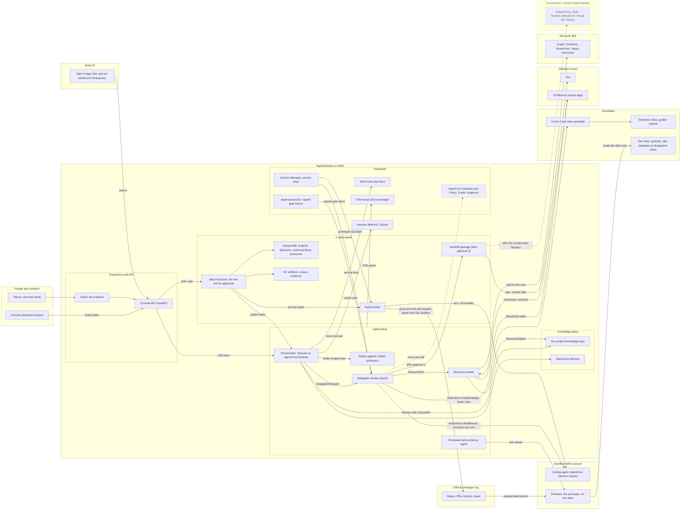

# HyperDelivery platform architecture for UA-DLC

How HyperDelivery grows from the EDM pilot into a platform: first a Final MVP that pilot users try
on real work, then hardened in Enterprise so several departments can rely on it. The summary and
phases are in [enterprise-plan.md](enterprise-plan.md); the process is in
[operating-model.md](operating-model.md); today's system is in [current-state.md](current-state.md).

Status: proposal, 2026-10-25, revised 2026-10-26 (where Step Functions fits, lessons from harness
engineering, and one coding lane: the AgentCore harness in HyperDelivery's sandbox account),
revised again the same day (re-phased into Current State, Final MVP and Enterprise, with one
architecture per phase) and for the Inception boundary (HyperDelivery builds prototypes in the
sandbox on dev data and ends every project with a handoff package; Construction is outside it). Designs marked "draft" are owned by the team named and are finalized in the phase shown.
Phases are HyperDelivery's own maturity (Current State, the Final MVP with its build and pilot,
Enterprise), not a project's target tier. Product status as of this date is in
[Dependency status](#15-dependency-status).

## The three architectures

The plan draws HyperDelivery once per phase; this document is the detail behind all three.

- **[Current State](enterprise-plan.md#phase-1-current-state)**, what runs on dev today. A React
  console and a FastAPI console API start a Step Functions line that waits on a person at three
  approvals; four station agents on AgentCore Runtime call Claude on Bedrock; projects and documents
  sit in DynamoDB and S3; Snowflake, Jira, Confluence and GitHub are reached with one person's
  tokens, and Copilot's coding agent opens a pull request per group of work. It stays as is for its
  current users while the Final MVP is built, and its gaps are in [current-state.md](current-state.md).
  In weeks 1 and 2 the baseline is measured and the long-lead requests start
  ([section 16](#16-external-teams-and-lead-times)).
- **[Final MVP](enterprise-plan.md#phase-2-final-mvp)**, what runs at MVP ready (week 14). The
  console API, the line, the data stores and Bedrock stay. Around them come one orchestrator that
  owns the chat; the delegation broker with typed contracts, the signed gate token and the
  do-no-harm write hook; service keys in Secrets Manager; the Cortex Code data specialist; the
  resource reader with a per-project index and AgentCore Memory; the coding agent, an AgentCore
  harness session in the sandbox account driven one piece at a time by a build worker; previews that
  read dev data only, and a prototype GitHub organization with scans; reviewers and the evidence
  agent; the handoff package after approval 3; traces and cost per project, shown but not enforced;
  the new console; Teams cards; and the project's Confluence page, published on request. The pilot
  (weeks 15 to 22) runs on it.
- **[Enterprise](enterprise-plan.md#phase-3-enterprise)**, what lands by Enterprise ready (week 36).
  Entra app roles and approval rules, on-behalf-of tokens, a GitHub App, Snowflake External OAuth
  and per-user Atlassian sign-in replace the service identities; AgentCore Policy checks every tool
  call; audit is immutable and forwarded to the SIEM; budgets are enforced per workspace from Admin;
  evals and the conformance suite gate CI and releases; HyperDelivery's own production environment
  with an SLO and on-call; a Construction intake agreed with engineering; then the Library,
  Portfolio, a second coding engine, Streamlit prototypes in a Snowflake sandbox, Rovo and Work IQ,
  and more departments. None of it is needed for the pilot, and none of it deploys a business app to
  production.

**Where HyperDelivery stops, in every phase.** HyperDelivery runs the first two UA-DLC phases.
Ideation ends at approval 1 with the Brief and a mockup. Inception ends at approval 3 with a working
prototype in the sandbox on dev data, and then the handoff package: a Jira epic with an issue per
ticket, AI-DLC context files checked with engineering's validator, the repository, the decision
chain, the evidence, what it skips, a dev-to-production data map and the target tier's Construction
checklist. Construction (engineering's Code, Review, Manual QA, Visual QA and Deploy, on production
data connections) and Operations (deployments, promotions and running) are outside HyperDelivery's
build. After approval 3 the Construction owner, the receiving engineering lead with the business
owner, records the Construction decision: AI-driven, AI-assisted with engineers, or not now. It is a
decision record, not a fourth approval, and engineering's own gates on push, merge and release apply
in both modes
([operating-model.md](operating-model.md#10-handoff-and-the-construction-decision)). Whether
HyperDelivery later adds an AI-driven Construction lane of its own is decided at the scale decision,
on handoff evidence; nothing in this document builds for it. How other AI-DLC products draw the same
boundary is in [research/dlc-landscape.md](research/dlc-landscape.md).

[What lands in which phase](#what-lands-in-which-phase) gives the same split area by area.

## How it connects

One assistant owns the conversation. Every specialist behind it crosses one trust boundary per call,
through a broker that holds the credentials, and every write with a side effect waits for a signed
approval. The diagram shows the Final MVP. The dashed Gateway and its line arrive in Enterprise;
the dashed grey Construction lane is outside HyperDelivery.



How to read it: people never talk to a specialist, only to HyperDelivery; the broker is the only
door out, and it gives each request a scoped credential (a service key from Secrets Manager in the
Final MVP, a credential minted for one call in Enterprise), a budget and a schema; the write hook
rejects every external write until the server records the authorizing approval as signed, and the
approval service's signed token is what unlocks repository creation, pushes and the start of a build
(approval 2) and the Jira filing at the handoff (approval 3); the coding agent runs in the sandbox
account and never reaches GitHub itself, because the build worker hands it Git bundles and pushes
the branch and its one pull request; previews, which are the prototype, read dev data only, while
discovery reads production metadata, counts and aggregates through the broker, never rows;
pointed resources land in that project's knowledge base, while signed decisions and confirmed facts
stay in DynamoDB; and the handoff package is HyperDelivery's last output, which Construction picks up
outside it. The interactive version is the "How HyperDelivery
Is Built" help page, opened from the "?" menu in the console's top bar
([ux-direction.md](ux-direction.md#architecture-canvas)): a Today, MVP and Enterprise switch, a
request replay, and each part's details in the side panel. It is not a project's Architecture tab,
which shows that project's own solution architecture, with HyperDelivery outside it as the builder.

## 1. What we keep and what changes

**Keep:**

- The gates are the product. Every station that writes outside the conversation has a human
  approval after it. A build's pull request, one per project build with a commit per piece, merges
  into the prototype repository only after its checks pass; nothing deploys beyond the sandbox, and
  nothing merges into a repository HyperDelivery did not create.
- Completeness is computed by the server from the stored artifact, not taken from the agent.
- The provider/tool split: generic clients carry no policy; per-agent least privilege lives in
  `src/tools/`. No agent holds the merge client. The delegation broker is a `tools/` policy wrapper
  over generic `providers/` clients, so it follows the same split.
- Step Functions durable waits and an agent built per request.
- Decisions signed by the verified identity and written before the gate is released.
- Undo instead of confirmation dialogs (reframed below as a pending signature).

**Change:**

- **Production work leaves HyperDelivery.** Today approval 3 would merge the build's pull requests,
  and earlier plans had HyperDelivery put T1 apps live, operate them and graduate them. From the
  Final MVP every project ends at approval 3 with a prototype in the sandbox on dev data and a
  handoff package; Construction and Operations stay with engineering and UA's existing change
  process, and the Construction decision is recorded, not built.
- **Writes before approval.** Today Blueprint creates repositories and Jira issues before approval
  2, and Review files issues, assigns Copilot and opens pull requests before approval 3, with only
  the prompt as a guard. The do-no-harm floor in the Final MVP moves repositories into a dedicated
  prototype organization and adds a before-tool-call hook that rejects every external write until
  the server records the authorizing approval as signed; Enterprise re-implements that rule as
  AgentCore Policy on the Gateway.
- **Shared credentials** (a classic GitHub token, a static Atlassian token, a personal Snowflake
  token) move into Secrets Manager in the Final MVP, are scoped to the prototype organization and
  the delegation broker, and are replaced by per-user and per-service identities in the Enterprise
  phase. The model never sees any of them, from the Final MVP on.
- **Station agents as chat personas** become artifact producers behind one orchestrator, which owns
  the main chat (section 2). The `Station` enum does not change.
- **One global agent-instructions note** that anyone signed in can edit becomes editable only by
  the platform team under the do-no-harm floor, then layered org, workspace and project context in
  the Final MVP. Until Enterprise, pilot users are an invite-only group.
- **Roles stored in the browser** become Entra app roles enforced on the server (Enterprise).
- **Uploads as the only way in** become pointing: paste a Teams recording, a OneDrive folder, a Jira
  ticket or a Confluence page, and HyperDelivery reads it as you and indexes it for the project
  (section 11).
- **A preview on one machine** becomes hosted, isolated, expiring previews in the sandbox account,
  reading dev data only.
- **Per-issue autopilot pull requests** (Review assigns GitHub Copilot's cloud agent one issue per
  group of work, and each returns its own pull request) become one coding-agent session per project
  build, running in the sandbox account, with the whole signed plan in its workspace (section 9).
- **"No speculative infrastructure"** still holds. Each phase builds what the next one needs, and
  enterprise controls arrive when the product has earned them, not before.

### What lands in which phase

Enterprise controls belong in the Enterprise phase unless they are part of the do-no-harm floor.
Every Enterprise item is requested in week 1 through the long-lead track, so hardening never waits
on other teams, and none of them is a precondition for the pilot.

| Area | Current State (today) | Final MVP (build W1 to W14, pilot W15 to W22) | Enterprise (hardening W23 to W36, rollout from W37) |
|---|---|---|---|
| Lifecycle scope | Four stations from intake to a Showroom demo; approval 3 would merge the build's pull requests | Ideation and Inception: a mockup signed at approval 1, a working prototype in the sandbox on dev data signed at approval 3, then the handoff package (Jira epic and issues, AI-DLC context files, repository, decision chain, evidence, what it skips, dev-to-production data map, target-tier Construction checklist) and a recorded Construction decision | A Construction intake agreed with engineering; Construction and Operations stay outside HyperDelivery unless the scale decision says otherwise |
| Identity | Entra sign-in with an ID token and no roles; one person's GitHub, Atlassian and Snowflake tokens act for every user, the Snowflake token in a plain environment variable | Entra sign-in, invite-only friendly and pilot users; remaining personal tokens in Secrets Manager, scoped to the prototype organization; a dedicated Snowflake service user with a grant-limited read-only role replaces the personal Snowflake token; pointed Microsoft 365 files read with the pointing person's delegated token and refreshed when they next open the project | App roles and approval rules per target tier; on-behalf-of per step; GitHub App installation tokens for every push and pull request; Snowflake External OAuth; per-user Atlassian sign-in; credentials minted per call for the acting user; the AgentCore Identity vault for background refresh; no individual tokens |
| Data access | Distill asks a Cortex Agent for raw rows, unscoped when no database or schema is set; results land in the turn with no query id | Snowflake only through the broker and Cortex Code, as the service user; per-task token exchange layered on once Snowflake confirms it; discovery reads metadata, counts and aggregates from approved views, never rows; prototypes read dev data only (synthetic, a dev database or designated views); measured in the pilot | Reference-design roles; aggregation and masking policies for agents; Cortex budgets; a named Cortex Agent for answers; Streamlit prototypes in a sandbox schema on dev data |
| Delegation and coding | Four station agents as chat personas; Review hands each group of work to Copilot's coding agent, one pull request per group; a harness build on an unmerged branch | Orchestrator owns the chat; broker and contracts, with `done_when` on delegations and a fix line in every rejection; drift and coverage from the broker; Cortex Code; the coding agent as one AgentCore harness session per build in the sandbox account, behind the `Builder` port, passing conformance suite v1; resource reader; reviewers and the evidence agent; the scope check in shadow from friendly users (W8), blocking from MVP ready; a span per delegation, shown in the trace view; golden-path lints and a short `AGENTS.md` map in each generated repository | Specialists behind Gateway targets, with policies on every tool that writes; a second coding engine behind the `Builder` port, chosen by the conformance suite; a build preview the builder can observe; Rovo and Work IQ questions; AgentCore Evaluations on build traces; conformance suite in CI; required scans on every repository |
| Resources and collaboration | Uploads only; Jira and Confluence through the community `mcp-atlassian` server and one API token; no index; one global context note | Paste-a-link: OneDrive and SharePoint as the person who pointed; Jira and Confluence through an allowlisted service token; files labeled above Internal not indexed; transcripts only after the interim Privacy and Legal scope, and meeting links once admin consent and the transcript tenant control are in place; per-project index; one Confluence page per project, published on the requester's explicit action and polled; Teams cards and Inbox; Confluence comments and revisions feed Confirm what we heard | Rovo MCP service account; project SharePoint site; Forge events; workspace index; per-reader access re-check; Purview labels; retention and legal hold |
| Policy | The prompt is the only guard: Blueprint creates repositories and Jira issues before approval 2, and Review opens pull requests before approval 3; anyone signed in can approve their own request | The floor: in-process write hook, prototype organization, builds and previews outside the HyperDelivery account; harness hooks on writes to protected files | Dogwood rules replayed against real traces in CI, then AgentCore Policy on every tool call; Verified Permissions for sharing |
| Telemetry, cost, evals | An OpenTelemetry provider with no exporter; plain-text logs; cost recorded only on successful turns, with no rollups or budgets | Traces to CloudWatch; cost per project including Snowflake credits and each build session's model and Runtime cost, shown but not enforced, apart from a dollar cap per build session; deterministic approval preconditions; receipt fields per unit and approval; in the pilot, user feedback and approvals rejected despite passing evidence become golden cases, harness causes join the failure taxonomy, and human corrections and cost per accepted outcome, questions per build, replaced microVMs and merge rate by piece size are reported, with build caps reset from the p90 of real builds | SIEM, Object Lock audit, budgets enforced per workspace and chargeback; golden intakes, evaluations and ablation gate CI |
| Running HyperDelivery | A five-minute invoker Lambda against ten-minute agent turns, with no retry or restart; full artifacts in the state payload; no point-in-time recovery; images pushed by hand; dev only | Async agent calls with task tokens; restart from a failed step; point-in-time recovery; a crash-and-resume test; a weekly release train and weekly doc gardening from the pilot | HyperDelivery production environment, SLO, on-call, tested restore; threat model and reviews signed |

## 2. The orchestrator and its specialists

### Shape

- **One voice.** The user talks to HyperDelivery. The orchestrator is today's per-request Strands
  agent, promoted to own the main chat: a platform-owned system prompt, station procedures as skills,
  thin read tools and a few delegation tools, with session state per project.
- **Split by context and trust domain, not by org chart.** One loop with skills usually beats a team
  of subagents; a split pays when the work needs little from the rest and returns a compact answer
  ([Anthropic](https://claude.com/resources/articles/building-agents-when-to-fold-subagents-into-your-main-agent-loop)).
  Snowflake work, coding, reading a two-hour recording and independent checking pass that test.
- **Station agents become artifact producers.** Distill (steps 1.1 to 2.2), Blueprint (2.3 to 2.5),
  Review (2.6 to 2.10, the prototype build) and Showroom (2.11, the handoff) keep their typed
  outputs, re-scored by the server and invoked at the gates; they stop being chat personas.
  Departments contribute skills and golden paths, not new agents.

### Roster

| Specialist | Engine | Crosses | Carries | In to out | Arrives |
|---|---|---|---|---|---|
| Orchestrator ("HyperDelivery") | Strands on AgentCore Runtime; Claude through Bedrock | Nothing | Nothing; asks the broker | Turns, memory to plan, delegations, decisions | Final MVP |
| Delegation broker (trusted code) | `tools/` wrapper over `providers/` clients | Holds service keys from Secrets Manager (Final MVP); mints per call (Enterprise) | Subject tokens, never passed on | `DelegationRequest` to `SpecialistResult` | Final MVP |
| Resource reader (context delegate) | Fresh-context Strands agent | AWS to Microsoft 365 and Atlassian | The pointer's delegated token, via the broker | `ResourceRef` to `ResourceDigest` | Final MVP |
| Cortex Code data specialist | Cortex Agents Coding Agent (discovery, profiling); a named Cortex Agent for answers (Enterprise) | AWS to Snowflake | The read-only service user's key (Final MVP; the per-task exchange once Snowflake confirms it); the user's role through External OAuth (Enterprise) | `DataTask` to `DataFindings` | Final MVP |
| Streamlit builder | Coding Agent with a mounted Snowflake workspace, behind the same `Builder` port | Sandbox schema on dev data only | Same, build role | `BuildUnit` (`runtime: sis`) to commit and manifest | Enterprise |
| Coding agent ("AgentCore harness, in the sandbox") | One AgentCore harness session per project build, behind the `Builder` port; Claude Sonnet 5.5 through Bedrock, set on each call. A second engine (a Claude Agent SDK image on AgentCore Runtime, or the Strands export) can replace it in the Enterprise phase | AWS to the sandbox AWS account, never the account that runs HyperDelivery; nothing in the sandbox reaches GitHub | None: Bedrock through the session's execution role; the API worker holds the GitHub credential and runs Git | `BuildUnit` to `BuildResult`, one piece per turn | Final MVP |
| Reviewers and evidence agent | Fresh context, read-only; Playwright against the preview | The preview, as a test viewer | Read-only; a test identity | Artifact to `Findings` and evidence | Final MVP |
| Atlassian and Microsoft 365 delegates | Rovo A2A and Work IQ A2A for questions; Rovo MCP for gated writes; the Teams bot | AWS to Atlassian, Microsoft 365 | User OAuth or on-behalf-of; a service account for writes at the handoff, after approval 3 | Question to cited answer; cards | Teams bot: Final MVP; Rovo, Work IQ and Rovo MCP: Enterprise |
| Prototype lifecycle monitor | Scheduled job | Sandboxes and previews | Read-only telemetry | Expiry, idle time and cost of prototypes | Enterprise (until then, the platform team) |

Which agent owns each step of the line, with that step's inputs and outputs, is in
[operating-model.md](operating-model.md#inputs-and-outputs-step-by-step); where each artifact is
stored and shown is in its [How artifacts are shown](operating-model.md#how-artifacts-are-shown)
table.

Checks keep their blocking rules; only their owners change:

| Check | Where | Runs as | Advises or blocks |
|---|---|---|---|
| Intake triage, context curation | Intake, Research | Orchestrator skill; resource reader | Advises; people confirm |
| Brief critic | Before approval 1 | Reviewer | Advises |
| System mapper | Tech Design (opted-in repositories) | Reviewer | The owning team approves the map |
| Architecture and data reviewer | Before approval 2 | Reviewer, with the data specialist | Per the signer matrix (operating-model.md section 4): blocks for a T2 target at High risk |
| Security reviewer | Approvals 2 and 3 | Reviewer, after deterministic scans | Blocks on confirmed findings at every tier; a full security review also blocks at High risk |
| Code review finders and verifier | Before approval 3 | Reviewers | Each finding answered |
| Scope check | Each `BuildResult`, after the deterministic checks | Fresh-context reviewer comparing the diff with its signed `BuildUnit` and criteria | Shadow from friendly users (W8); blocks from MVP ready |
| Evidence and numbers check | Before approval 3 | Evidence agent, with the data specialist | Produces evidence; on dev data it says "definitions match; numbers not checked on dev data" rather than claiming the numbers match |
| Accessibility checker | Before approval 3 | Reviewer | Per the signer matrix: blocks for a T2 target at Medium and High risk |
| Demo producer, handoff packager | Handoff (2.11), after approval 3 | Orchestrator skills; context files checked with engineering's validator | Produce artifacts; a context file that fails the validator holds the package |

- **"Confirmed"** means reproduced by a deterministic tool or accepted by the platform engineer on
  duty (until the Enterprise phase creates on-call, the plan owner in business hours). The business owner sees
  only "Blocked by a security check; platform team notified; expected by [date]".
- **Loop budgets:** 2 check rounds (the session's own tests, then CI on the pushed branch) and 3
  review rounds, then escalation in plain language. Two practices from OpenAI's harness write-up
  are deliberately not adopted: looping until every agent reviewer is satisfied, and agents merging
  their own work behind minimal gates
  ([research](research/harness-engineering.md#7-not-adopted)).
- **Deterministic first:** scans and validators block; LLM reviewers add to them, never replace
  them. New reviewers start in shadow mode; automated approvals are sampled.
- **The scope check makes approval 2 binding in the code.** It extends `touchpoint_drift` from files
  to behavior: a refactor, a disabled test or an extra feature outside the signed unit gets one
  course-correction inside the loop budget, then escalates. Veto and recovery rates are reported.
  Spotify's equivalent judge vetoes about a quarter of sessions, half of them recover, and the most
  common trigger is the agent going outside its instructions
  ([research](research/factory-sources-round4.md)).
- **Reviewers earn their place.** The verifier asks whether a finding is worth a person's time given
  the change, never what the model says its confidence is: Faire's confidence filter discarded 65% of
  comments for a 3% gain. Each reviewer's share of findings the author addressed, and its
  false-positive rate, are tracked; a reviewer that falls below its bar goes back to shadow mode.

### The delegation broker

The orchestrator decides *what* to delegate; the broker, trusted code in `src/tools/`, decides with
what authority:

1. **Scope comes from the server, never the model:** envelope, tier, allowed objects, knowledge base id.
2. **One credential per call.** For Snowflake, one token exchange per task with
   `act.sub = hyperdelivery/<project>/<station>/<task>`; the subject token never leaves the broker.
3. **A budget per call:** seconds, tokens, credits, statement timeout, check rounds, and dollars per
   build session.
4. **Validate what comes back.** Reject objects outside the envelope and groups below the minimum
   size; keep SQL and query ids, drop result sets; flag instruction-like text, because specialist
   output is untrusted input. The broker, not the specialist, decides `completed` or `partial`, by
   checking the request's `done_when` conditions, as the server already does for station artifacts
   ([research](research/harness-engineering.md#5-the-recommendations)).
5. **No side effects without a signed gate token.**
6. **Context packs, not credentials.** The coding sandbox gets a `context/` folder of cited excerpts;
   Cortex Code gets only the data-relevant ones; neither ever receives a Graph or Atlassian token.
7. **Write the span,** with cost.

**Every rejection says how to fix it.** Each rejection the platform owns carries a `remediation`
line written for the agent: the broker's grain and envelope checks ("return counts by country and
HTS chapter, not rows"), `touchpoint_drift`, the scope check, conformance failures and
`policy_refusals`. The next attempt inside the loop budget then repairs instead of guessing; OpenAI
writes its lint messages the same way. Enterprise adds the field to AgentCore Policy refusals on the
Gateway ([research](research/harness-engineering.md#5-the-recommendations)).

### Contracts

Contracts live in `src/core/domain/delegation.py` (proposed): Pydantic, framework-free, versioned,
exported as JSON Schema and mirrored in the console, with a drift test like
`tests/unit/test_protocol_constants.py`. Large payloads go to S3 and travel as references.

```yaml
DelegationRequest:
  delegation_id, project_id, station, decision_id, specialist   # specialist is an AgentName-style constant
  objective: str
  done_when: [str]                  # checkable conditions; the broker sets completed or partial from them
  resources: [jira:KEY, confluence:page@version, graph:driveItem, teams:recording, s3:key, snowflake:object]
  constraints: {tier, envelope_id, read_only: true}
  budget: {turns, usd, deadline}
  output_schema: {id, version}
  acting_identity, gate_token?, trace_context      # W3C trace context
SpecialistResult:
  status: completed | needs_input | partial | failed | refused
  summary: str                      # bounded
  payload: <typed by output_schema>
  evidence: [SourceRef]             # query id, page anchor, file and line, PR URL
  side_effects: []                  # empty unless a gate token was presented
  questions, usage, cost
  provenance: {specialist, prompt_version, model}
  policy_refusals: [{rule_id, description, remediation}]     # remediation is written for the agent

DataTask:
  kind: discover | profile | sample_synthetic | answer | validate_metric | build_sis_app
  question: str
  envelope: {envelope_id, tier, classification, allowed_objects, grain, min_group_size, rss, role}   # from the broker
  budget: {seconds: 600, tokens: 200000, credits: 2.0, statement_timeout_s: 120, warehouse}
DataFindings:                       # never rows
  status: ok | partial | refused | over_budget | error
  objects: [{name, kind, certified, owner, columns: [{name, type, null_rate?}], row_count}]
  aggregates: [{metric, grain, groups, suppressed_groups, values_ref}]
  sql: [{purpose, text, query_id}]
  gaps: [str]                       # missing objects; conflicts with certified definitions
  cost: {credits, tokens_in, tokens_out, duration_s, warehouse_seconds}

BuildUnit:                          # one piece of the signed plan; one harness turn
  unit_id, blueprint_version_hash, repo: {org, name, base_ref, branch}   # one hyperdelivery/<project> branch
  piece: {index, of, name}          # signed order; Layer 1 reads "Building piece 4: filters"
  goal, files: [FileTouchpoint], api_contracts: [ApiContract]
  acceptance: [{ac_id, given, when, then, test_id}], tests_in: [path]
  golden_path, data: {mode: synthetic_fixtures, schema_ref}    # no credentials, ever
  limits: {turn_min: 50, ci_rounds: 2, usd, egress}            # a turn at its cap continues in the next
  engine: {id, version, model_id}   # set by the server, never by the model
BuildResult:
  status: done | needs_input | failed | timed_out | over_budget
  question?                         # the ask_user question when status is needs_input
  commit: {sha, trailer}, pr: {url, number, head_sha}         # a commit per piece, one PR per build
  touchpoint_drift: {undeclared_files, untouched_declared}     # computed by the broker from the diff
  ac_coverage: [{ac_id, test_id, result}], tests: {passed, failed, skipped}   # from CI, not the session
  security: {code_scanning, secrets, dependencies}
  evidence: [{ac_id, screenshot_ref, recording_ref}]           # project evidence store, never the repo
  receipt: {engine, harness_version, image_digest, model_id, prompt_hash}
  cost: {tokens, usd_estimate, runtime_seconds, actions_minutes}

ResourceRef:
  resource_id, kind: drive_item | teams_meeting | teams_recording | loop | jira | confluence | file
  canonical_url, source_version, pointed_by, label
ResourceDigest:
  status: indexed | snapshot | stale | access_lost | blocked_by_tenant
  statements: [{text, speaker?, ref: SourceRef}]
  decisions, questions, people: [{name, role, account_ids}]
  chunks_indexed, gaps

Findings:
  reviewer, summary
  items: [{id, severity, claim, evidence: SourceRef, confirmed_by: tool | engineer | null, blocks: bool}]

HandoffPackage:                     # assembled after approval 3; HyperDelivery's last output
  project_id, approval_3_decision_id, commit_sha, build_id
  decision_chain: [{decision_id, hash}]
  artifacts: {brief, mockup, plan, evidence, what_it_skips}      # S3 references
  repository: {org, name, ref}
  jira: {epic_key, issue_keys}
  context_files: [path]             # engineering's AI-DLC format, checked with its validator
  data_map: [{dev_source, production_source, certified_definition}]
  target_tier, construction_checklist: [str]
ConstructionDecision:               # a decision record, not a fourth approval
  mode: ai_driven | ai_assisted | not_now
  decided_by, default_from: {risk, target_tier}, rationale
```

Specialists start isolated, with no transcript, and fetch referenced resources with their own
least-privilege identity. `BuildUnit` extends the portable Blueprint contract the repo already has
(decision 2026-09-04) with acceptance tests and an evidence spec, and `touchpoint_drift` closes the
gap that decision left open.

**Engineering's formats at the boundary.** UA engineering's AI marketplace already defines a
research evidence-pack JSON Schema and AI-DLC context files (one per unit ticket, one per epic) that
its Jira-to-PR pipeline reads. HyperDelivery vendors both pinned to a commit rather than tracking
`main`, because they are young and not yet consistent: it mirrors the evidence pack in `core/domain/`
with a drift test like the one above, imports a research run someone points at, and checks its own
exports with engineering's dependency-free validator. For the handoff package (Final MVP) it emits
context files from `BuildUnit`, the decision records and the work graph; their `generated_by` value
needs engineering to accept HyperDelivery as a source, and the handoff format is agreed with
engineering on the long-lead track ([section 16](#16-external-teams-and-lead-times)). The package
lands where engineering's Construction tooling starts: its Jira-to-PR pipeline reads the context
files either with an engineer approving the plan (AI-assisted) or with `--require-context`, trusting
the plan signed at approval 2 as the approved design (AI-driven), which engineering has to confirm.
Fixes go upstream, not into a fork
([research](research/ua-marketplace-alignment.md#4-what-to-reuse-or-interoperate-with)).

### Transports behind one port

A `Specialist` port has `run()` for short work and `start`, `get`, `update` and `cancel` for long
work. Adapters in `providers/`: an in-process Strands agent wrapped as a tool (Final MVP); the
Cortex Agents REST API, with the Cortex Agent SDK as an optional client (Final MVP); an AgentCore
harness adapter behind the `Builder` port, the coding agent's narrower form of the same port (Final
MVP, section 9); and, in the Enterprise phase, a separate AgentCore Runtime per credential domain
reached through the Gateway as an MCP target, so one Cedar and Dogwood policy covers every call.

**Long work never blocks the chat.** The delegation starts, Step Functions waits on a task token,
the result lands in the project timeline, and the orchestrator picks it up on the next turn or posts
in Teams. A single Snowflake table listing took about 117 seconds in the repo (decision 2026-08-29).
**Each delegation is an `invoke_agent` span** with specialist, status, retries and cost, linked to
its parent: the trace view's agent lanes, delegation connectors and failure markers come from it.

### Policy layers for every write

| Layer | What it is | Arrives |
|---|---|---|
| Floor | A Strands intervention (before-tool-call hook with the Cedar handler) in the agent's process: a floor, never a wall | Final MVP |
| Key | A service identity only a signed gate token unlocks, checked in the broker, then in a Gateway interceptor | Final MVP, Enterprise |
| Wall | AgentCore Policy on every Gateway tool call: Cedar plus Dogwood temporal rules, outside the agent's process | Enterprise |

The first Dogwood rules: at most N Jira writes per session; no push unless tests passed since the
last change; no outbound call after a restricted read. Count requests, not responses, and let trusted
code set the policy session id. Dogwood never replaces the human gates: its windows cap at 24 hours
and its session id is caller-supplied.

### Strands, not LangGraph, for now

Stay on Strands through the Enterprise phase. The code already builds per-request agents with structured output
and hooks, Strands is AgentCore-native, and interventions, Cedar, interrupts and delegate mode cover
the orchestrator. LangGraph's main advantage, human-in-the-loop that resumes from saved
checkpoints, already lives one layer up in Step Functions and the signed decision record. Revisit
if the in-session plan must resume mid-run after a crash, if long-running specialists need steering
Strands cannot express, if Strands lags on a standard that matters (it still pins the A2A 0.3 SDK),
or if the team standardizes on LangSmith. Even then, start with one specialist on its own runtime behind the same contract.

Keep it framework-agnostic: no framework types in `core/`; MCP `outputSchema` as the default wire;
OTel GenAI conventions for traces; a conformance suite every adapter passes; prompts, skills and
golden evaluations stored as data.

### Why Step Functions stays, and where LangGraph would fit

Step Functions and an agent framework do different jobs, so this is not a choice of one or the
other.

- **Step Functions is the spine that holds each project across days.** Each project is one standard
  execution of the line's state machine (`infra/stacks/orchestration_stack.py`), which can wait up
  to a year. At every approval it parks the project on a task token saved to the project's record.
  When someone signs the approval in the console, the console API resumes the project, or ends it on
  a rejection (`src/infrastructure/messaging/step_functions.py`). It retries and times out steps
  (the Final MVP adds heartbeats on long agent calls and restart from the failed step, section 12) and
  keeps every project's execution history. No model sits in that loop, so the gates are enforced
  outside any agent: no prompt, tool call or crashed session can release one.
- **Strands is the reasoning inside each step.** The orchestrator and the specialists are Strands
  agents. They read, plan, call tools and draft for minutes at a time; a project lives for weeks and
  spends most of them waiting on people.
- **LangGraph would replace Strands, not Step Functions.** LangGraph, and LangChain beneath it, are
  frameworks for the reasoning inside a step: graphs of model and tool calls with saved checkpoints.
  Using LangGraph for the gates would move the approval record into a framework checkpoint store
  inside the agent's runtime, next to the model. The plan keeps signatures in the decision record,
  released by code no model drives. LangChain alone adds model and tool wrappers the code already
  gets from Strands and Bedrock.
- **Where the boundary sits.** Step Functions owns the line's steps, its approvals and long waits on
  outside work, such as a delegation to Cortex Code, a build the coding agent works through one
  piece at a time, and each sandbox's lifecycle (section 9). It does not own what happens inside a step, such as which tool to call next or when to
  ask a question. That stays with the agent.
- **When to revisit.** The triggers are listed in
  [Strands, not LangGraph, for now](#strands-not-langgraph-for-now). Any of them would bring
  LangGraph in for one specialist behind the same contract, and Step Functions would not change.
  Hosting the orchestrator on Claude Managed Agents is not adopted either: it runs on the Claude
  Platform, and the plan routes Claude through Bedrock.

**What harness engineering adds.** The harness-engineering sources split an agent system into the
model, its tools and an append-only history, so each can fail or be replaced alone. In
HyperDelivery, Step Functions and DynamoDB are that history and the controller that runs across
days; moving the line into LangGraph checkpoints would put the history back inside the agent's
process. Two Final MVP additions follow
([research](research/harness-engineering.md#5-the-recommendations)):

- a resilience test that kills the orchestrator mid-turn and shows the next turn resumes from the
  project's record with no lost decision;
- an orchestrator tool that rereads the project's turn and decision log by position (for example,
  "everything since decision D-2"), so an AgentCore Memory summary is never the only way back to
  what someone said.

### Strands Box and Dogwood

- **Strands Box** ([launch post](https://aws.amazon.com/blogs/opensource/introducing-strands-box-ai-agent-sandboxes-powered-by-dogwood/),
  [repo](https://github.com/strands-agents/box)) pairs operating-system containment with Dogwood
  policy over every shell command, file, HTTP request and MCP call. It is a v0.1.0 developer preview
  (7 Oct 2026), stable on macOS only, and a local sandbox; AWS's own guidance for cloud use is to run
  it inside a per-session microVM. **Watch it; do not adopt it yet.**
- **Dogwood** is Cedar plus temporal clauses over the history of tool calls, and AgentCore Policy
  now runs it on Gateway tool calls (log-only mode supported). **Use it from the Enterprise phase.**
- **Six lessons the threat model adopts:** enforce outside the agent's process; the agent never
  holds a secret; a credential binding is not an authorization; whatever shares a sandbox shares its
  credentials, so each credential domain gets its own runtime session and IAM role; deny cloud
  metadata endpoints explicitly; record every decision with the rule that made it.
- **Sequence:** in the Enterprise phase, first replay real traces through the three rules with the
  `dogwood` CLI in CI, and offer Box to engineers running coding agents on their Macs; then AgentCore
  Policy in log-only, then enforcing. Later, Box inside an AgentCore session for a self-built coding sandbox,
  with the microVM as the hard boundary.

## 3. Identity for each step

Draft, owned by the security architect, decided in the Enterprise phase. Until then the do-no-harm
floor applies: pilot users sign in with Entra, remaining personal tokens live in Secrets Manager and are scoped to the
prototype organization, and Snowflake reads go through the broker as a dedicated Snowflake service
user (key-pair or workload identity) holding only a grant-limited read-only role, with `QUERY_TAG`
carrying user and project. The per-task token exchange described in section 6 is layered on once
Snowflake confirms it. Either way the model never holds a token.

| Step | Interactive? | Reads as | Writes as | Token source |
|---|---|---|---|---|
| Intake to Stories (console or Teams) | Yes | The user (Entra on-behalf-of through AgentCore Identity) | None | The user's session |
| Pointed resources | Either | The pointing user; background refresh from the vault, marked "access lost" on a refused refresh | None | Session, then vault |
| Cortex Code delegations | Either | The user's workspace role, through a per-task token exchange with a Restricted Session Scope and `act` type agent; a `SERVICE_AGENT` user only for unattended work with no human principal | The project's sandbox schema only (section 7) | Broker |
| Agent work after an approval (Tech Design onward), often days later | No | The approver who released the gate, on a delegated token held in the AgentCore Identity vault and expiring with the project | Not applicable | Vault |
| Repository creation, pushes, Jira writes | No | n/a | A service identity unlocked only by a signed gate token | Approval service |
| Coding agent builds | No | n/a | Nothing from the sandbox: Git crosses its boundary as bundles, and the API worker pushes and opens the pull request, with the prototype organization's fine-grained token (Final MVP), then a GitHub App installation token minted for one hour and limited to that repository and to contents and pull-request permissions (Enterprise). No Copilot seat is needed, because the model never touches GitHub | Approval service; Secrets Manager |
| Teammates with no Snowflake user | Yes | Catalog metadata and dev data only, unless provisioned | None | n/a |

Gate tokens are signed by the approval service and verified in the broker from the Final MVP and in
a Gateway interceptor from the Enterprise phase, because Cedar policies are stateless and the agent must not be
able to supply its own gate state.

## 4. Authorization and approvals

- **Coarse access in Entra** (Enterprise). "Assignment required" on the enterprise app. App roles:
  Builder, Viewer, Contributor, Data Owner, Data Steward, Engineering Reviewer, Governance Admin,
  Platform Admin, assigned through security groups. Contributor goes to every teammate through a
  dynamic group, so anyone can answer a question or join a project. Raw group claims are never used
  for authorization (Entra drops them past 200 groups). Until Enterprise, an invite-only group of pilot users.
- **Fine-grained access in Cedar** through Amazon Verified Permissions (Enterprise). Entities: Org,
  Workspace, Project, Artifact, Session, Fact, Connection, Resource. Project roles: Owner, Editor,
  Contributor, Viewer, plus approver relations per gate and a definitions-reviewer relation for
  stewards. Conditions on target tier, classification and department. Templates power "Share with a group".
- **The same Cedar for agents.** AgentCore Policy evaluates every Gateway tool call, deny by
  default. That needs every tool to be a Gateway target, so the community `mcp-atlassian` stdio
  server moves to Atlassian's remote Rovo MCP server first (Enterprise).
- **Approvals as signatures.** The decision records signer, role, time, document version and hash,
  the prompt and model versions, the authentication method and the policy decision. The 12-second
  window is a *pending* signature ("Signing in 12s · Undo"); the record commits and the gate releases
  when it ends. After that, "Withdraw approval" writes a new record. Later edits show as "N changes
  since approval", and re-approval reviews only the changes.
- **Teams is where people are asked; signing happens where the evidence is.** Questions are
  answered inside the Teams card. An approval card is a notification whose primary action opens the
  evidence (a Teams tab, task module or the console) where the signature, and any strong sign-in,
  happens. The card then refreshes into a receipt everyone in the chat can see. A reply such as
  "looks good" in chat or Teams is never read as an approval; only the signed control counts, as in
  engineering's own pipeline.

## 5. Workspaces and tenancy

- **Org** is UA's Entra tenant: org policies, the model allowlist, golden paths, org context.
- **Workspace** is a business domain or team. It is the cost center, the workspace context layer,
  the workspace knowledge base, and the **data envelope**: the Snowflake workspace roles, SharePoint
  sites, Jira projects and GitHub organization it may use. A data owner pre-approves the envelope
  once (for example, "Merchandising: sell-through and the margin golden report, aggregated and
  read-only for discovery; the dev sell-through database for prototypes"), so projects inside it
  need no per-project sign-off.
- **Project** has members and cross-workspace guests, its own knowledge base, its own memory
  namespace and its own Confluence page (section 11). Joining a project that carries confidential
  data needs data owner approval for that member, guests included.

Workspace and project roles, schemas and grants in Snowflake are provisioned by data platform's
infrastructure-as-code from requests HyperDelivery generates. HyperDelivery holds no role-creation
or grant privileges.

**Open by default? Decide before the pilot.** Shopify's agent works only in public channels, because
the searchable record is what compounds; a private project teaches only the people in it. The
proposal: each project's Brief, decisions and status (not quoted source text) are discoverable across
its workspace (in the Final MVP, across the pilot's users), so others can find it, comment and join as "one
more voice". Sources, data and previews stay membership-gated as the prototype contract says. A private
project is an explicit, logged choice, and the default for People and Finance. Privacy and the works
council are asked first for EMEA ([research](research/factory-sources-round4.md)).

## 6. Snowflake access model and the Streamlit in Snowflake golden path

Draft. Data platform owns the reference design, produced on the long-lead track (weeks 4 to 12) and
adopted in the Enterprise phase. The Final MVP fixes below do not wait for it.

### Today's integration, and the Final MVP fixes

Today one tool, `snowflake_query`, attached to Distill, calls the Cortex Agents run endpoint with
`code_toolset_all`. It breaks the plan's data rules five ways:

| Problem | Where | Final MVP fix |
|---|---|---|
| A personal access token in a plaintext environment variable | `config/settings.py`, `scripts/deploy_agent.sh` | A dedicated Snowflake service user with a grant-limited read-only role, its key in Secrets Manager; per-task exchange once confirmed; the model never sees a credential |
| The system prompt asks for "the raw data ... one row per line" | `tools/snowflake.py` | "Never return rows; return schema, counts and aggregates at the stated grain"; the broker rejects row-level output |
| Unscoped when no database or schema is set | `tools/snowflake.py` | Database and schema required; envelope from the workspace record |
| `always_allow`, web search and every bundled skill on | `providers/storage/snowflake.py` | `always_ask` answered by the broker; unneeded skills disabled; `orchestration.budget` set |
| Results returned into the turn, with no query id or credits | `stream_agent` reads only text | Parse tool use and tool results for SQL and query ids; store those and the credits, never result sets |

### The Cortex Code data specialist: re-scoped, not retired

The earlier plan retired the Cortex coding-agent path. Since 2026-08-26 the endpoint the repo already
calls is a generally available product, the Cortex Agents Coding Agent, on the same runtime as Cortex
Code (CoCo), and Snowflake has shipped the controls containment needs. So the path is **re-scoped as
the data specialist** the orchestrator hands Snowflake work to: discovery, profiling, drafting and
checking SQL, and the numbers check. It returns `DataFindings`, only what the session needs. A named
Cortex Agent over the envelope's semantic views, behind Snowflake's managed MCP server, answers
business questions from the Enterprise phase. Work a person can do alone in Snowflake goes to CoCo or CoWork
directly, and `SYSTEM_EXECUTE_SQL` stays off.

**Sampling,** which the owner asked for, means profiles (null rates, distinct counts and value
distributions at the envelope's grain) and schema-shaped synthetic samples generated inside Snowflake.
Real sample rows never leave Snowflake under the floor; whether synthetic samples are enough for every
project is an open question to settle with pilot users.

| Control | Mechanism |
|---|---|
| Role | The workspace role, named in the token exchange; allowed-roles list; secondary roles off |
| Privilege ceiling | Restricted Session Scope (GA 2026-09-03): reads on envelope schemas, object discovery, writes only to the sandbox schema; bound to each token, with an admin session policy as a backstop |
| Grain | Secure views at the envelope's grain, plus aggregation policies that apply when an agent is asking, so Snowflake itself refuses row-level agent queries |
| Compute and spend | Per-workspace warehouse and statement timeout; run budget in seconds and tokens; Cortex resource budgets (warehouse monitors do not cover Cortex Code) |
| Tool approvals | `always_ask`, answered by the broker's policy; instructions are advisory, never the control |

**Identity.** In the Final MVP the broker calls Snowflake as the dedicated service user above. Once
Snowflake confirms token exchange (and from the Enterprise phase with External OAuth), the broker exchanges the
user's credential for a token with the workspace role, the scope and `act` type agent. It runs as the user, lasts one hour, cannot be refreshed or re-exchanged,
and is labeled as an agent in Snowflake's query and access history. Snowflake does not authenticate
the caller of the exchange, so the subject token never reaches an agent. Agent-aware policies apply
only to agent sessions (Cortex Agents, the managed MCP server, an `IS_AGENTIC` OAuth integration,
token exchange with `act`, or a `SERVICE_AGENT` user), never to plain SQL from our own code. The
exchange's release status is confirmed with the account team before the Final MVP relies on it.

**Two kinds of read.** Discovery and the numbers check read production metadata, counts and
aggregates through the broker, never rows, so the Brief and the plan can cite certified definitions;
from the Enterprise phase they read with the user's own role (secure views with aggregation policies,
and data-owner-approved grants where the envelope needs them). The prototype itself connects only to
dev data: synthetic data, a dev Snowflake database, or views data platform designates as dev data
(what counts is agreed with data platform before the pilot,
[section 16](#16-external-teams-and-lead-times)). Delegations are asynchronous, and their credits
flow into the project's cost view. Cortex Code needs cross-region inference, checked against the
EMEA rule before any EMEA workspace.

**Reference design (Enterprise):** External OAuth through a dedicated HyperDelivery Entra client with
`IS_AGENTIC = TRUE`, so its sessions are distinct in `LOGIN_HISTORY`; one Entra scope per workspace
role, with project isolation inside Snowflake through row access policies or per-project secure
views; `EXTERNAL_OAUTH_ANY_ROLE_MODE = DISABLE`, allowed roles limited to HyperDelivery workspace
roles, `OAUTH_USE_SECONDARY_ROLES = NONE`; agents see the intersection of the project's approved data
and the member's entitlement; no free-form SQL tool for agents. Teammates with no Snowflake user work
from metadata and dev data; whether to SCIM-provision workspace audiences is an Enterprise decision
for data platform and identity. Data platform grants the platform role a scoped privilege to pause a
prototype (revoke `USAGE`, suspend the compute pool and warehouse) on HyperDelivery's sandbox schemas
only; production apps databases belong to Construction and Operations.

### Streamlit in Snowflake golden path

Co-signed by data platform. Inside HyperDelivery a Streamlit prototype lives in the project's sandbox
schema on dev data; deploying a production app is Construction's. The production rules still ship as
lints from the first build, so a handoff needs no rewrite.

In HyperDelivery's sandbox:

- Sandbox schemas get no grants outside the project, read only dev data, are tagged with target
  tier, project and expiry, and stay out of the catalog. On expiry, roles, grants, schemas, compute
  pools and app objects are removed through data platform's provisioning pipeline.
- Packages from the Snowflake Anaconda channel or an approved artifact repository only.
- The path's rules also ship as lints and structural tests in each generated repository
  (section 10), so the coding agent meets them as failing checks, not only as instructions.

In Construction (outside HyperDelivery; listed so the handoff package's checklist can name them):

- Apps are owned by a functional app role scoped to exactly what the audience may see, never by a
  project role with broader grants. Restricted caller's rights for row-secured data (generally
  available since 2026-06-01).
- The audience is an Entra group SCIM-synced to a Snowflake role.
- Shared compute pools per workspace with auto-suspend, and a query warehouse with a resource
  monitor.
- Deploys use the Snowflake CLI from CI under a key-pair or workload-identity deploy user, into an
  apps database per workspace.
- Every production data app built for a T1 or higher target is registered as a dbt exposure and a
  catalog consumer of its sources, so upstream changes reach data platform's change process.

**Delegating the build** (Enterprise): Blueprint marks the unit `runtime: sis`; one Coding Agent run
works in a project Snowflake workspace mounted from the prototype repository, under the build role
(never an app role), with a scope that allows dev-data reads and object management only in the
sandbox schema. It builds a Streamlit prototype there and returns a commit, the manifest, SQL with
query ids and tests; the evidence agent opens the prototype as a test viewer. Deploying it to a
workspace apps database is Construction's, from the handoff package. Snowflake App Runtime (Next.js,
GA 2026-09-01) is a second in-Snowflake golden path to evaluate.

## 7. Data handling: rows stay in Snowflake

Agents reason over metadata, definitions and aggregates. Row-level data is never stored outside
Snowflake:

| Surface | Rule |
|---|---|
| Agent prompts | Schema, counts and aggregates no finer than the grain the data envelope states |
| Specialist results | `DataFindings` only: objects, aggregates at or above the grain, SQL and query ids; the broker rejects anything finer |
| Turn records | Snowflake results never stored; the Snowflake query id is stored instead |
| Traces and logs | Data-bearing spans record object names, query id, role, warehouse, row count, bytes scanned and duration, never payloads |
| Bedrock model invocation logs | Off for data-bearing turns, or retained briefly with KMS and read-audit |
| S3 project corpus and knowledge base | Documents, pages and transcripts only, never extracts |
| AgentCore Memory | Conversation and proposed facts only, never query results |
| Generated repositories | No extracted data; fixtures generated from schema; push protection and PII scanning |
| Previews | Read dev data only, as the viewer or under the prototype's read-only role (section 9); no cached extracts on disk or S3 |
| Evidence screenshots and recordings | Taken on dev data only, kept in the project evidence store with KMS, the project's access policy and deletion at expiry; never in repositories or Teams cards |
| Third-party telemetry (for example Langfuse) | Never receives data-bearing spans |

Every Snowflake session sets `QUERY_TAG` with the app, project, station, delegation and decision ids,
so Snowflake's `ACCESS_HISTORY` joins to HyperDelivery's decision record. EMEA data is processed only
in Bedrock regions UA approves.

**Data in the sandbox, whatever the target tier:**

| Who reads | Snowflake objects |
|---|---|
| The prototype (previews, the evidence agent, testers) | Dev data only: synthetic data generated inside Snowflake from the governed source (tool availability to confirm) into a synthetic database, a dev Snowflake database, or views data platform designates as dev data; `CREATE` only in the project's sandbox schema. No production grants |
| Discovery and the numbers check (Cortex Code, through the broker) | Metadata, counts and aggregates from approved secure views at the envelope's grain, never rows |

The prototype contract in [operating-model.md](operating-model.md#the-prototype-contract) states
the same rule. What counts as dev data is agreed with data platform before the pilot
([section 16](#16-external-teams-and-lead-times)); until then, prototypes use synthetic data. Because
a prototype reads dev data, its evidence says "definitions match the golden report; numbers not
checked on dev data" rather than claiming the numbers match: a numbers check against a golden report
is often possible only in Construction, and the handoff package's data map says which sources it
needs there.

Zero-copy clones of production data are not dev data. They are made only by exception, with data
owner approval, an expiry and centrally placed policies: a clone is still a copy as far as
governance is concerned.

## 8. Telemetry and traces

**Backbone:** the OpenTelemetry GenAI semantic conventions (still at Development status) as the
contract, exported through the AWS OpenTelemetry distribution into AgentCore Observability and
CloudWatch, on from the Final MVP. Data stays in UA's accounts with per-agent log groups, KMS and IAM. A
self-hosted Langfuse is an optional second destination later, never for data-bearing spans.

**Contract:**

- The project id is the session id.
- One trace per station turn; no span stays open across a human gate, and the next station links
  to the previous one.
- Every span carries project, station, unit-of-work and decision ids.
- Every delegation is an `invoke_agent` span with the specialist, its brand key (for the logo), status,
  retries, cost and a link to its parent. Long delegations end with a span event when the result
  lands, so the trace shows the delegation and the return.
- Policy decisions carry the rule id and description, so a refusal shows as a failed step with its
  reason.
- Decisions are emitted as span events and stored in DynamoDB; evaluation results use the
  `gen_ai.evaluation.result` event.
- Layers 1 and 2 read the console's own DynamoDB projection, not CloudWatch.
- Specialist-side telemetry joins by id: Snowflake's agent traces and credit history join on
  `QUERY_TAG`; the coding agent's harness traces and token usage events join on the project id,
  from which its build session's id is derived.

**Views:**

- **Layer 1:** plain-language narration built from span types ("Checked 3 Confluence pages",
  "Looked up margin per door in Snowflake"), who is being waited on, requirement coverage (today's
  `TraceView`, kept).
- **Layer 2:** decision records with options, the recommendation, rationale, evidence and who chose;
  the decision timeline by person; delegation lanes; a ledger of every external side effect.
- **Layer 3:** the span tree and waterfall with agent lanes, tool and model marks, delegation
  connectors, failed and retry markers, the slowest step, tokens, cost rolled up per station and
  delegation, latency, errors and a CloudWatch deep link. Built from the MIT-licensed AgentPrism
  viewer (alpha; restyle from Tailwind 3 to v4), which already renders a span's brand as a logo.

**A receipt per unit and per approval.** Most of what a run should leave behind already exists
across the decision record, `BuildResult`, spans and `Assisted-by` trailers. One view assembles it
on the approval and in Layer 2, and the Final MVP adds four fields: the policy-set and golden-path
versions in force, the context sources the unit received, the number of human corrections
(point-and-say fixes, course corrections, send-backs) and a rollback point. From the pilot, human
corrections per accepted outcome are reported beside cost. The receipt of approval 3 travels in the
handoff package, so Construction starts from the signed commit and its evidence; rolling back a
production app is an Operations matter, outside HyperDelivery
([research](research/harness-engineering.md#5-the-recommendations)).

**Logging:** structured JSON with project, user and request correlation, retention policies, and
read-audit for content-bearing views (Enterprise, with SIEM forwarding).

## 9. Sandboxes and previews

| Tier | Choice | Notes |
|---|---|---|
| Build | One AgentCore harness session per project build in the sandbox AWS account, in VPC mode, with managed session storage | A Firecracker microVM per session, at most 2 vCPU and 8 GB, ended at 8 hours. Session storage is a preview (1 GB, wiped after 14 idle days and when the harness version changes), so Git, pushed after every piece, stays the source of truth. Where it runs is set out below |
| Web previews | ECS Express Mode, one preview per build branch, redeployed after each piece is pushed, torn down at merge, minimum zero tasks, with a "Wake preview" action that shows the cold start. The accepted prototype is pinned to the commit signed at approval 3 and kept for project members and named testers until the Construction decision plus 30 days (proposed) | One per build, as operating-model.md step 2.6 says, so the evidence agent checks the branch the pull request carries, outside the build session. App Runner is closed to new customers |
| Preview access | A shared auth sidecar that validates the ALB-signed Entra header and checks project membership or a named tester: against HyperDelivery's own project record in the Final MVP, and in Verified Permissions from the Enterprise phase | ALB sign-in alone cannot limit access to project members |
| Prototype data | Dev data only: synthetic data, a dev Snowflake database, or views data platform designates as dev data (section 7) | No prototype connects to production data; that starts in Construction |
| Data apps | Streamlit prototypes in a sandbox schema on dev data, from the Enterprise phase (section 6) | Production Streamlit in Snowflake apps are Construction's |
| Portable definition | A `devcontainer.json` in every generated repository | Engineers open the same environment at handoff |

### The coding agent: one lane, in the sandbox

There is one coding lane from the Final MVP: an AgentCore harness session in the sandbox AWS account,
never the account that runs HyperDelivery. The harness has been generally available since 18 June
2026: `CreateHarness` declares the model, tools, skills, memory and limits, `InvokeHarness` runs a
turn, and each session gets its own microVM with a filesystem and a shell, from our own image, with
no harness fee. The requirement is that the coding agent runs in a sandbox HyperDelivery defines,
not on another service's autopilot, so where it runs is a short list of settings HyperDelivery
owns, records on every build's receipt and tests
([research](research/agentcore-harness-coding.md#2-knowing-where-the-coding-agent-runs)):

| Question | Answer from the Final MVP |
|---|---|
| Account and Region | The sandbox AWS account in `us-east-1`; fallback, a named non-production account with no HyperDelivery resources or data credentials. HyperDelivery's build worker assumes a role there that can only invoke one harness endpoint and stop its sessions |
| Compute | One Firecracker microVM per project build session, at most 2 vCPU and 8 GB, replaced after an idle timeout (15 minutes by default) and ended at 8 hours |
| Software | The golden-path toolchain image (arm64, at most 2 GB) in the sandbox account's ECR, pinned by digest, running the agent as a non-root user, rebuilt on the 7-day patch rule (section 10) |
| Network | VPC mode with no internet route: endpoints for Bedrock, ECR and S3, and a package proxy. No route to GitHub |
| Identity inside | An execution role that can invoke one model, pull the image and write logs, nothing else, because the shell can reach the cloud metadata service |
| Credentials inside | None. Git crosses the boundary as bundles, and the API worker holds the GitHub credential |
| Version | A named `BUILD` harness endpoint pinned to a version and promoted only between builds; the model set on each call |
| Record | CloudWatch traces with payloads, command inputs in CloudWatch Logs, CloudTrail data events, and HyperDelivery's turn and cost ledger; synthetic data only, as `BuildUnit` requires |

- **One session per build, with the whole plan in its workspace (Final MVP).** The session works
  through the signed plan's pieces in order, one harness turn per piece, with the signed Brief,
  plan, decisions, data contract and the map below written into the workspace as files. After each
  piece it runs the tests and the preview build inside the microVM, and the piece is committed on
  `hyperdelivery/<project>` with an `Assisted-by:` trailer naming the engine, model, project and
  piece; one pull request per build carries a commit per piece. When two readings of the plan would
  build different things, the agent asks through an `ask_user` tool, the question goes to the person
  who can answer it, and the build waits. The API, not the model, clones, pushes and opens the pull
  request.
- **Why one session, not a pull request per issue.** Per-issue autopilot gives each issue its own
  session, branch and pull request: GitHub's cloud agent works in one repository and one branch per
  task and stops at 59 minutes, so piece 4 is built without seeing pieces 1 to 3, and integration,
  the full test run and the preview happen only after several pull requests merge. On 878 agent pull
  requests in `dotnet/runtime`, fully autonomous ones succeeded 55.1% of the time against 86.2% with
  a human commit; about half of the pull requests that passed SWE-bench's grader would not have been
  merged; and two reviewers wrote 36% of all human feedback, so one coherent review per build asks
  less of the scarcest people than one per issue. No study compares the two shapes head to head; the
  case rests on how they work and on these numbers
  ([research](research/agentcore-harness-coding.md#3-why-one-session-with-the-whole-plan-beats-per-issue-autopilot-pull-requests)).
- **A swappable engine behind one port.** The builder is a `Builder` port, `BuildUnit` in and
  `BuildResult` out (section 2). The harness is the default engine, with Claude Sonnet 5.5 through
  Bedrock set on each call. A second engine can replace it in the same sandbox and image without
  touching the line: a Claude Agent SDK image on AgentCore Runtime, when a hard dollar cap inside a
  turn or schema-checked output matters more than managed plumbing, or once harness export to the
  Claude Agent SDK ships; or the Strands export of the same harness configuration. Per-tool hooks are
  no longer a reason to switch, since the harness gained lifecycle hooks on 21 Sep 2026. The
  conformance suite below picks the second engine in the Enterprise phase
  ([research](research/agentcore-harness-coding.md#4-engine-comparison)).
- **Step Functions runs the build loop (Final MVP).** A build sub-machine prepares the workspace, then
  loops over the pieces in order. Each piece is one harness turn, run by a small Fargate build worker
  that Step Functions starts with `ecs:runTask.sync` and waits on. The worker holds the stream,
  relays it to the console, prices each usage event, and returns `done`, `needs_input`, `timed_out`
  or `over_budget`; `needs_input` parks the execution on a task token until the person answers, as
  approvals do. Streaming stops at 60 minutes, so a turn is capped at 50 and continues in the next if
  it reaches the cap. Neither a 15-minute Lambda nor the optimized `InvokeHarness` state runs builds:
  that state waits at most 15 minutes, returns only the final text without its tool calls (so an
  `ask_user` question cannot be read from it), and stopping the execution does not stop the harness.
- **No GitHub credential in the sandbox or its logs (Final MVP).** AgentCore writes each command's
  input to CloudWatch Logs, so a token in a command string is a token in the logs. The unmerged
  `coding_agent_harness_test` branch sends its token that way today: search the dev account's harness
  log group for `GIT_CONFIG_VALUE_0`, and rotate the token if it is there. Instead, the worker clones
  with its own credential and hands the session a Git bundle through a presigned URL that expires in
  minutes; after each piece the session streams a bundle back with Git hooks disabled
  (`-c core.hooksPath=/dev/null`), and the worker checks the commits and the diff, then pushes
  ([research](research/agentcore-harness-coding.md#7-the-token-in-the-command-logs-and-the-fix)).
- **Survive a replaced microVM (Final MVP).** Short-term AgentCore Memory, keyed to the project and
  with no long-term strategies so nothing crosses projects, reloads the conversation when an idle
  microVM is replaced. Each turn starts with a check and ends with a note: it reads the progress note
  and Git log and runs the build's existing end-to-end check before changing anything, and ends by
  updating that note on the branch (what was done, what failed, what is next), so a replaced microVM
  costs at most one piece and a retry continues instead of starting over
  ([research](research/harness-engineering.md#5-the-recommendations)).
- **A dollar budget per build session (Final MVP).** The harness caps iterations, time and tokens, not
  dollars. The worker prices each usage event from the model price table and stops the session when
  the project's build budget is spent, and a hook refuses a new turn once the ledger says the budget
  is gone. Defaults come from the p90 of real builds in the pilot. As an illustration, not a
  measurement, an 8-piece, 2-hour build on Sonnet 5.5 costs about $6, over 95% of it model tokens
  ([research](research/agentcore-harness-coding.md#9-cost-of-a-build)). The budget guards against a
  runaway session; it is not the workspace budgets enforced in the Enterprise phase.
- **Small pieces, instructions first (Final MVP).** On `dotnet/runtime`, agent pull requests of 1 to 50
  changed lines succeeded 76 to 80% of the time against 54.5% for performance work, and better
  instructions and setup, not new models, moved success from 38.1% to 69%. So pieces stay small and
  well specified, with architecture settled in Tech Design and signed at approval 2. The builder's
  instructions and setup (the harness system prompt and skills, the exact build and test commands,
  the package proxy's allowlist) are versioned with the golden path, bound in the decision record
  beside the prompt and model versions, and improved from failures before a model or engine is
  swapped. Plan for about one in three pieces needing a second pass, give a stuck piece a platform
  engineer's help rather than more autonomous retries, and report merge rate by piece size and kind
  ([research](research/factory-sources-round4.md)).
- **A map in every generated repository (Final MVP).** A short `AGENTS.md`, its size capped in CI,
  points to the signed Brief and plan, `/decisions` and a generated data contract (objects, columns,
  grain and owners, never rows). The coding agent cannot read DynamoDB, so signed decisions that bind
  a unit go into the repository with their hash from the first build, not only in the handoff
  package ([research](research/harness-engineering.md#5-the-recommendations)).
- **Evidence comes from outside the build session (Final MVP).** Anything computed in the microVM is
  the builder's claim. The API checks each bundle's diff (protected files, including test
  configuration and `package.json` scripts, and touchpoint drift), the repository's CI runs on the
  pushed branch, and the evidence agent runs the acceptance checks against the hosted preview in its
  own session and role. A harness hook denies writes to protected files as an early guard; the diff
  check stays the backstop, because shell commands are free text. The builder never grades itself:
  the evidence agent is always a separate agent.
- **What the builder can observe (Enterprise).** The builder and the evidence agent can read the
  build's preview logs and request latency, and for data apps Snowflake's query history and source
  freshness by `QUERY_TAG`, all read-only. Requirements such as the Tariff planner's "p95 under 3 s"
  and "refreshed by 06:00" then become acceptance criteria with a check, not prose
  ([research](research/harness-engineering.md#5-the-recommendations)).
- **One conformance suite decides the engine.** Every engine, and every model change, passes the same
  suite before it is the default: golden intakes (a reference web app and a Streamlit app build from
  their signed plans and pass the evidence agent's checks in the preview), the `BuildResult`
  contract, no credentials (a canary token never appears in a transcript, trace or log), egress (a
  host outside the allowlist is unreachable), protected tests, questions (an `ask_user` round trip
  within a turn, after a replaced microVM and after 24 hours), resume, budget, scope, injection (an
  instruction planted in a repository file is not carried out) and receipts. Version 1 lands in
  the Final MVP, and the harness must pass it to be the default; from the Enterprise phase it runs in CI
  ([research](research/agentcore-harness-coding.md#52-missing-for-it-to-be-the-final-mvp-default)).
- **Where GitHub Copilot still fits.** GitHub Copilot's cloud agent is not a lane for business
  prototypes in the Final MVP: it runs outside UA's AWS accounts, its tasks API accepts only a seated
  user's token, and it builds one issue per session. Small, independent, well-specified changes suit
  it, which describes a receiving engineering team's own repositories in Construction, under that
  team's rules. Today's delegation to Copilot in Review is removed for business prototypes in the
  Final MVP.
- **What the branch already proves, and what the Final MVP adds.** The unmerged `coding_agent_harness_test`
  branch (latest commit 2026-10-22) already builds on a harness: one session, one branch and one pull
  request per project, an `ask_user` tool, a toolchain image, and the API running Git. The Final MVP closes
  its gaps: it deploys in the same CDK app and account as HyperDelivery; memory is off, so an idle
  replacement (30 minutes there) erases the conversation and possibly a pending question; it commits
  once at publish, not per piece; tests run inside the agent's own microVM, and its protected-test
  check misses `package.json` scripts and test configuration; it builds into one test repository
  instead of one per project; its `build_mode: copilot` actually selects the harness path and is
  renamed; and it pins boto3 and botocore 1.43.78, which predate hooks, so the upgrade to 1.43.99 or
  later comes first.

**Lifecycle controller.** A Step Functions machine drives each sandbox through requested,
provisioning, running, paused, expired and deleted or handed off. Previews pause after 7 idle days
and are deleted after 30 idle days, set on cost grounds; an accepted prototype stays until the
Construction decision plus 30 days (proposed), then is archived. Every sandbox is tagged for cost
and has a budget alarm. The cloud platform team vends the sandbox account and owns its SCPs and IAM.
A `SandboxProvider` interface in `providers/` keeps other providers possible. **Construction never
ships the sandbox itself;** it builds from the repository and the handoff package.

**Prototypes' own credentials.** One rule: a prototype reads dev data only, through a read-only role
on the dev database or designated dev views, or from synthetic data; from the Enterprise phase it
reads as the viewer (External OAuth) where the viewer has a Snowflake user. At approval 2 the data
owner confirms that the dev-data source and the production sources in the data map are within the
envelope. Production credentials (a per-app functional role whose audience the data owner approves,
restricted caller's rights for Streamlit in Snowflake apps) are set up in Construction, from the
handoff package's data map. Secrets live only in Secrets Manager or Streamlit in Snowflake's native
authentication, never in a repository or env file.

## 10. Securing generated code and the build agent

- **Threat model** drafted on the long-lead track from week 2 and signed by the security architect in
  the Enterprise phase, covering prompt injection from Confluence pages and comments, transcripts, SharePoint,
  Jira tickets and repository contents, and the six lessons in section 2.
- **A dedicated GitHub organization for all prototypes** from the Final MVP, with naming rules and
  auto-archive on expiry; a repository transfers to the receiving organization when Construction
  starts.
- **Scanning.** From the Final MVP, the repository's CI runs secret, dependency and code scanning on every
  pushed build branch before review is requested, outside the build session: GitHub's own scanners
  where licensed, otherwise gitleaks, OSV-Scanner and Semgrep CE. (Copilot's cloud agent ran this
  validation itself; it no longer builds business prototypes.) From the Enterprise phase, required
  workflows on every generated repository: secret scanning with push protection, Dependabot,
  dependency review, CodeQL, a license policy (no AGPL or GPL without approval), SBOM export and
  container image scanning, with approval 3 blocking on high or critical findings. Several need
  GitHub's paid secret protection and code security on private repositories; if they are not
  licensed, equivalent open-source scanners run as required workflows (gitleaks, OSV-Scanner,
  Semgrep CE, Syft for the SBOM, Trivy for images) with the same blocking rule.
- **Golden-path rules as checks, not only instructions.** Each rule stays in the builder's
  instructions and also ships as a lint or structural test, with a
  remediation message, in every generated repository: Snowflake access only through one data module
  that sets `QUERY_TAG`; no credentials in code; responses parsed into typed models; no query results
  written to disk. The data and secret rules back the floor from the Final MVP; the Streamlit in
  Snowflake path's rules arrive with it in the Enterprise phase
  ([research](research/harness-engineering.md#5-the-recommendations)).
- **Packages** through a package proxy (CodeArtifact or the artifact proxy, with a deny list) that
  the build session reaches through a VPC endpoint, from the Final MVP; the session has no other route out.
- **No AWS, data or SaaS credentials on runners or in sandboxes;** egress allowlisted at the VPC with
  path-level rules where a proxy terminates TLS; cloud metadata endpoints denied where the platform
  allows it. The build session's shell can reach the metadata service, so its execution role is held
  to invoking one model, pulling the image and writing logs.
- **Instruction-like text** in plan content, context packs and specialist results is flagged and
  shown to the approver of the plan.
- **Patching:** a critical dependency vulnerability in a running prototype is rebuilt from the
  patched golden-path base within 7 days, or the prototype is paused.

## 11. Integrations, resources and per-project memory

| System | Pattern | Notes |
|---|---|---|
| Microsoft Teams | One HyperDelivery app on the Teams SDK for Python: chat, question and approval cards (Universal Actions), a channel tab with single sign-on, later a meeting side panel and a "send this thread" message extension | One persona |
| SharePoint and OneDrive | A link resolver and file picker with Graph calls on behalf of the user; approved documents written back to a project SharePoint site | `Sites.Selected` where app-only access is needed |
| Department knowledge | Bedrock Managed Knowledge Base, one per workspace, syncing only sources the whole workspace may read; `bedrock:Retrieve` restricted to the HyperDelivery runtime role; access re-checked in Cedar before content reaches a model (Enterprise) | AWS states its permission filtering is "not a security boundary". Customer-managed knowledge bases stopped accepting new SharePoint and Confluence connectors on 30 Sep 2026 |
| Meeting transcripts | Pulled when someone points at a meeting; a downloaded `.vtt` or `.docx` transcript is accepted in the same box | Gated by a tenant control (below) |
| Jira and Confluence | Final MVP: today's client, its token in Secrets Manager. Enterprise: Atlassian's Rovo MCP server (version 2 catalog), per-user OAuth for reads, a service account for writes at the handoff, after approval 3; Rovo A2A for questions | Needs an Atlassian admin to allow the client; consumes Rovo credits (about 1 to 10 per enriched call, 15 to 30 per generated item) |
| Microsoft 365 questions | Work IQ A2A with an Entra delegated token (Enterprise), for "what did we decide about X" across the user's mail, chats and files | Does not replace transcript ingestion |
| Snowflake | The broker and the Cortex Code data specialist (section 6); the managed MCP server for named agents | |
| GitHub | The API worker pushes build branches and opens pull requests in the prototype organization: a fine-grained token in the Final MVP, GitHub App installation tokens in the Enterprise phase; a GitHub App per opted-in repository (Enterprise). Copilot's cloud agent only on a receiving team's own repositories in Construction, under that team's rules | Each commit links back to the project timeline and carries an `Assisted-by:` trailer naming the engine, model, project and piece; the human signature stays in the decision record, never a Git sign-off |
| AWS AgentCore | Runtime, Gateway, Identity, Policy, Memory, Evaluations, Observability; the harness for the coding agent, in the sandbox account | One place for policy, guardrails, audit and evaluation |

### Pointing at resources

People point at what they already have instead of uploading it. A resolver in `providers/` turns a
link into a canonical id, kind and version, and the resource reader reads it as the pointing user:
OneDrive and SharePoint sharing links through Graph `/shares` (delegated `Files.Read.All`, no admin
consent, without redeeming the link; the docs list `Files.ReadWrite`, so test that the read scope
suffices); Teams meeting links through the meeting's transcripts (works for invitees, needs admin
consent for transcript reads); recordings by their transcript, never the video; Loop pages as HTML
(up to 2 MB); Jira and Confluence as below.

- **Pointing shares.** Once indexed, every project member can ask about the resource, and the
  console says so at the moment of pointing. Enterprise adds a per-reader access check at query time.
- **Refresh** reads as the same user from the vault (from Enterprise; until then, refreshed on the
  person's next visit); a refused refresh marks the resource "access lost".
- **Parsers** add `.vtt` (cue timestamps and speakers become citation anchors), Loop HTML, mail
  files and `.csv` to what `src/tools/documents.py` already reads.
- **Transcripts** are gated by a tenant control that is off by default; delegated reads need admin
  consent; the API works only until the meeting expires, so HyperDelivery ingests at point time.
  Transcribing a recording ourselves to get around a disabled control is the same governance decision,
  owned by Privacy, Legal and the Microsoft 365 admins. Until the control is on, people drop the
  transcript file from the meeting recap into the same box.

### Starting from a Jira ticket or Confluence page

A project starts from scratch, from pointed resources, or from an existing ticket. From a ticket,
HyperDelivery reads the fields, comments, attachments, linked Confluence pages and changelog, and
drafts a Brief the requester confirms, every line with a source: the description is quoted as "in
your words"; type, labels and parent suggest the path and workspace; reporter and watchers become
people to ask; an acceptance-criteria field seeds criteria; each comment becomes a "What we heard"
statement attributed to its author; attachments and linked pages become pointed resources, with open
inline comments as open-question candidates; issue links feed the duplicate check. Writing back to
the ticket is a side effect, so it waits for the Jira filing at the handoff, after approval 3; until
then the project only links to the ticket.

`EvidenceLink` gains a `SourceRef`: resource id, kind, URL, anchor (heading, page, transcript cue,
comment id), source version, content hash and retrieval time. Atlassian account ids are captured at
connect time, so comment authors map to Entra identities without relying on email.

### The collaborative space: Confluence now, HyperDelivery as the system of record

Each project gets one Confluence page, carrying the living project document. It is created with
today's Atlassian client (the Rovo MCP service account from the Enterprise phase), only when the requester presses Publish,
only in a space on the allowlist, and the action is recorded in the decision record. The Brief is human-owned; generated sections say to comment or edit in HyperDelivery, and a
human edit inside one becomes a suggested change that the next publish never overwrites silently.
HyperDelivery polls owned and pointed pages every 2 to 5 minutes (Forge events from the Enterprise phase), may
reply in and resolve threads only on pages it owns (enforced by page id in `tools/`), and keeps every
approval: a signature records the page id, version and a hash of the stored body.

From the Final MVP, with Confirm what we heard, every new comment, reply or human edit becomes a
**proposed** record with a `SourceRef`: a reply to a question becomes an answer the requester
accepts; a statement becomes a proposed fact checked against certified definitions and confirmed by
the person it is attributed to (and a steward for a metric); a proposal becomes an open decision
that only its named owner can save; an objection reopens a decision. Nothing is auto-settled, and
regenerating a draft never changes a settled decision.

Risks: business users may lack Confluence licenses, comment anchors are fragile, and the page is
visible to everyone who can see it. A self-hosted native editor (Tiptap with Yjs in UA's AWS account)
is built only if one of those bites: no Confluence for business users, anchors that must survive
edits, live co-editing in meetings, or agent edits breaking human comments.

### The per-project index and memory

The moat is UA's own context, indexed per project and reused with citations:

- **A Bedrock Managed Knowledge Base per project** for pointed documents, transcripts and pages, fed
  by direct ingestion from the S3 corpus the repo already writes (and never reads back). Per project
  gives hard isolation and one-call deletion at expiry; the service is GA since 17 Jun 2026, allows
  10,000 per account per Region, and costs about $5 per GB of raw data a month. Retrieval is a
  per-agent tool whose knowledge base id comes from server state; answers cite chips that open the
  page version, comment or timestamp. The workspace knowledge base is the second tier.
- **AgentCore Memory** for conversation only: chat history per session, summaries for delegations,
  user preferences, and proposed facts that feed "Confirm what we heard" and are never treated as
  true. Namespaces are keyed by workspace and project, with project and classification as
  strictly-consistent keys so records never merge across projects. Episodic memory is off for
  projects with a T1 or higher target.
- **DynamoDB** keeps the resource registry, decisions, confirmed facts and signatures, served by a
  direct `get_confirmed_facts(project)` tool; the Library queries them by workspace.
- **Freshness:** Confluence by version polling, Jira by JQL on `updated`, project SharePoint folders
  by eTag (webhooks later), OneDrive links as dated snapshots refreshed on read, meetings pulled once
  at point time, source deletions propagated to the index.
- **Resource chip states:** Indexed, Reading, Stale, Snapshot from a date, Needs access, Access lost,
  Blocked by tenant setting.
- **Enterprise governance:** the AWS copy sits outside Purview retention, eDiscovery and legal hold, so
  project retention maps to the source label and Legal signs off on transcript copies.

## 12. Operating HyperDelivery itself

**Final MVP resilience** (delegation depends on it):

- Agents are invoked asynchronously with `.waitForTaskToken` and a heartbeat, and the runtime calls
  back on completion, instead of a synchronous five-minute Lambda against ten-minute turns.
- Builds run one piece per turn through a Fargate worker that Step Functions starts with
  `ecs:runTask.sync` and waits on, never inside a 15-minute Lambda (section 9).
- Step Functions redrive restarts from a failed step.
- Artifacts are passed by S3 reference, not inside the 256 KB state payload.
- Running executions keep the definition they started with, so projects already waiting at a gate
  are drained or recreated when the fix ships.
- The table keeps its physical name and only new resources take environment suffixes, avoiding a
  replacement and data migration.
- Point-in-time recovery and conditional writes.
- A test that kills the orchestrator mid-turn and shows nothing decided is lost, and a tool that
  rereads the project's turn and decision log
  ([Why Step Functions stays](#why-step-functions-stays-and-where-langgraph-would-fit)).

**Recurring cleanup.** From the pilot, the `sync-docs` skill runs weekly on HyperDelivery's own
repository and opens doc fix-up pull requests; this repository has already drifted once
([research](research/harness-engineering.md#5-the-recommendations)). HyperDelivery runs no live apps,
and a prototype lives only until the Construction decision plus 30 days (proposed), so the 7-day
patch rule (section 10) covers what it builds.

**HyperDelivery's own production environment (Enterprise):** a separate production account or stage
for HyperDelivery itself, not for the apps it prototypes, which reach production only through
Construction; a release pipeline with immutable image tags and a staging soak; prompt and model
changes released through the same pipeline and gated on evaluations; backups with a tested restore;
a scheduled canary run from intake to handoff; an SLO (proposed 99.5% in business hours, RPO 1 hour,
RTO 1 business day); an on-call rotation; a service desk category; the console as a fallback when
Teams cards fail. Until then, a weekly release train with a second engineer able to deploy, debug
and roll back.

## 13. Governance, audit and cost

- **Audit:** every decision, policy decision and external side effect, hash-chained to S3 Object
  Lock and forwarded to UA's SIEM (Enterprise), including Snowflake's agent access history joined on
  `QUERY_TAG`.
- **Model governance:** a service control policy allowlisting approved Bedrock models (owned by the
  cloud platform team); Bedrock Guardrails on inputs and outputs; Microsoft Purview checks on
  prompts and responses (owned by Microsoft 365 and security teams).
- **AWS cost:** application inference profiles tagged per workspace and project, plus the console's
  own per-turn pricing, from the Final MVP.
- **Specialist cost:** Snowflake credits from `DataFindings.cost` and Snowflake's usage history; each
  build session's model tokens, Runtime time and Actions minutes from `BuildResult.cost`; Rovo credits
  per enriched call.
- **Snowflake cost controls:** a HyperDelivery warehouse per workspace (extra-small by default) with a
  resource monitor and a statement timeout (proposed 120 seconds), Snowflake Budgets and Cortex
  resource budgets, and attribution from `QUERY_TAG`. Each workspace's credits are reported and
  enforced from the Enterprise phase; until then HyperDelivery is centrally funded, and who pays is
  decided at the scale decision.
- **Reported as cost per accepted outcome,** including Snowflake, never cost per token.
- **Compliance:** finance prototypes stay on dev data, and SOX controls apply in Construction;
  Privacy and works council review before meeting capture; WCAG 2.2 AA for the console and generated
  apps; the AI-literacy module before EMEA access.
- **UA review bodies:** informed in week 1 with the do-no-harm floor; InfoSec architecture review and
  AI governance review in the Enterprise phase, before the second department; change advisory in
  Construction, outside HyperDelivery.

## 14. Quality and evaluation

- Golden intakes, 20 to 50 drawn from real pilot projects, run on demand and then in CI on every
  change to a prompt, skill, tool or model in the Enterprise phase, through AgentCore Evaluations.
  Every escaped defect becomes a new case.
- Model-quality evaluations per specialist (data findings against known answers, build results
  against acceptance tests) before a model change ships.
- A conformance suite every specialist adapter passes: schema, refusal shapes, grain check, cost and
  span fields. Every coding engine and model change also passes the build conformance suite
  (section 9) before it becomes the default.
- Approval preconditions stay deterministic with a stated reason ("2 decisions still open"), never a
  percentage threshold.
- Review scoring fixed in the Final MVP: a report with no requirement met cannot pass, and coverage is
  graded only after builds settle.
- **The handoff passes engineering's validator.** From the Final MVP, the context files in every
  handoff package are checked with engineering's dependency-free validator before the package is
  released. From the pilot, each handoff taken into Construction without a rewrite, and each one sent
  back, is reported with its cause: whether handoffs are taken without a rewrite is the claim the
  pilot has to prove.
- **Passed every check, still rejected.** About half of the pull requests that passed SWE-bench's
  grader would not have been merged by maintainers, and "passes CI but wrong" is the failure that
  erodes trust in the whole system. From the pilot, every approval sent back or rejected although each
  criterion had passing evidence becomes a golden case and a fix to the evidence plan or the evidence
  agent. Detection moves earlier (Test Plan, the scope check), at the price of more failed
  generations ([research](research/factory-sources-round4.md)).
- **Fix the factory, not the output.** From the pilot, every escalated unit, vetoed build and rejected
  approval is classified into a fixed cause with an owner: missing context in the golden path or
  instructions (platform team), a missing test, an ambiguous ticket or criterion, a data definition
  gap (steward), a harness cause (platform team: a tool or contract gap, a missing sensor, a policy
  gap including blocked attempts, lost state, or an untraceable failure), or a model error. "Model
  error" is used only when the trace shows the harness gave the model what it needed. The cause is
  fixed in the golden path, skill, docs or tests, and the golden cases rerun. Every fix lands twice:
  as guidance (skill, instructions, docs) and as a check (lint, broker validation, Dogwood rule or
  golden case) ([research](research/harness-engineering.md#5-the-recommendations)).
- **Ablation on model changes.** Each harness component (unit size, loop budgets, the scope check,
  context pack size, each reviewer) records the assumption it encodes about the model. On each model
  change, the golden intakes rerun with one component removed at a time, and what no longer changes
  the result is retired and logged as a decision: on demand and then in CI, in the Enterprise phase. Anthropic
  dropped context resets, then sprints, this way as models improved
  ([research](research/harness-engineering.md#5-the-recommendations)).

## 15. Dependency status

As of 2026-10-26. Each has a fallback so the plan does not hinge on it.

| Component | Status | Fallback |
|---|---|---|
| AgentCore Runtime, Identity (including Entra on-behalf-of), Gateway | GA | n/a |
| AgentCore Policy, Evaluations | GA since March 2026; Policy accepts Dogwood temporal policies (not labeled preview; confirm with AWS) | Policy in our own code |
| AgentCore harness | GA since 18 Jun 2026 (preview from 22 Apr 2026); lifecycle hooks since 21 Sep 2026 (botocore 1.43.99); no harness fee | A second engine behind the `Builder` port: a Claude Agent SDK image on AgentCore Runtime, or the Strands export |
| AgentCore managed session storage | Preview: 1 GB per session, wiped after 14 idle days and when the harness version changes | Git as the source of truth, pushed after every piece |
| Step Functions optimized `InvokeHarness` state | Available; Request Response only, stops waiting at 15 minutes, returns only the final text | Not used for builds: Step Functions waits on a Fargate build worker |
| Bedrock Managed Knowledge Base | GA since 17 Jun 2026 | Direct Graph search as the user |
| Snowflake Cortex Agents Coding Agent | GA since 26 Aug 2026 | Cortex Code CLI in an AgentCore session |
| Snowflake Restricted Session Scope | GA since 3 Sep 2026 | Grant-limited read-only role |
| Snowflake OAuth token exchange with `act` | Documented, no preview label; status to confirm | Final MVP read-only role on approved views |
| Snowflake managed MCP server with External OAuth; Cortex Agent SDK | GA; SDK in public preview | Cortex Agents REST |
| Streamlit in Snowflake container runtime; restricted caller's rights | GA | Warehouse runtime |
| Strands Box | Developer preview v0.1.0, macOS only | AgentCore Runtime microVM and Policy |
| Atlassian Rovo MCP server | GA since February 2026; version 2 catalog (versions, diffs, comment resolution) documented September 2026 | Today's community server |
| Rovo A2A; Work IQ A2A | Available (Rovo: user OAuth only); Work IQ GA announced for June 2026, to confirm | Rovo MCP reads; Graph reads as the user |
| ECS Express Mode; Teams SDK for Python | GA | Standard ECS; Bot Framework |
| OpenTelemetry GenAI conventions; AgentPrism | Development status; alpha, MIT | Pin a version; our own span tree |
| Teams meeting AI insights API | Beta; needs Microsoft 365 Copilot | Our own extraction from transcripts |
| Microsoft Copilot Managed Runtime, Copilot Studio and Cowork apps, Agent 365 registry sync | Preview or early access | Not used; compared in the plan's use-case matrix |
| Snowflake synthetic data generation | To confirm | Synthetic data from schema |
| Engineering's AI-DLC context-file format and validator | Young, vendored pinned to a commit; HyperDelivery not yet accepted as a `generated_by` source | Hand over the Jira epic and the package as documents until the format is agreed |

## 16. External teams and lead times

Every request starts on the long-lead track, most in week 1, so none blocks Final MVP work.

| Team | We need | Requested | Needed by | Lead time |
|---|---|---|---|---|
| GitHub org admins | Prototype organization; the GitHub App registered in it as soon as it exists, since that needs an organization administrator, not a seat purchase. No Copilot seats | Week 1 | Week 3 (organization, for the first builds); Enterprise (App installation tokens everywhere) | [to confirm] |
| Entra admins | App registration and Graph consents (including transcript read); later app roles, dynamic group, authentication contexts | Week 1 | Week 3 (registration, for pointing at OneDrive and SharePoint); Enterprise (roles) | [to confirm] |
| Cloud platform | Sandbox account, SCPs, IAM roles (the team holds PowerUserAccess without `iam:*`), VPC endpoints, a package proxy and the build worker's cross-account role | Week 1 | Week 3 (builds: the coding agent runs only there); week 5 (hosted previews, ahead of friendly users in week 8). Fallback: a named non-production account with no HyperDelivery resources or data credentials | [to confirm] |
| Microsoft 365 admins | Teams app approval; the transcript tenant control | Week 1 | Week 10 (Teams app, for the Final MVP cards); the pilot (meeting-link transcripts) | [to confirm] |
| UA Brand | Review of the wordmark, red usage, typeface and partner logos in chips | Week 2 | Week 10; fallback: public UA identity only, neutral chips without Microsoft marks, and the typeface held until Brand responds | [to confirm] |
| InfoSec, AI governance | Heads-up and the floor in week 1; threat model draft; architecture and AI governance reviews | Weeks 1 to 2 | Enterprise sign-off | [to confirm] |
| Data platform | Final MVP service user and grant-limited read-only role; confirm token exchange; reference design and roles; aggregation policies; provisioning | Week 1 (service user, scope); weeks 4 to 12 (design) | Week 2 (service user); Enterprise (design) | [to confirm] |
| Data platform | A dev-data source for prototypes: synthetic data, a dev Snowflake database, or views it designates as dev data | Week 1 | Week 5 (hosted previews, ahead of friendly users in week 8); fallback: synthetic data from schema | [to confirm] |
| UA engineering (AI marketplace owners, receiving engineering leads) | Agreement on the handoff format (context files, the `generated_by` source, the Jira epic's shape) and the Construction intake; who owns the Construction decision and its default by risk; whether `jira-to-pr --require-context` is what AI-driven means | Week 2 | Week 10 (the handoff package is built in weeks 10 to 14); fallback: emit engineering's published context-file format, checked with its validator, and settle the agreement at the pilot readout; the pilot (first Construction decisions) | [to confirm] |
| Atlassian admins | Allowlist of Jira projects and Confluence spaces for the Final MVP; later the Rovo MCP client, service account and Forge app | Week 1 (allowlist); during the pilot (Rovo) | Week 3 (allowlist); Enterprise (Rovo) | [to confirm] |
| Privacy and Legal | Interim scope for pointed meeting transcripts (pilot users' meetings only, no EMEA attendees, project index only) | Week 1 | Week 3 | [to confirm] |
| Privacy and Legal | Meeting-capture review, including EMEA works councils, and transcript copies on AWS | Week 8 | Week 20 | [to confirm] |
