<!-- Point-in-time research, retrieved 2026-10-25 for the UA-DLC plan. Claims carry source links; vendor features and dates change quickly, so verify before acting. See README.md in this folder. -->
<!-- cspell:words Kiro Merch Reimagining automations speckit -->

# Reconciling the UA-DLC phase model

Research key: `ua-dlc-reconcile`. Date: 2026-10-25. Status: proposal for the owner and for UA
engineering. Builds on `docs/ua-dlc/operating-model.md`
(the line, tier contract, signer matrix, roles, glossary), `platform-architecture.md` (specialists,
Snowflake access, data handling, integrations), `ux-direction.md` (screens and components) and the
research set (`aws-aidlc.md`, `anthropic-playbook.md`, `software-factories.md`,
`github-next-chopin.md`, `critique.md`). It does not repeat them; it reconciles them.

## 0. Bottom line

1. **Adopt engineering's vocabulary as the process spine.** All twelve of engineering's step names
   survive verbatim (Research, Brief, Requirements, Stories, Tech Design, Test Plan, Tickets, Code,
   Review, Manual QA, Visual QA, Deploy) inside its three phases (Ideation, Inception,
   Construction). Engineering's phase names come from AWS AI-DLC 2.x, so the org already shares
   them with AWS's tooling.
2. **Add a fourth phase, Operation** (Show, Operate, Learn, Renew or retire), plus the optional
   Graduate gate. Engineering's variant ends at Deploy; every other framework reviewed closes the
   loop, and UA-DLC's own tier contract (expiry, kill switch, support) needs an owner after
   release.
3. **Add three steps engineering does not list:** Intake (triage, dedupe, routing) before
   Research, Data discovery (owned by the Cortex Code data specialist) before the Brief, and an
   explicit Automated QA (functional plus numbers check) before Visual and Manual QA.
4. **Keep exactly three standing approvals, named by decision:** approval 1 "what we're building"
   after Stories, approval 2 "the plan" after Tickets, approval 3 "the working prototype" after
   Manual QA. Both of the first two sit in Inception, so the Light-depth "one sitting, two
   signatures" rule falls out naturally. Graduate stays optional, one approval per tier move.
5. **Scale by three dials, never by approval count:** path (which steps run), depth (how much each
   step writes and asks) and tier (which hardening steps attach). A project's hardening attaches to
   its tier moves (T0 Sandbox, then T1 Team prototype, then T2 Department app, then T3 Production handoff), not
   to the first build, which applies the owner's "no red tape before feature maturity" direction to
   each project without removing a gate.

## 1. What each input contributes

### 1a. Process frameworks

| Unified UA-DLC step | Engineering variant | Current UA-DLC | AWS AI-DLC 2.11 | Anthropic playbook | Microsoft (Spec Kit, Foundry, Copilot Studio ALM, CAF) |
|---|---|---|---|---|---|
| 1.1 Intake | (none) | Intake | 0.x Initialization (automatic) | Plan: originator brings intent | Spec Kit `assess-intake`; Copilot Studio ALM starts at "initial idea and requirements gathering" |
| 1.2 Research | Research | Implicit in Frame | 1.2 Market Research, 1.3 Feasibility; 2.1 Reverse Engineering (brownfield) | Plan: analyst questions | `assess-research` |
| 1.3 Data discovery | (none) | Part of Discover ("certified definitions first") | 1.3 Feasibility and constraints (generic) | (none) | CAF "Plan for agents" includes data architecture (org level) |
| 1.4 Brief | Brief | Frame (Brief agreed, a confirmation) | 1.4 Scope, 1.7 Approval and Handoff (initiative brief), Verification Gate 1 | `intent.md`, accepted by the product owner | `assess-define/shape/decide`: go, needs-clarification or kill, then a `review-verdict` gate |
| 2.1 Requirements | Requirements | Discover | 2.3 Requirements Analysis | Design: `spec.md` with flagged concerns routed to policy owners | `speckit-specify`, `clarify`; the constitution holds standing policy |
| 2.2 Stories | Stories | Discover (criteria) | 2.4 User Stories (mob) | Inside `spec.md` | Spec template: prioritized, independently testable user stories |
| Approval 1 | (unspecified) | Approval 1 | Stage gates on every stage | Product owner accepts intent and spec | Workflow gate `review-spec` |
| 2.3 Tech Design | Tech Design | Plan (clickable mock, System Map) | 2.5 Refined Mockups, 2.6 Domain Design, 2.8 Contract Design; 3.1 to 3.4 per unit | Build: `plan.md` in plan mode | `speckit-plan` (research, data model, contracts, constitution check) |
| 2.4 Test Plan | Test Plan | Plan (testable criteria) | Test strategy dial; 3.6 Build and Test | Test: feedback loop, failing test first | `speckit-checklist`, `analyze`; Copilot Studio testing strategy; Foundry evaluations before publish |
| 2.5 Tickets | Tickets | Plan (units, thin slice first) | 2.7 Units Generation (DAG), 2.9 Delivery Planning (Bolts) | `plan.md` steps | `speckit-tasks`; tasks-to-issues moved to the `github` extension |
| Approval 2 | (unspecified) | Approval 2 | Plan approval before each unit's code | Engineer approves the plan | Workflow gate `review-plan` |
| 3.1 Code | Code | Build and check | 3.5 Code Generation (per unit) | Build: parallel sessions, no ask-gates | `speckit-implement`, `converge` loop; Copilot coding agent draft PR |
| 3.2 Review | Review | Build and check (scans, reviewers) | Reviewer agents; Build and Test | Deploy: AI in the PR loop; code owner approves | Copilot code review |
| 3.3 Automated QA | (none) | Evidence pack, numbers check | 3.6 Build and Test | Test: CI, screenshot diff, evals | Playwright MCP (Agentic DevOps testing phase); Copilot Studio test sets |
| 3.4 Visual QA | Visual QA | Evidence pack | 2.5 Refined Mockups as baseline | Screenshot diff | Figma MCP design-to-code |
| 3.5 Manual QA | Manual QA | (implicit at approval 3) | Walking-skeleton approval | (none) | Copilot Studio dev, test, prod environments |
| Approval 3 | (unspecified) | Approval 3 | Construction verification command | Release manager authorizes production | Power Platform pipelines pre-deployment approval |
| 3.6 Deploy | Deploy | (implicit, at graduation for T1) | 4.1 to 4.3 Deployment | Deploy: tiered autonomy, rehearsed rollback | Foundry publish (stable endpoint, new identity); pipelines into managed environments |
| 4.1 Show | (none) | Show and learn | (none) | (none) | (none) |
| 4.2 Operate | (none) | Tier contract (operator, support) | 4.4 Observability, 4.5 Incident Response | Maintain: tiered detection | Foundry monitor; Azure SRE Agent; CAF "manage agents" |
| 4.3 Learn | (none) | Show and learn (lessons, candidate rules) | 4.7 Feedback and Optimization, learning loop | Maintain: findings become the next `intent.md` | Foundry optimize and iterate |
| Graduate | (none) | Graduate | Scope change | (none) | Copilot Studio environment progression |
| 4.4 Renew or retire | (none) | Tier contract maximum life | (none) | (none) | Copilot Studio ALM runs to decommissioning; CAF "deployment to retirement" |

### 1b. Software-factory products

| Unified UA-DLC phase | 8090 Software Factory | Kiro | Factory | Runlayer (internal factory) | Chopin |
|---|---|---|---|---|---|
| Ideation | Requirements: six Product Overview documents (business problem, current state, product description, personas, success metrics, technical requirements), filled by interview or by importing an existing app | (none) | Triage stage | Signals from calls, Slack, red CI, pins on a live UI; dedupe against Linear and open PRs, requester added as "one more voice" | Channel chat; research child documents with isolated workers |
| Inception | Feature Requirements, then Blueprints (container, component, feature) that engineers sign off, then Work Orders (phases, dependencies, context links); drift automations flag disagreement between requirements and blueprints | `requirements.md` (EARS) or `bugfix.md`, `design.md`, `tasks.md`; Quick Spec skips the gates; Analyze Requirements finds gaps | Missions: co-written plan of features and milestones, approved, with a cost estimate of about one run per feature plus two per milestone | Risk routing: small work built now, bigger or auth-adjacent work goes to engineers as a write-up | One document plus decisions kept outside the prose; a task graph approved by a person; Build stays inert with a reason |
| Construction | Work Orders sent to engineers' agents through MCP, linked PRs | Tasks run in dependency waves; property tests from the spec | Mission Control; validators at each milestone; Code-gen and Validate stages | Sandboxed build with before and after evidence; adversarial review; tiered auto-merge; bounded PR babysitting | Coding agent claims the graph; "N changes to build" |
| Operation | Feedback items and themes feed requirements | (none) | Release, Document (AutoWiki), Monitor (incidents, agent effectiveness) | Post-merge QA fuzzing; notify the people who asked; changelog ledger and weekly video digest | (none) |

### 1c. Observations that shaped the proposal

- **Engineering's phase names are AI-DLC's.** AI-DLC 2.11 runs Initialization, Ideation, Inception,
  Construction and Operation, with automated traceability checks at each phase boundary and an
  approval at the end of every stage
  ([phases guide](https://github.com/awslabs/aidlc-workflows/blob/main/docs/guide/04-phases-and-stages.md)).
  Engineering kept the names and dropped Operation. Restoring it keeps UA aligned with the source.
- **Nobody else puts three standing business approvals on the line.** Spec Kit's full cycle has
  two gates (after the spec and after the plan) and none before implement
  ([workflow.yml](https://github.com/github/spec-kit/blob/main/workflows/speckit/workflow.yml)).
  AI-DLC gates every stage (30 gates in its `feature` scope). Anthropic puts ask-gates at plan and
  deploy and warns against them during build. Kiro offers a Quick Spec with no gates. UA-DLC's
  three named decisions sit between those extremes and should stay.
- **Microsoft has no single, current "agentic SDLC" document.** Its guidance is spread across
  GitHub Spec Kit (spec-driven development, with a Microsoft Learn training module), the Foundry
  agent development lifecycle (create, add tools, save immutable versions, trace, evaluate, publish
  a stable endpoint with its own identity, monitor;
  [Learn, updated 2026-09-24](https://learn.microsoft.com/en-us/azure/foundry/agents/concepts/development-lifecycle)),
  Copilot Studio ALM (at least dev, test and prod environments, managed solutions, pipelines with
  pre-deployment approval, testing taxonomy, and a lifecycle that ends in decommissioning;
  [Learn, updated 2026-09-12](https://learn.microsoft.com/en-us/microsoft-copilot-studio/guidance/alm)),
  the Cloud Adoption Framework for agents (plan, govern and secure, build, manage;
  [Learn](https://learn.microsoft.com/azure/cloud-adoption-framework/ai-agents/)), and the 2025
  Agentic DevOps framing (idea to code, coding agent, design to code, testing, SRE Agent
  monitoring, modernization;
  [Microsoft Developer blog, May 2025](https://developer.microsoft.com/blog/reimagining-every-phase-of-the-developer-lifecycle/)).
  Three useful borrowings: Foundry's immutable versions and re-scoped identity at publish (our
  Deploy), Copilot Studio's environment progression and explicit decommissioning (our tiers and
  Renew or retire), and Copilot Studio's testing taxonomy (our QA steps).
- **The front of the line is where every framework adds steps.** The critique counted seven to nine
  human stops if every report's addition were adopted. This proposal adds steps but no stops: the
  new front steps are automated or end in a confirmation.

## 2. The unified UA-DLC at a glance

```mermaid
flowchart LR
  subgraph IDEATION
    I1[Intake] --> I2[Research] --> I3[Data discovery] --> I4[Brief]
  end
  subgraph INCEPTION
    N1[Requirements] --> N2[Stories] --> A1{{Approval 1: what we're building}}
    A1 --> N3[Tech Design] --> N4[Test Plan] --> N5[Tickets] --> A2{{Approval 2: the plan}}
  end
  subgraph CONSTRUCTION
    C1[Code] --> C2[Review] --> C3[Automated QA] --> C4[Visual QA] --> C5[Manual QA] --> A3{{Approval 3: the working prototype}}
    A3 --> C6[Deploy]
  end
  subgraph OPERATION
    O1[Show] --> O2[Operate] --> O3[Learn] --> O4[Renew or retire]
    O3 -. optional .-> G{{Graduate: go wider or hand to engineering}}
  end
  I4 --> N1
  A2 --> C1
  C6 --> O1
  O3 -. feedback and change requests .-> I1
  G -. next tier, back through the line at the delta .-> N3
```

Rules carried over unchanged from operating-model.md: risk decides who signs, never how many
approvals; no bulk approve; deterministic checks block, model reviewers advise; approvals are
named by the decision, not by number. New rules:

- **Phase names are process vocabulary.** Ideation, Inception, Construction and Operation appear
  in engineering docs, Jira, the Portfolio for leads and Layer 2, never in Layer 1. Business users
  see step labels and the line (section 9).
- **A confirmation is not an approval.** The Brief, "Confirm what we heard", tester notes and
  renewals are confirmations: one person, no co-signers, no strong sign-in.
- **Phase-boundary checks are sensors, not stops.** Borrowed from AI-DLC: at each boundary the
  server checks traceability (every criterion maps to a story, every story to a requirement, every
  ticket to a criterion and a proof) and makes the next approval inert with a reason if it fails.
- **Every step writes a versioned artifact; approvals bind to hashes.** Confluence may render the
  living document for comments, but the signed version is HyperDelivery's, and later edits show
  as "N changes since approval".

## 3. Owning agents

One orchestrator speaks to people; delegates do bounded work and return only what the orchestrator
needs. Following Anthropic's fold-subagents guidance, anything that does not need its own identity,
sandbox or independence is a skill of the orchestrator, not an agent.

| Agent | Job | Runs as, and where | Why it is separate |
|---|---|---|---|
| **Orchestrator** (the HyperDelivery assistant) | Main chat session, the project plan, the living document, every user-facing word; skills for triage, Brief, Stories, Tickets, demo, handoff, learning | Strands on AgentCore Runtime; reads on behalf of the user; writes only through gated tools | One voice |
| **Context delegate** | Ingests and indexes resources people point at: Teams recordings and transcripts, OneDrive and SharePoint folders, Jira issues, Confluence pages and their comments and revisions | Graph on behalf of the user; Atlassian Rovo MCP; S3 corpus, the per-project knowledge base and AgentCore Memory namespaces keyed by workspace and project ([flexible namespace keys, Aug 2026](https://aws.amazon.com/about-aws/whats-new/2026/08/agentcorememory-flexible-namespaces)) | Connector tokens and access checks isolated; long-running |
| **Cortex Code data specialist** | Snowflake discovery, metadata, profiling, queries, the numbers check | The Cortex Agents Coding Agent on the Cortex Code runtime over REST ([delegation-coco-coding.md](delegation-coco-coding.md)), or Cortex Code headless ([`--print` mode documented](https://docs.snowflake.com/en/user-guide/cortex-code/code-mode)) as a fallback, under the user's workspace role, read-only; returns `DataFindings`, never rows | Rows stay in Snowflake; context isolation; UA's data org already uses it |
| **Coding agent** (sandbox) | Writes code per ticket, opens PRs, fixes findings | Copilot cloud agent today, swappable for a sandboxed agent on AgentCore | Sandbox, GitHub identity, no production credentials |
| **Reviewers** | Brief critic, architecture and data reviewer, security reviewer, code-review finders plus verifier, accessibility checker | Separate prompts and identities; deterministic scanners run first | Independence |
| **Evidence agent** (QA) | Runs each criterion in the preview, records evidence, visual diff; calls the data specialist for the numbers check | Browser automation in the sandbox | The builder must not grade itself |
| **Atlassian delegate** | Jira epics and issues, Confluence pages; ingests comments and revisions | Per-user reads; service-account writes after approval 2 | Write gating |
| **Microsoft 365 delegate** | Teams question and approval cards, working-session panel, notifications, SharePoint write-back | Teams SDK app, Graph | Channel-specific |
| **Ops monitor** (new) | Watches live apps: usage, errors, cost, data freshness, expiry; tiered response | Scheduled, read-only | Operation tail |

## 4. Phase by phase

Each phase has two tables: what the step does, then who sees it, how it scales and what
engineering-only work adds. "Matrix" means operating-model.md section 4.

### Phase 1: Ideation (ends with the Brief agreed, a confirmation)

| Step | Inputs | Outputs (artifacts) | Owning agent | Human role | Automated or approved |
|---|---|---|---|---|---|
| 1.1 Intake | An idea in words; links people point at (Teams recording, OneDrive folder, Jira ticket, Confluence page); or a signal (Teams message, "Report a problem" on a live app, a feedback theme, a labeled Jira issue) | Project record, a join to an existing project as "one more voice", or a prefilled warm handoff (CoWork, BI, Copilot Studio); triage reason; proposed path | Orchestrator (triage skill); Atlassian delegate searches Jira for duplicates | Requester chooses start, join or handoff | Automated triage; requester's choice |
| 1.2 Research | Project record; pointed resources; Library; workspace knowledge base; System Maps | Per-project source index with access lists; "What I found" digest with citations; proposed (unconfirmed) facts; related projects; isolated research notes | Context delegate (ingest, index); orchestrator (synthesis); system mapper for an existing system | Requester confirms which sources matter; owners grant access when asked | Automated; nothing to approve |
| 1.3 Data discovery (when the idea touches data) | Candidate metrics and terms; the workspace data envelope; the requester's Snowflake entitlement | Data map: certified sources (semantic views, golden reports), owner and steward, classification, grain, freshness; each metric marked certified, canonical or not yet agreed; profile summaries, no rows; feasibility verdict ("the golden report already answers this"); deterministic tier floor | Cortex Code data specialist | Requester confirms "these are the numbers I mean"; steward answers definition questions in Teams | Automated; confirmations only |
| 1.4 Brief | Intake, research digest, data map | Brief (Draft, Agreed): problem in the requester's words, outcome and success measure, users, path, depth with time per person, proposed tier and risk floor, who we need to hear from, verdict (go, needs clarification, redirect, stop) | Orchestrator; brief critic advises | Requester agrees or stops | Confirmation, not an approval |

| Step | Business user sees it? Screen and component | Light / Standard / Thorough | Engineering lane adds |
|---|---|---|---|
| Intake | Yes. Start a project: one box with resource chips showing real product logos, starters, triage result cards | Same at every depth | Intake from a Jira or GitHub issue; dedupe against open PRs |
| Research | Yes. Project page: a Sources panel (logo chips, ingest state, where each source was used); "What I found" in the living document; Library suggestions | L: requester's sources and the Library. S: plus related projects and Confluence spaces. T: plus meeting transcripts where the tenant allows, and isolated web research | Reverse engineering into a System Map with a freshness check; practices discovery and an agent-readiness score for the repository |
| Data discovery | Yes. Project page: a Data panel built on a modern data table (certification badge, owner avatar, classification chip, freshness, grain) and "How this number is calculated" | L: metadata and certified definitions. S: plus profiling aggregates. T: plus lineage and data-quality signals | Non-Snowflake sources (APIs, operational databases); a data contract draft |
| Brief | Yes. Project page: the Brief section; the depth picker with time cost; the first segment of the line | Sets the depth | Rough estimate and team note |

### Phase 2: Inception (approvals 1 and 2)

| Step | Inputs | Outputs (artifacts) | Owning agent | Human role | Automated or approved |
|---|---|---|---|---|---|
| 2.1 Requirements | Agreed Brief; source index; data map; Library | What we heard (attributed, cited, confirmed or rejected); decision records (Open or Settled, frozen question, who saved, why); requirements with definitions bound to certified sources; assumption register; optional Confluence page | Orchestrator (drafts a provisional section, then sends one batch of role-labeled questions on cards); Microsoft 365 delegate (cards, working session); Atlassian delegate (Confluence render; comments and revisions come back as proposed facts); context curator flags conflicts with certified definitions | Requester, contributors, data steward; optional working session | Capture automated; statements confirmed by the people quoted; decisions settled only by a person |
| 2.2 Stories | Requirements, decisions, visual choices | Stories ("who does what"), prioritized and each independently testable, with acceptance criteria; a "Shape, not final" wireframe; draft of what it skips | Orchestrator; brief critic checks testability | Requester reacts; contributors optional | Drafted; signed at approval 1 |
| **Approval 1: what we're building** | Brief, What we heard, decisions, requirements, stories and criteria, wireframe | Signed decision bound to each artifact's hash; tier and risk floor confirmed | Server enforces preconditions (Approve inert with a reason while decisions are open) | Signers per the matrix | **Approval** |
| 2.3 Tech Design | Signed requirements and stories; data map; golden-path catalog; System Map; policy skills | Golden path and runtime; clickable mock in the UA app kit; architecture (components, entities, integrations, contracts) on an interactive canvas; data design (exact views, grain, masking, role; synthetic plan at T0); classification and risk tier; NFRs by tier; cost estimate; flagged policy concerns | Orchestrator (today's Blueprint capability); Cortex Code data specialist (grants, recomputed certified metrics); architecture and data reviewer; system mapper | Business owner reacts to the mock; policy owners answer flagged concerns; engineering reviewer at T2, High risk or an existing system | Drafted, agent-reviewed; signed at approval 2 |
| 2.4 Test Plan | Criteria, mock, data design, tier | Evidence plan per criterion (browser check, screenshot or recording); numbers-check targets (3 to 5 figures, golden report, same filters); visual baseline from the mock; accessibility target; failing acceptance tests written first | Evidence agent with the orchestrator; data specialist writes the reconciliation queries | Business owner sees "How we'll show it works"; an analyst may review the numbers targets | Generated; signed at approval 2 |
| 2.5 Tickets | Tech Design, Test Plan | Units of work as a dependency graph, a thin end-to-end slice first, each with criteria, areas touched, proof and a confidence hypothesis; Jira epic and issues drafted; run, cost and time budget | Orchestrator; Atlassian delegate files after approval 2 | None beyond approval 2 | Drafted; external writes only after approval 2 |
| **Approval 2: the plan** | Mock, what you get, what it skips, data used, consequence line (tier, data, audience, expiry), test plan, cost, reviewer findings | Signed decision bound to the plan and graph revisions; unlocks repository creation, Jira filing, sandbox and sandbox-schema grants | Server | Signers per the matrix | **Approval** |

| Step | Business user sees it? Screen and component | Light / Standard / Thorough | Engineering lane adds |
|---|---|---|---|
| Requirements | Yes. Teams question card ("Not me, suggest who", "I don't know"); the living document with questions in the margin; Confirm what we heard; a Decisions view with a decision timeline (gantt by person: who decided what, who is being waited on, for how long); working-session side panel | L: one batch to at most two people. S: role-labeled batches, optional session. T: working session and stakeholder map | Requirement IDs in EARS form; NFR capture |
| Stories | Yes. Project page: "What you'll be able to do" and the wireframe | L: 3 to 6 criteria. S: stories with criteria. T: story map and edge cases | Points; Jira epic draft |
| Approval 1 | Yes. Gate decision screen; Teams approval card that opens the evidence view | At Light, presented with approval 2 in one sitting | Engineering reviewer co-signs per the matrix |
| Tech Design | Partly. Layer 1: the plan as a clickable mock, a "Which data it uses" table, "What it skips". Layer 2: the architecture canvas | L: golden-path template and mock. S: plus data design and canvas. T: plus NFRs, ADRs with rejected alternatives, threat sketch | Contract design (OpenAPI), NFR and infrastructure design, threat model, ADRs required |
| Test Plan | Yes. Plan: "How we'll show it works" checklist | L: browser checks from criteria. S: plus numbers check and visual baseline. T: plus accessibility, performance, adversarial cases | Unit, integration and contract tests; property tests from criteria; load tests; a test baseline before any change to an existing system |
| Tickets | No. Layer 2 only ("8 pieces, first one tomorrow"; a table of pieces for analysts) | L: kept in HyperDelivery. S: Jira per workspace setting. T, T2 and above, and the engineering lane: Jira required | Sprint placement, estimates, assignment to the coding agent from Jira with criteria in custom fields ([Copilot for Jira, Apr 2026](https://github.blog/changelog/2026-04-22-github-copilot-for-jira-our-latest-enhancements/)) |
| Approval 2 | Yes. Gate decision screen with the consequence line; Teams card | Same sitting as approval 1 at Light | (none) |

### Phase 3: Construction (approval 3, then Deploy)

| Step | Inputs | Outputs (artifacts) | Owning agent | Human role | Automated or approved |
|---|---|---|---|---|---|
| 3.1 Code | Signed tickets; golden-path repository template; generated agent instructions (one-command build, test, lint; review rules); failing acceptance tests | Commits and PRs per unit in the prototype organization, each linking back to the project timeline; an ephemeral preview per slice | Coding agent in a sandbox; orchestrator narrates; data specialist creates objects only in the project's sandbox schema | None | Automated; bounded loops (2 CI rounds) |
| 3.2 Review | Diffs, plan, policies | Findings tagged Important, Nit or Pre-existing, each answered; scan results (secrets, dependencies, code, license, SBOM); security verdict | Reviewers (finders plus verifier, security) and deterministic scanners; coding agent fixes (3 rounds at most) | Platform engineer on duty for confirmed findings; code owner for an existing repository, T2 and above, or High risk | Automated; blocks on confirmed or high findings |
| 3.3 Automated QA | Preview; test plan | Evidence per criterion (passed, failed, not verified); numbers check reconciled to the golden report ("Numbers not checked: sample data" on synthetic data); "How this number is calculated" | Evidence agent; data specialist runs the reconciliations | Analyst optionally reviews the numbers | Automated; a failed numbers check blocks approval 3 unless the owner records why |
| 3.4 Visual QA | Preview; approved mock frames; UA app kit tokens | Side-by-side and diff against the mock; token conformance; responsive captures; WCAG 2.2 AA results | Evidence agent; accessibility checker | Requester glances; accessibility blocks at T2 Medium and High | Automated; blocking per the matrix |
| 3.5 Manual QA | A preview that passed 3.2 to 3.4; testers (members at T0, named testers at T1) | Point-and-say annotations (element, component, note, screenshot) that become change requests; fixes looped back to Code; tester notes; final "what it skips" | Orchestrator (annotation intake); coding agent (fixes); Microsoft 365 delegate (tester nudges) | Requester, business owner, testers | Human testing; informs approval 3, is not one |
| **Approval 3: the working prototype** | Evidence, numbers check, visual QA, review and security status, what it skips, tester notes | Signed decision bound to the commit SHA and build id | Server | Signers per the matrix | **Approval** |
| 3.6 Deploy | Signed SHA; tier contract; audience group; golden-path runtime | Release at the tier signed at approval 2 (T0: pinned preview for members; T1: team-apps environment or Streamlit in Snowflake from the repository through CI; T2: Streamlit in Snowflake on governed views); app identity scoped to its audience; banner; kill switch registered; changelog entry. For an existing repository: a PR to the owning team, who merge | Deterministic pipeline triggered by the orchestrator; no model deploys | None beyond approval 3; the owning team merges for an existing repository | Automated after approval 3 |

| Step | Business user sees it? Screen and component | Light / Standard / Thorough | Engineering lane adds |
|---|---|---|---|
| Code | Yes. Project page: "Building 3 of 8, about 2 hours left" and "Since you left". Layer 3: the trace (a colored bar per agent with its logo, handoff connectors, failed and retry markers, a slowest badge, playback), tool chips and model logos | Same; thin slice first always | Developer can take over the sandbox; devcontainer |
| Review | Only when it blocks: a failure-and-recovery block ("Blocked by a security check; platform team notified") | L: scans and one finder pass. S: full finders. T: plus full security review | Human code-owner review; bounded PR babysitting |
| Automated QA | Yes. Preview: evidence drawer per criterion; numbers-check table (match or mismatch, source report) | L: browser checks. S: plus numbers check. T: plus adversarial and performance | CI suites; integration and contract tests |
| Visual QA | Yes. Evidence drawer: "Looks like the plan" side-by-side | L: mock diff. S: plus responsive. T: plus full accessibility | Cross-browser and visual regression in CI |
| Manual QA | Yes. Preview with the provenance bar and a point-and-say toolbar; Teams "Try it" card | L: requester. S: plus 1 to 3 contributors. T: plus a scripted acceptance session | QA engineer exploratory testing; bug bash |
| Approval 3 | Yes. Gate decision screen; Teams card | (none) | Engineering reviewer per the matrix |
| Deploy | Yes. A "Live for 23 people in Merch planning" moment; the app banner; the Home card | Same | Engineering change process; staged rollout and feature flags; change advisory at High; rehearsed rollback |

### Phase 4: Operation (Show, Operate, Learn, Renew or retire; Graduate optional)

| Step | Inputs | Outputs (artifacts) | Owning agent | Human role | Automated or approved |
|---|---|---|---|---|---|
| 4.1 Show | Live app, evidence, decisions | Demo package and talk track in UA's three parts (what it is, what it does, how it makes you better); recorded showcase with the provenance bar; notes to the people who asked, contributors credited; changelog and digest entries | Orchestrator (demo skill); Microsoft 365 delegate | Requester presents | Automated |
| 4.2 Operate | Usage, errors, latency, cost including Snowflake credits, data freshness, banner reports | Health status, usage and cost per project, incidents, tiered responses (log; read-only diagnosis; a proposed change request) | Ops monitor; platform team operates T0 to T2 | Platform team; business owner first-line at T1 | Automated detection; every fix goes back through the line |
| 4.3 Learn | Feedback (reports, annotations, tester notes, Teams and Confluence comments); corrections made at approvals; cycle time and human minutes | Feedback items grouped into themes, then change requests or new ideas; candidate rules for policy-owner signature; confirmed facts promoted to the Library; project measures | Orchestrator (learning skill); context delegate writes workspace and organization memory | Business owner triages themes; policy owner signs rules; steward ratifies definitions | Drafting automated; rules and definitions are governance approvals in Admin, not project gates |
| Graduate (optional) | Current and target tier; an automated readiness delta against the target tier's contract | Readiness checklist; delta work back through the line; graduation decision; at T3, the handoff package | Orchestrator (handoff skill); reviewers; Atlassian delegate (epic, page); data specialist (data-app readiness) | Business owner, co-signers per the matrix, receiving team | **Approval** (optional, one per move) |
| 4.4 Renew or retire | Tier maximum life; idle signals | Renewal; or pause, delete, revoke grants and archive, keeping decisions and Library facts | Orchestrator (scheduled) with the platform and data platform pipelines | Business owner renews | Confirmation; retirement automated at expiry |

| Step | Business user sees it? Screen and component | Light / Standard / Thorough | Engineering lane adds |
|---|---|---|---|
| Show | Yes. Project page: Show tab; Teams digest; Home "Across UA" | L: demo note. S: talk track. T: recorded showcase | Release notes; repository docs |
| Operate | Lightly. App banner; Home card status; Portfolio for sponsors; Layer 3 for the platform team | Same | SLOs, dashboards, alarms, runbook, on-call, incident response |
| Learn | Yes. Project page: "What we learned"; Library reuse counts; Inbox for stewards and policy owners | Same | Postmortems; each escaped defect becomes an eval case |
| Graduate | Yes. Graduation view ("Go wider", "Hand to engineering"); the line extends | Delta depth chosen per move | Accept, decline or rebuild from the spec within 10 business days; 30 days of hypercare |
| Renew or retire | Yes. Inbox "Renew or retire"; expiry on the banner | Same | Engineering lifecycle at T3 |

## 5. The approvals

| | Product label | What is signed | Binds to | Unlocks |
|---|---|---|---|---|
| Approval 1 | "Your approval: what we're building" | Brief, What we heard, decisions, requirements, stories and criteria | Hash of each artifact version | Tech Design work; nothing external |
| Approval 2 | "Your approval: the plan" | Mock, data used, consequence line, test plan, tickets, cost | Plan revision and graph revision | Repository in the prototype organization, Jira filing, sandbox, sandbox-schema grants |
| Approval 3 | "Your approval: the working prototype" | Evidence per criterion, numbers check, scans, what it skips | Commit SHA and build id | Deploy at the tier signed at approval 2; a PR to the owning team for an existing repository |
| Graduate | "Go wider" or "Hand to engineering" | Readiness checklist and delta evidence | The delta's SHA | The next tier's audience and runtime, or the handoff |

Signers, strong sign-in, delegation and nudges are unchanged from operating-model.md section 4.

## 6. Scaling: path, depth and tier

**Path (breadth).** A always runs, C conditional, Δ runs on the change only, and a dash is folded
into a neighboring step. Approvals always run.

| Step | New idea | Change something that exists | Report into an app | Fix | Change this prototype | Engineering-only |
|---|---|---|---|---|---|---|
| Intake, Research | A | A, plus System Map | A, plus golden-report lookup | A (reproduction context) | Δ | A, plus reverse engineering and practices |
| Data discovery | C | C | A (bind to the semantic view) | C | C | C |
| Brief | A | A | A | Folded into the bug assessment | Folded into the change note | A |
| Requirements, Stories | A | Δ | A | Symptom, cause, expected behavior | Δ | A |
| Tech Design | A | A, owning team reviews the System Map | A (Streamlit in Snowflake path) | Cause and fix approach | Δ | A, plus engineering additions |
| Test Plan | A | A, plus a test baseline before the change | A, numbers check required | A failing test that reproduces the bug | A | A |
| Tickets | A | A | A | One unit | Δ | A, filed to Jira |
| Code to Manual QA | A (Visual QA when there is a UI) | A | A | A; Manual QA confirms the symptom is gone | A | A |
| Deploy | A | PR to the owning team | Streamlit in Snowflake | A | A | Engineering change process |
| Operation | A | A | A | Show is a changelog line | A | A, plus engineering operations |

The Fix path matches Spec Kit's bug extension (assess, fix, test, with a verdict of verified, partial
or failed) and Kiro's bugfix spec.

**Depth** changes how much each step writes and asks (the per-step columns above) and the time
budgets in operating-model.md section 6. It never changes the approval count.

**Tier and the maturity path.** A project's app moves up the tier contract: T0 Sandbox, T1 Team
prototype, T2 Department app, T3 Production handoff. Each move is one Graduate approval. Hardening attaches to
the move, not to the first build. (Tiers describe a project. HyperDelivery's own phases, Current
State, Final MVP and Enterprise, are in the enterprise plan and never share these names.)

| Move | What runs again | What it adds | Signers |
|---|---|---|---|
| T0 Sandbox to T1 Team prototype | Data discovery (envelope check), Tech Design delta (app role, audience), Deploy | Approved secure views inside the envelope; named testers; team-apps or Streamlit in Snowflake runtime; 90-day life | Business owner who is not the requester, plus the data owner if data changes |
| T1 Team prototype to T2 Department app | Requirements (ratify metrics not yet agreed), Test Plan (accessibility, numbers check required), Review (full security at High), Visual QA (accessibility blocks at Medium and High) | Confidential data with data-owner approval; up to 150 people; 12-month life | Business owner, data owner, engineering reviewer |
| T2 Department app to T3 Production handoff | Tech Design (threat model, lineage, NFRs), Test Plan (CI coverage, browser tests), Operate (runbook, alerts), handoff package | Engineering accepts, declines or rebuilds from the spec | Business owner, data owner, receiving team; change advisory at High |

A project whose Brief and approval 2 already set T1 deploys to T1 at approval 3. Graduate is only
for moving above the tier signed at approval 2 (see open question 1).

## 7. What engineering-only work adds

Engineering-only work (an engineering team opting a repository in, or a T3 handoff) runs the same
line with these additions, drawn from AI-DLC, Kiro and Anthropic's playbook:

- **Ideation:** reverse engineering into a reviewed System Map with a freshness check; practices
  discovery and an agent-readiness score before delegating to agents.
- **Inception:** EARS-style requirement IDs; ADRs with rejected alternatives; API contract design;
  NFR and infrastructure design; threat model; unit, integration, contract, property and load tests
  in the test plan; tickets filed to the team's Jira board with estimates and sprint placement, and
  assignable to the coding agent with criteria in custom fields.
- **Construction:** human code-owner review under branch protection; bounded PR babysitting; CI
  pipeline; staged rollout and feature flags through engineering's change process; HyperDelivery
  never merges in a repository it did not create.
- **Operation:** SLOs, dashboards and alarms; runbook and on-call; incident response; postmortems
  that become intake items and eval cases.

## 8. Where this diverges from engineering's variant, and why

1. **Intake is added before Research.** The plan expects 20 to 40% of requests to be routed
   elsewhere, and duplicates should join existing work as "one more voice". Every factory reviewed
   has this step (Runlayer's signals and dedupe, Factory's Triage stage, Spec Kit's
   `assess-intake`).
2. **Research means "point at what you have", not market research.** It ingests the Teams
   recording, OneDrive folder, Jira ticket or Confluence page a person points at, and indexes it per
   project; this is the owner's moat direction. AI-DLC's Market Research and Team Formation stages
   were already rejected for internal prototypes.
3. **Data discovery is added before the Brief.** EDM work is data-bound. The Brief proposes the tier
   from the data classification, so the data must be found first; certified definitions come first
   by rule; and single-source data asks route to CoWork or Cortex Code only with this evidence.
4. **The Brief is a confirmation, not an approval.** AI-DLC ends Ideation with an approval; adding it
   would make four standing approvals. The go, needs-clarification or redirect verdict is borrowed
   from Spec Kit's `assess` extension, and the requester can stop the idea.
5. **Requirements are gathered from people, not written alone.** Same name, different mechanism:
   role-labeled questions on cards, decisions kept outside the prose (the Chopin pattern), statements
   confirmed by the people quoted. Cross-functional capture is the moat.
6. **Approval 1 sits inside Inception, after Stories, not at a phase boundary.** The business
   decides "what" before design is spent. Putting approvals 1 and 2 in the same phase makes the
   Light-depth single sitting natural. AI-DLC's phase-boundary checks survive as automated sensors.
7. **Tech Design includes the clickable mock and the data design.** Business owners approve what
   they can see ("show, don't name"), and the data design is where EDM risk lives. The architecture
   canvas stays in Layer 2 for engineers.
8. **The Test Plan is an evidence plan agreed before code and signed with the plan.** This is
   Anthropic's sprint contract and Kiro's correctness idea; it lets approvers review evidence, not
   code, and it fixes the numbers-check targets in advance.
9. **Tickets always exist as units of work; Jira filing is conditional and happens only after
   approval 2.** Writes before approval are today's main gap. Filing sandbox work to Jira by default
   would add board noise; for engineering work, Jira assignment to the coding agent is the handoff.
10. **QA is reordered and split: Automated QA, then Visual QA, then Manual QA.** People's time comes
    last, on builds that already pass. Manual QA is where a project's testers try the build. The numbers
    check is the EDM-specific part of Automated QA.
11. **Approval 3 comes before Deploy, and Deploy is a pipeline, not a model.** Anthropic puts
    ask-gates at deploy, Foundry re-scopes identity at publish, and the brownfield rule turns Deploy
    into a PR for any repository HyperDelivery did not create. The approval binds to one commit.
12. **An Operation phase is added, with the optional Graduate gate.** Engineering's variant ends at
    Deploy. Without Operation nothing owns expiry, the kill switch, support, feedback or learned
    rules, and every other framework reviewed closes the loop.
13. **Review is automated except where the matrix calls for a person.** Prototype repositories at
    T0 and T1, Low risk, need no human code review; existing repositories, T2 and above, and High
    risk keep a code owner. This needs a logged decision (the critique's contradiction 6).

Mapping from today's stages: Intake becomes 1.1; Frame becomes the Brief; Discover becomes
Requirements and Stories; Plan becomes Tech Design, Test Plan and Tickets; Build and check becomes
Code through Manual QA; Show and learn splits into Show and Learn; Graduate is unchanged. Research,
Data discovery, Deploy, Operate and Renew or retire become explicit. In code, Distill covers 1.1 to
2.2, Blueprint 2.3 to 2.5, Review 3.1 to 3.5, and Showroom 4.1; the `Station` enum need not change
for this to be adopted.

## 9. Labels people see

Process terms stay out of Layer 1, as the glossary already requires for "UA-DLC" and "depth". To be
tested with teammates before shipping.

| Process term | Layer 1 label |
|---|---|
| Ideation, Inception, Construction, Operation | Not shown (Layer 2, Portfolio for leads) |
| Research | "What I found" |
| Data discovery | "Your data" |
| Requirements | "What we heard" and "Decisions" |
| Stories | "What you'll be able to do" |
| Tech Design | "The plan" (the mock); "How it will work" (Layer 2) |
| Test Plan | "How we'll show it works" |
| Tickets | "Pieces" (Layer 2) |
| Code, Review | "Building", "Checks" |
| Automated QA, Visual QA | "Evidence", "Looks like the plan" |
| Manual QA | "Try it" |
| Deploy | "Live for (audience)" |
| Learn | "What we learned" |

## 10. Open questions

1. **Does approval 3 authorize deploying at the tier signed at approval 2?** This proposal says yes,
   and operating-model.md now adopts it: a project whose plan set T1 goes live for its named testers
   when approval 3 is signed, with no fourth sign-off.
2. **What may the Cortex Code specialist return?** The owner's direction includes sampling. The plan
   settles it as schema, counts and aggregates at the envelope's grain, never rows, checked by the
   broker and, at T1 and above, enforced by Snowflake aggregation policies;
   platform-architecture.md now re-scopes the Cortex coding-agent path as the data specialist instead
   of retiring it, and allows no free-form SQL tool at T0 or T1. Still open: whether schema-shaped
   synthetic samples cover what testers mean by sampling. Per-user OAuth is no longer a blocker: the
   REST API and the Cortex Agent SDK accept OAuth access tokens and a per-task token exchange
   ([delegation-coco-coding.md](delegation-coco-coding.md)).
3. **Auto-merge inside prototype repositories** at T0 and T1, Low risk: needs a logged decision.
4. **Jira defaults** for business-only work: which Jira project, and whether T0 files at all.
5. **Confluence as the collaborative surface:** Rovo credit cost per ingest, and whether comment
   ingestion needs per-user OAuth.
6. **Where does engineering intend its gates?** The variant names phases and steps but no approvals.
7. **Who does Manual QA** for business prototypes: business testers (proposed) or an engineering QA
   function?
8. **Engineering-only work is in tension with the routing table**, which sends developer tasks in an
   existing codebase to engineering's own tools. The engineering lane is proposed for opted-in
   repositories and T3 handoffs only.

## 11. Could not access or verify

- No single official 2026 Microsoft "agentic SDLC" guidance was found; the Agentic DevOps framing
  dates from May 2025. Microsoft Reactor's Agentic DevOps series and the Power Platform delegated
  deployments page were not read.
- Kiro's spec page implies, but does not describe, a formal approval at each phase.
- The older Cortex Code Agent SDK is described only in a Medium article; Snowflake has since
  replaced it with the Cortex Agent SDK (public preview, 2026-10-13, per
  [delegation-coco-coding.md](delegation-coco-coding.md)). Snowflake's docs confirm headless `--print`
  mode. The Snowflake Labs `subagent-cortex-code` skill was last updated in May 2026.
- Runlayer details come from a single X post (via the earlier software-factories research); its
  video was not watched.

## Sources

- AWS AI-DLC workflows: [phases and stages](https://github.com/awslabs/aidlc-workflows/blob/main/docs/guide/04-phases-and-stages.md), [scopes and depth](https://github.com/awslabs/aidlc-workflows/blob/main/docs/guide/05-scopes-and-depth.md), [CHANGELOG](https://github.com/awslabs/aidlc-workflows/blob/main/CHANGELOG.md) (2.11.1, 2026-10-20; cloned at commit 21c78ff)
- GitHub Spec Kit: [README](https://github.com/github/spec-kit), [full SDD workflow](https://github.com/github/spec-kit/blob/main/workflows/speckit/workflow.yml), [spec template](https://github.com/github/spec-kit/blob/main/templates/spec-template.md) (v1.2.3, 2026-10-22); [Microsoft Learn module](https://learn.microsoft.com/en-us/training/modules/spec-driven-development-github-spec-kit-enterprise-developers)
- Microsoft: [Foundry agent development lifecycle](https://learn.microsoft.com/en-us/azure/foundry/agents/concepts/development-lifecycle); [Copilot Studio ALM](https://learn.microsoft.com/en-us/microsoft-copilot-studio/guidance/alm); [Copilot Studio testing strategy](https://learn.microsoft.com/en-us/microsoft-copilot-studio/guidance/sec-gov-phase4); [CAF AI agent adoption](https://learn.microsoft.com/azure/cloud-adoption-framework/ai-agents/); [Agentic DevOps blog](https://azure.microsoft.com/en-us/blog/agentic-devops-evolving-software-development-with-github-copilot-and-microsoft-azure/); [Reimagining every phase](https://developer.microsoft.com/blog/reimagining-every-phase-of-the-developer-lifecycle/); [Power Platform pipelines approval exercise](https://learn.microsoft.com/en-us/training/modules/extend-pipeline/exercise-add-approval-stage-pipeline)
- Anthropic: [AI-native SDLC playbook](https://claude.com/resources/articles/the-ai-native-sdlc-playbook)
- 8090: [Software Factory](https://www.8090.ai/software-factory), [Requirements](https://www.8090.ai/docs/modules/requirements), [Blueprints](https://www.8090.ai/docs/modules/blueprints), [Work Orders](https://www.8090.ai/docs/modules/work-orders), [Feedback](https://www.8090.ai/docs/modules/feedback)
- Kiro: [Specs](https://kiro.dev/docs/specs/) (updated 2026-10-15)
- Factory: [Missions](https://docs.factory.com/missions/overview.md), [Planning and validation](https://docs.factory.com/missions/planning.md), [Software Factory](https://docs.factory.com/software-factory/overview.md)
- Runlayer: [Rafal Wilinski's post](https://x.com/rafalwilinski/status/2109940991868252302)
- Chopin: [project page](https://githubnext.com/projects/chopin/), [implementation lifecycle](https://github.com/githubnext/chopin/blob/main/docs/implementation-lifecycle.md)
- Snowflake: [Cortex Code code mode and headless use](https://docs.snowflake.com/en/user-guide/cortex-code/code-mode); [subagent-cortex-code](https://github.com/Snowflake-Labs/subagent-cortex-code)
- AWS: [AgentCore Memory flexible namespaces](https://aws.amazon.com/about-aws/whats-new/2026/08/agentcorememory-flexible-namespaces)
- GitHub: [Copilot for Jira enhancements](https://github.blog/changelog/2026-04-22-github-copilot-for-jira-our-latest-enhancements/)
